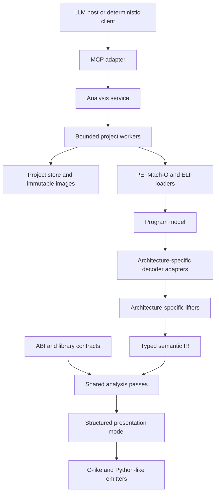

# Open Decomp — Project Plan

## 1. Status and purpose

This document records the agreed product direction and implementation contracts. The verified first-local-release execution scope is **macOS arm64 / Node 24.22.0**. Linux, including WSL using Linux Node/filesystem/process APIs, is an intended but not yet host-qualified execution environment; native Windows execution is outside the product requirement. Windows PE x64, macOS Mach-O ARM64 and Linux ELF/System V x64 are analysis targets, not required execution hosts. F01 Python-like emission, F02 authenticated Streamable HTTP/native TLS and F03 ELF/System V AMD64 have strict checking, 852/852 tests, compilation, eight-fixture/two-emitter compiled acceptance and actual HTTP/HTTPS proof on macOS. Source `0d3e40b` also has exact-archive clean offline macOS installed acceptance. See [RELEASE-VERIFICATION.md](RELEASE-VERIFICATION.md) for scoped evidence/provenance, and [TODO.md](TODO.md) for current work.

Build a headless, LLM-oriented reverse-engineering workbench for understanding native programs, especially abandoned or closed-source software whose behavior must be reproduced for compatibility. The system provides deterministic analysis tools; the calling LLM performs the investigation and reasoning. The analysis engine must also be callable by ordinary programs and integration clients.

The distinguishing feature is a **homemade decompiler**, building on `../disass_arm/src/decompiler/`. Public instruction decoders are dependencies, not replacements for our semantic lifters, analyses, type recovery, or pseudocode generation.

A successful investigation can open a binary, inspect its structure, search imports and strings, follow references, decompile relevant functions, attach evidence-backed names and types, reanalyze, and resume the same project later.

## 2. Accepted technology decisions

| Area | Decision | Reason / boundary |
| --- | --- | --- |
| First-party implementation | Strict TypeScript, ESM | Reuse existing work; explicit types and exhaustive handling of IR variants. No handwritten Rust/C++ backend in the initial implementation. |
| Runtime and development | Node.js 24.22.0 runtime; Bun 1.4.3 package manager with `bun.lock`; TypeScript `tsc`, `tsx` for development and `node:test` for tests | Pin Bun with `.bun-version` and `package.json`'s `packageManager`; install with `bun install --frozen-lockfile`. Use `bun run test`, not Bun's test runner. Compile distributable code; do not require a sibling checkout at runtime. |
| ARM64 decoder | a64js | Preserve its canonical encoding identity, fields, operands, and feature/validity information. Pin and record the imported revision. |
| x86-64 decoder | iced-x86 official JavaScript/WebAssembly package | Structured operands, implicit register effects, flags metadata, control flow, and TypeScript declarations. Pin the package version. |
| Name demangling | Pinned local WASM engines for Itanium C++, Microsoft C++, and Swift | Display-only decoration; preserve native names and identities. Demangled text never establishes an ABI signature or object layout. |
| Decompiler | Our own TypeScript implementation | Port useful existing behavior into a typed semantic IR and architecture-independent analyses. No Ghidra or other external decompiler backend. |
| First output syntax | C-like pseudocode | Readable reconstruction, not recovered original source and not a promise of recompilable C. |
| Output extensibility | Separate emitter interface and structured presentation model | F01 now provides C-like and Python-like syntax over the same analysis/presentation pipeline; other syntaxes need not rewrite decoding, lifting or analysis. |
| LLM-facing protocol | MCP using the official TypeScript SDK | Tool discovery, schemas, structured results, progress/cancellation where supported. Do not hand-roll a competing protocol. |
| Initial transport | MCP over stdio | Client-launched local process; stdout contains protocol messages only, logs go to stderr. |
| Persistent projects | SQLite, immutable imported images, versioned derived artifacts | Keep facts and annotations durable; derived caches remain disposable. Use the bundled `node:sqlite` API behind a store interface under the pinned Node runtime. |
| Heavy work | Bounded project worker processes | Parsing, analysis, and synchronous SQLite operations stay off the MCP event loop. A process boundary is fault containment, not by itself a security sandbox. |
| Later remote access | MCP Streamable HTTP | F02 now implements private bearer authentication, project authorization, Host/Origin checks, native TLS and resource limits. Separate extension, not a requirement of the original first local release. |
| LLVM / Capstone disassemblers | Optional development-time comparison tools | Useful independent decoder checks. Neither is an initial runtime decoder dependency; assembly text is never parsed into semantic instructions. |

Full TypeScript refers to first-party code we maintain. iced-x86's Rust implementation compiled to WASM, Node, and SQLite are external dependencies, not a requirement to maintain a mixed-language application. The pinned a64js dependency is a generated ESM snapshot with typed declarations: provenance records its original TypeScript hashes, transformed JavaScript hashes, revision, license, and TypeScript 5.9.3 transformation. `allowJs` copies this vendor runtime into the distribution; first-party TypeScript remains strictly checked.

Demangler pins are `gecko-profiler-demangle` 0.4.0, `llvm-msvc-demangle` 0.2.0, and `swift-demangle-wasm` 1.0.2. Load only their fixed installed assets, never a target-selected module or runtime library. Distribution must retain package licenses and third-party notices: MIT/Apache-2.0 for Gecko, MIT wrappers, LLVM Apache-2.0 WITH LLVM-exception and applicable runtime notices, and Swift's actual [upstream license and Runtime Library Exception](https://www.swift.org/LICENSE.txt). Do not substitute the Swift wrapper NOTICE's exception label for the governing text or claim an unverified published-WASM source revision. Input/output/cache bounds and worker deadlines contain untrusted names.

Local MCP uses official SDK v2.3.1: `@modelcontextprotocol/server` and `@modelcontextprotocol/core` at runtime, with `@modelcontextprotocol/client` for deterministic verification. These packages support MCP 2026-07-28 and SDK-managed legacy negotiation; the maintenance-only v1 SDK is not the implementation. Preserve their full licensing-transition notice: new/relicensed code is Apache-2.0, unconsented legacy contributions retain MIT, and non-specification documentation contributions are CC-BY-4.0. See the [current SDK documentation](https://ts.sdk.modelcontextprotocol.io/v2/).

## 3. Initial targets and explicit boundaries

### Native target combinations

- **macOS target:** Mach-O, AArch64/arm64, Darwin ARM64 ABI; thin images and selection of ARM64 slices in universal/fat containers; executables and dynamic libraries.
- **Windows target:** PE32+, x86-64, Windows x64 ABI; executables and DLLs.
- **F03 target:** ELF64 little-endian EM_X86_64 ET_EXEC/ET_DYN, System V AMD64 ABI, OSABI 0/3. Requires bounded valid section/program tables and unique PT_LOAD translations. Sectionless and extended-count/index encodings, ELF DWARF, dependency/relocation execution, ASLR guessing, PLT callable-entry recovery and IFUNC-selected targets are outside this subset. OSABI 0 is not proof of Linux syscall/kernel semantics.
- All three target formats are statically analyzed on the verified macOS execution host without executing target binaries. Intended execution environments are macOS and Linux/WSL; only macOS arm64 / Node 24.22.0 is currently host-qualified. Cross-compilation or target analysis does not verify Linux/WSL execution.
- Container format, instruction set, target features, ABI, and source-language metadata are distinct properties. ELF reuses iced-x86, the x86 lifter, shared analysis and public tools; no Linux-specific decompiler or public protocol was added.

Windows users are expected to execute the tool under **WSL with Linux Node**, not native Windows `win32` Node. Native Windows process/pipe/filesystem/installer behavior is not a product requirement or release gate. Historical native observations, including failures and a focused current-artifact lifecycle pass, remain preserved without implying full native support. No VM, SSH, native-install or native-performance follow-up is required for the current scope. Linux/WSL remains intended and unverified; this scope correction does not create a new runtime-qualification project or infer a pass.

### Included in the first local release

- Structured headers, sections/segments, mappings, entry points, imports, exports, relocations/fixups, available symbols, and string discovery.
- Raw byte reads and structured disassembly with explicit address spaces and bounds.
- Evidence-based function discovery, CFGs, code/data cross-references, caller/callee navigation, and bounded indirect-target recovery.
- Homemade ARM64 and x86-64 decompilation, with an explicit semantic support inventory and conservative handling of unsupported behavior.
- Names, signatures, recovered data types, structures, notes, provenance, revisioned edits, persistence, and cache invalidation.
- Existing applicable Mach-O debug information and runtime-metadata behavior, ported without UI dependencies. PE debug-directory / CodeView identities are exposed; comprehensive PDB type/location reconstruction is not implied by PE support.
- A complete local MCP investigation workflow, not merely a decoder endpoint or an engine scaffold.

### Coverage is not a binary supported/unsupported label

Track format parsing, instruction recognition, instruction semantic lifting, ABI support, and high-level reconstruction separately. Being able to print an instruction does not prove that we can decompile it.

The first semantic corpus must cover ordinary compiler-generated integer/control-flow code, stack and memory accesses, direct and indirect calls, and scalar floating-point / common vector operations used by the chosen fixtures. Carry forward supported ARM64 behavior. Record exact supported families and exceptions for each architecture rather than promising complete ISA coverage. Advanced extensions, language runtimes, and exception constructs outside the implemented subset remain visible with diagnostics and conservative boundaries.

Objective-C/Swift/C++ metadata may improve names and evidence; it must not be presented as full source-language reconstruction. Packed/encrypted code, self-modifying code, JIT code, and managed .NET bodies are not silently treated as ordinary native functions.

### Not part of the first local release

- A human GUI, terminal UI, or interactive disassembler shell. A launch command and deterministic development clients are still required.
- Executing/debugging/emulating the target, loading target libraries into the server, patching binaries, or arbitrary shell/code execution exposed as tools.
- Automatic fetching of remote dependencies, symbol servers, or embedded URLs while inspecting a binary.
- Replacing the homemade decompiler with a public decompiler.
- Genuine source recovery, exact original types/names, or proof of whole-program equivalence.
- A Python-like emitter, remote hosting, or another target platform. These were explicit later extension tasks, not hidden prerequisites for the original first release. F01/F02/F03 are now implemented in development; their own verification and artifact qualification stay separate from frozen-release history.

F03 implements **ELF x86-64 and the System V AMD64 ABI** as a static Linux-target subset, not a Linux application-host release or target execution environment. Source metadata may remain partial despite complete decode/lift/ABI and all reconstruction units; the workflow oracle requires those machine-layer facts, complete instruction mappings and evidence links rather than forcing aggregate `complete`.

## 4. Architecture and ownership boundaries



The MCP adapter owns protocol concerns only. No decoder, analysis pass, or store depends on MCP types. Worker IPC is a private implementation detail, not another public socket API.

Start with explicit static registrations for supported loaders, decoders, ABIs, and emitters. Interfaces are extension points; there is no need for an arbitrary plugin-loading framework.

Suggested ownership layout, to be established by the foundation tasks:

```text
src/
  core/                 identities, addresses, diagnostics, capabilities, contracts
  loaders/macho/        Mach-O / fat containers and loader metadata
  loaders/pe/           PE32+ and loader metadata
  loaders/elf/          ELF64LE x86-64 static native metadata
  decoders/arm64/       a64js adapter
  decoders/x86_64/      iced-x86 adapter and WASM ownership
  ir/                   semantic nodes, builders, verification, provenance
  lifters/arm64/        ARM64 semantics
  lifters/x86_64/       x86-64 semantics
  abi/                  Darwin ARM64, Windows x64, System V AMD64, library contracts
  analysis/             discovery, CFG/SSA, references, propagation, stack/types
  presentation/         structured control flow and emitter-neutral statements
  emitters/             shared renderer, neutral contracts, C-like/Python-like syntax
  metadata/             debug information, demangling, runtime metadata
  project/              SQLite store, annotations, migrations, revision management
  workers/              worker lifecycle, bounded IPC, cancellation
  service/              project operations, queries, pipeline orchestration
  mcp/                  SDK integration, tool schemas, result envelopes
vendor/a64js/           pinned source snapshot with provenance and notices
fixtures/               redistributable binaries, source, build metadata, expected behavior
test/                   unit and integration tests
```

Directory ownership prevents concurrent edits from becoming an integration strategy. Shared contracts have one integration owner; a task needing a contract change requests it explicitly.

## 5. Decoder contracts and replaceability

A decoder consumes an explicit ISA/mode, target feature selection, image address, and bounded byte range. It returns instruction lengths, encoding identity, typed operands, decoder diagnostics, and architecture-specific details required by its lifter. Preserve raw bytes by immutable image references/ranges rather than copying a byte array into every instruction record.

- ARM64 retains canonical encoding relationships, fields, SP/ZR distinctions, width, feature availability, and reserved/undefined distinctions.
- x86-64 retains operand/address widths, prefixes, register slices, effective-address components, relative targets, implicit accesses, and flags metadata. Do not assume every metadata field is a complete semantic specification.
- Formatting is separate and optional. Neither human-facing aliases nor formatted operands drive lifting.
- Code discovery supplies valid decoding regions. A decoder does not decide that every executable byte is code. Truncated instructions and gaps remain explicit.
- Decode buffers/regions, not one public RPC call per instruction. Reuse WASM instruction wrappers where possible and free all owned WASM objects.

Decoder replacement is intentionally possible, but not promised to be trivial. Different libraries expose different encodings, aliases, validity rules, and metadata. The replaceable unit is the **decoder adapter plus its architecture-specific lifting integration**. The shared semantic IR, analysis service, emitters, and public tools must remain stable when equivalent semantics are supplied. Conformance fixtures, not an LLM's confidence, determine compatibility.

## 6. Typed IR and homemade decompilation

### Semantic representation

The existing lifter builds C-expression strings. They must not become the long-term IR. New semantic nodes are discriminated TypeScript unions with explicit types, widths, operands, effects, and source instruction references.

Represent at least:

- Bit-vector constants and operations with explicit widths, wrapping, signed/unsigned comparisons, shifts, truncation, and extension.
- Register identities/slices and architectural write rules, including ARM64 W/X behavior and x86 AL/AH/AX/EAX/RAX behavior.
- Floating-point/vector operations with explicit types and supported semantics; unsupported cases remain explicit rather than being rewritten as integers.
- Loads, stores, effective addresses, alignment requirements where relevant, and ordered memory/call effects.
- Flags and conditions, including flags known written, preserved, undefined, or unknown.
- Calls, returns, direct/indirect branches, traps that are actually established, and unknown control-flow/effect boundaries.
- Stable value/block IDs and source provenance surviving transformations.

Lifters may initially produce typed register-form operations. Shared construction establishes CFGs and SSA values with phi nodes or block parameters. Preserve memory-effect ordering conservatively; do not require a general alias-analysis solution before useful decompilation is possible.

An unsupported instruction is not a no-op and is not automatically a guaranteed trap. Stop or conservatively bound dependent analysis and report the reason. Unknown calls may clobber registers and memory according to their contract/ABI; lack of a known target is not evidence of purity.

### Shared analyses

Reuse and port the existing pipeline's useful behavior: CFG construction, comparison recovery, propagation, dead-assignment elimination, stack recovery, call binding, type recovery, and control-flow structuring. Architecture-specific knowledge belongs in lifters/ABI models, not scattered through generic passes.

Use bounded fixed-point/worklist passes. Side effects, reachability, arithmetic widths, aliasing uncertainty, nonreturning behavior, and provenance must survive optimization. Preserve labeled branches/gotos when structured syntax cannot be justified.

### ABI and type boundaries

Darwin ARM64, Windows x64 and System V AMD64 models define argument/return locations, preserved registers, stack alignment, stack arguments, variadic rules, supported aggregate classification and target C layout. SysV uses six INTEGER/eight SSE registers with independent allocation and aggregate rollback, mixed returns/hidden results, callee-entry RSP offsets including the pushed return address, no Windows shadow space and a 128-byte red-zone capability without inferred ownership. SysV `long double` is an 80-bit value in 128-bit object storage; x87 value/return reconstruction, AVX argument types, nontrivial C++ and kernel/syscall conventions remain unsupported.

Argument-list completeness is explicit: a known prefix is not complete variadic/unprototyped actuals. Unknown layouts prevent certainty about later allocation; unknown source arity is never inferred from register use. SysV AL supplies an upper bound on vector argument-register usage, not a source argument; declaration-only variadic metadata cannot satisfy an unknown observed call. Actual-list completeness must be established before treating the list/stack extent as final.

A symbol name does not establish a function signature, object size, nonreturning property, or side-effect contract. Keep debug information, library contracts, analysis deductions, and user/LLM assumptions distinct. Conflicts are reported, not silently merged into certainty. Strict treatment of unknown calls is the default; any speculative policy is explicit and included in results and cache keys.

### Output languages

Analysis produces an emitter-neutral structured presentation model. F01 supplies both C-like and Python-like emitters over that same model and semantic pipeline; neither owns instruction semantics or type inference, and Python-like output is not rewritten C text. Neutral `EmissionInput` / `EmissionResult` live in `src/emitters/model.ts` and are exported at the package root alongside `CEmitter` / `emitC` / `C_EMITTER_VERSION` and `PythonLikeEmitter` / `emitPythonLike` / `PYTHON_LIKE_EMITTER_VERSION`. The old C-specific input/result names are removed, without compatibility aliases.

Select `options.emitter: "c-like" | "python-like"`; C-like remains the default. A shared renderer returns each dialect's final text with direct UTF-16 statement/control spans, stable semantic identities and original instruction mappings; output budgets still count UTF-8 bytes. Python-like output is explicitly **non-executable machine pseudocode**: finite-width helpers, effect tokens, physical-state snapshots, simultaneous edge copies, labels/gotos and indeterminate control preserve machine behavior rather than implying ordinary Python arithmetic or source recovery.

Output language, selected emitter version and presentation options are part of cache identity. Pipeline and version selection use the full target contract, not the host or architecture alone. Stored payload language/version must match the selected emitter identity; C and Python-like artifacts cannot stand in for each other.

Current emitter versions are `typed-machine-c-2` and `typed-machine-python-like-2`; composed analysis includes `stack-calls/2`, `library/2` and `types/2` for changed call/layout/type semantics. Old versioned artifacts are not newly verified output; schema migration does not automatically reparse historical images with a new loader.

## 7. Program model, addresses, and evidence

- Give projects, images/slices, functions, blocks, symbols, variables, and annotations stable IDs. Names are mutable labels, never identities. Reanalysis that splits/merges entities records the change instead of silently reusing an ID for a different object.
- Identify imported bytes by content hash and selected slice. Keep an immutable project-owned image snapshot; never modify the user's original binary. Reimports of changed bytes create distinct image identities.
- Use `bigint` for machine addresses and integer values in TypeScript. Convert to bounded numeric indices only after validation. JS bitwise arithmetic is not 64-bit machine arithmetic.
- On the wire, addresses and machine-width integers are hexadecimal strings. Addresses carry an image ID and explicit space: virtual address, RVA/image-relative, or file offset. Persist unsigned full-width values losslessly; do not rely on SQLite's signed integer range for arbitrary addresses.
- Address translation is centralized and handles zero-filled memory, unmapped ranges, overlapping/invalid mappings, image bases, and slices. ASLR/runtime slides are not guessed during static analysis.
- Every result identifies project revision, analysis/backend versions, relevant options, completion state, and diagnostics. Empty, unsupported, incomplete, cancelled, and failed results are distinguishable.
- Record evidence origin as binary fact, analyzer-derived conclusion, debug/library information, or user/LLM assertion. Attach source locations and derivation links where available. Avoid invented numeric confidence scores.
- Keep original/mangled names alongside display names. Treat recovered strings, symbols, debug records, and notes as untrusted data, never tool instructions.

## 8. Persistence, annotation edits, and caching

SQLite stores project metadata, image identities, indexes, evidence, annotations, revisions, and artifact metadata. Large derived artifacts can be immutable files referenced by the database. The database schema and artifact formats are versioned; unsupported newer versions fail explicitly without overwriting the project.

The initial store uses `project.sqlite`, content-addressed files under `images/`, and opaque artifact-ID files under `artifacts/`. SQLite exclusive locking gives one active owner and releases on process exit; WAL transactions preserve the last committed revision after an interrupted worker. Versioned tagged records preserve unsigned machine integers and distinguish them from hexadecimal-looking user text. Image imports are limited to 512 MiB, individual metadata records to 16 MiB, artifacts to 64 MiB, and artifact read pages to 1 MiB. These are enforced bounds, not measured performance claims.

One active worker owns writes for a project. Apply annotation batches transactionally with an `expected_revision` precondition. A successful edit increments the revision; a conflict returns current revision information without partial edits. Support names, notes, signatures, types/structures, and explicit hypothesis status. Deleting or retracting an assertion must also invalidate dependent analysis.

Cache identities include image hash/slice, the full selected `Target` (format, architecture, ABI, endian, address width and features), decoder/lifter/analysis/ABI versions, relevant evidence and annotation revision, function identity, analysis policy/options, original request budgets and selected emitter/version. Start with conservative invalidation; targeted dependency invalidation is an optimization, not a correctness prerequisite. Reject payload language/version mismatches. Never serve stale inferred types or pseudocode as current after an edit.

Resuming a project restores semantic identity, evidence, and user work, not just names in a transient process. Read-only queries operate against a specified revision. Pagination cursors bind to that revision and reject stale/incompatible reuse.

## 9. LLM-facing tools and result contracts

Use a small schema-defined tool surface. No generic shell, arbitrary code evaluator, or unrestricted SQL tool.

| Tool | Required purpose |
| --- | --- |
| `project_open` | Import/resume a project; identify format, architecture, ABI, slices, and capabilities; return stable handles. |
| `project_close` | Flush and release the active project without deleting persistent analysis. |
| `binary_info` | Query headers, sections/segments, directories/load commands, mappings, entry points, relocations, and capability/coverage information. |
| `symbols_find` | Filter/search symbols, imports, and exports; preserve original names and evidence. |
| `strings_find` | Search decoded strings by query, encoding, and location; distinguish candidates from established referenced strings. |
| `functions_find` | Find discovered functions by identity, name, address, and supported analysis properties. |
| `function_get` | Fetch bounded metadata, signature, ranges, structured disassembly, or CFG for a function. |
| `function_decompile` | Obtain pseudocode, source mappings, evidence, diagnostics, and exact completeness/capability information. |
| `xrefs_get` | Query incoming/outgoing code/data references, callers, and callees, including unresolved edges. |
| `memory_read` | Read bounded mapped bytes or explicitly typed data; report unmapped/zero-filled regions accurately. |
| `annotations_apply` | Apply atomic, revision-checked name/type/signature/note edits with provenance. |
| `analysis_status` | Inspect a long-running job and its result/artifact references. |
| `analysis_cancel` | Cancel a job and report whether cancellation completed or work had already finished. |

Tool names are the initial public contract; argument/result schemas are finalized in the shared-contract task before independent implementations diverge. Binary headers and reconstructed source declarations are different concepts and must not share an ambiguous result field.

Requirements for all tools:

- Validate inputs and outputs against versioned schemas; encode `bigint` only at serialization boundaries.
- Return structured data and readable pseudocode, not scraped terminal tables. Make evidence-bearing fields available without asking the LLM to parse assembly text.
- Bound output size, page size, read length, graph expansion, and analysis work. Use server-side filtering and deterministic ordering. Never silently truncate.
- Oversized output returns a continuation cursor or a project-scoped artifact reference with a bounded retrieval path. Resource reads must enforce the same project permissions and revision rules as tools.
- Include explicit result states and actionable errors such as unsupported target, ambiguous slice, invalid address, stale revision, resource limit, and unavailable semantics. Do not confuse an empty result with an unfinished search.
- Long work returns a project-owned job ID that can be inspected/cancelled; use MCP progress/cancellation capabilities where available without depending on optional client support. Jobs remain tied to their input revision and never publish stale results as current.
- Support a bounded set of concurrent read jobs; serialize annotation mutations. Protocol request IDs are not persistent project/job identities.

## 10. Safety and resource boundaries

Static inspection is the default and only initial mode. The server never executes the target, follows embedded commands, loads a target DLL/dylib, or fetches referenced URLs automatically.

Restrict imports and project access to explicitly authorized roots or handles. Canonicalize paths, account for symlinks, and distinguish image input access from project output access. Resource URIs and artifact IDs must not become arbitrary file-read capabilities.

Treat binaries and metadata as hostile parser inputs. Enforce file/range/decompression/table-count limits, recursion/work budgets, checked arithmetic, and cancellation points. Bound worker count, queued work, decoded instructions, IR growth, and output. A worker crash must not corrupt project state or hang the MCP host. Use atomic artifact publication and database transactions.

Implemented bounds apply during construction, not only to completed graphs: lifters and SSA reserve node/block capacity, and provenance/verification consume cumulative work. Budget-truncated discovery cannot publish a semantic artifact. Partial supported-metadata recovery retains diagnostics and explicitly incomplete native-name indexes across reopen.

Local stdio uses 2 MiB frames, 1,024-byte string request IDs, eight pending requests/output messages and a 30-second stalled-write limit. Reject invalid IDs before mutations; check annotation text-plus-structured delivery inside its transaction without changing semantic budgets/cache identity. Shutdown waits for every worker even if one close fails. These are bounded failure policies, not a guarantee that an acknowledgement survives client disconnection.

Worker isolation alone is not an OS sandbox. Document actual restrictions and exercised process/OS controls on the verified macOS execution host. Do not infer Linux/WSL or native-Windows behavior from target analysis or advertise a stronger sandbox than the implementation.

F02 now provides HTTP transport using the official SDK 2.3.1 `createMcpHandler`, with authentication, project authorization, exact Host/Origin checks, loopback-default binding, native TLS for non-loopback listeners and separate bounded network/work/control lanes. It serves the existing tools/resources, not a new public analysis protocol. [REMOTE.md](REMOTE.md) is the operator contract: `open-decomp-mcp-http --config ABSOLUTE_JSON_PATH` and the compiled `dist/src/mcp/http/entry.js` are separate from installed stdio binary `open-decomp`. Root embedding exports are `startHttpServer` / `HttpServerHandle` and `loadHttpConfig` / `HttpConfig`.

Authentication is private, operator-provisioned high-entropy bearer authentication with stored hashes, not OAuth/SSO. Each principal owns a private project root, service and worker pool; inputs may be shared only through configured authorized roots. Ownership transfers at validated, authorized service dispatch, not a guaranteed durable commit. Subsequent disconnect/deadline/SDK cancellation does not automatically cancel dispatched work: use durable status/cancel and reconcile lost acknowledgements without mutation replay. Shutdown settles dispatched bounded calls, cancels remaining queued work and closes every principal's workers. These controls are not an OS sandbox or general browser/CORS support.

## 11. Migration and verification strategy

### Reuse sources, not sibling runtime imports

The existing project is a reference and migration source. It remains untouched unless a separate change is explicitly required. Relevant sources include:

- `../disass_arm/src/decompiler/`: decoding integration, lifting, CFG, stack/call/type recovery, structuring, propagation, emitters, and diagnostics.
- `../disass_arm/src/executable.ts`, `dyld.ts`, `imports.ts`, `image-memory.ts`, `address.ts`: Mach-O loading and address/import behavior.
- `../disass_arm/src/analysis.ts`, `control-flow.ts`, `references.ts`, `recovery.ts`, `value-recovery.ts`, `strings.ts`: discovery and analysis behavior.
- `../disass_arm/src/debug-info.ts`, `dwarf*.ts`, `decompiler-debug.ts`, `runtime-metadata.ts`, `library-prototypes.ts`, and demangling modules: evidence and metadata integration.
- `../disass_arm/test/`: useful behavior regressions; migrate only tests that establish observable correctness, not incidental formatting or implementation details.

First record behavior and gaps on a redistributable corpus. Port to TypeScript and typed IR incrementally, keeping architecture-specific behavior at its boundary. Do not retain a permanent legacy decompiler path, duplicate ABI logic, or compatibility shims in the new project. Remove migration-only scaffolding after equivalent behavior is demonstrated.

### Verification layers

1. Decoder conformance: instruction boundaries, typed operands, invalid/truncated encodings, aliases, target features, implicit operands, flags, and relative addresses. Independent decoders are comparison evidence, not infallible oracles.
2. Semantic checks: small fixture functions and an isolated test-only IR evaluator or equivalent oracle check arithmetic widths, branches, register slices, flags, memory effects, and calls. Fixture execution occurs only for trusted test inputs on compatible hosts, never for user-loaded targets.
3. Analysis regressions: joins, loops, irreducible CFGs, stack aliases, unknown calls, jump tables, conflicting type evidence, unsupported instructions, and source mappings.
4. Loader/project boundaries: malformed images, slices, zero-filled sections, relocations, imports by name/ordinal, persistence, migrations, revision conflicts, stale caches/cursors, and cancelled jobs.
5. Real MCP smoke: launch the compiled server on macOS, discover tools, and execute complete investigations for Mach-O, PE and ELF targets with both emitters. Actual HTTP/HTTPS workflows additionally exercise artifact hashes, cache reuse, annotation invalidation, full-process restart, authentication and cross-principal denial. Tests alone are not proof that the actual tool surface works; analyzed targets are never executed.
6. Host distribution: run the core regression, compiled workflows and clean offline installed acceptance on macOS arm64 / Node 24.22.0. Linux/WSL is intended but not yet qualified; native Windows execution is out of scope, not a blocking gate. No additional VM/runtime qualification is required now. Retain fixture source/toolchain/flags/hash/redistribution provenance; target cross-compilation is not a host execution pass.
7. Performance: measure cold import, indexing, per-function decode/lift/analysis/emission, cached requests, IPC/serialization cost, and peak memory on representative small and large inputs. No Rust-vs-JS speed claim or numeric SLA is established yet. Optimize measured bottlenecks without weakening semantics.

Use deterministic, isolated behavior tests. Do not pin incidental pseudocode wording, terminal layouts, source text, or forwarding implementations. The integration owner runs combined checks after each completed work wave; agents do not race full-repository builds/tests against shared edits.

## 12. First local release acceptance

- **A01 — Native loading:** Mach-O ARM64, PE x64 and ELF/SysV x64 targets expose correct structured headers/mappings/imports/exports within their documented subsets and support immutable byte reads, including stripped binaries and ARM64 slice selection.
- **A02 — Structured decoding:** Both adapters supply lossless required metadata without parsing assembly strings; invalid, truncated, unavailable, and unsupported cases are distinguished.
- **A03 — Navigation:** Function discovery, CFGs, strings, and code/data references support a bounded investigation; unresolved indirect edges remain visible.
- **A04 — ARM64 migration:** Existing applicable decompiler behavior is retained with typed IR, strict evidence handling, and no runtime dependency on `../disass_arm`.
- **A05 — x86-64 decompilation:** The homemade x86-64 lifter and Windows ABI handle the documented semantic corpus, including partial-register/flag behavior, stack arguments, and calls; unsupported families remain explicit.
- **A06 — Sound shared analysis:** Propagation, stack/call/type recovery, and structuring preserve widths, memory effects, unknown behavior, and provenance on the regression corpus.
- **A07 — Output separation:** C-like pseudocode has accurate source mappings and completeness diagnostics; semantic analysis does not depend on C syntax or formatting.
- **A08 — Durable investigation:** Names, types, signatures, notes, and evidence survive restart; revision conflicts are atomic; edits/retractions invalidate affected derived results.
- **A09 — Actual LLM interface:** A deterministic client completes open → search → references → decompile → annotate → reanalyze → close/resume through the compiled stdio MCP server on macOS for all three analysis targets; both dialects retain mappings, evidence and explicit partial/unsupported boundaries.
- **A10 — Honest failure and containment:** Malformed files, unsupported semantics, path violations, stale revisions, cancellation, worker failure, and resource limits produce bounded, explicit outcomes without executing target code or corrupting projects.
- **A11 — Reproducible delivery:** Documented installation and launch work on the verified macOS arm64 / Node 24.22.0 host; dependency versions, licenses/provenance, fixture recipes and capability limits are included. Linux/WSL is intended but unverified; native Windows execution is not a product requirement.
- **A12 — Measured resource behavior:** Representative timing/memory results and enforced work/output limits are recorded; cached and uncached paths are exercised without correctness regressions.

All A01–A12 apply to the current **macOS execution-host** release scope, including actual delivery and resource evidence for that host. Windows PE, Mach-O and ELF remain required analysis targets within their documented subsets; no target execution or Windows/Linux VM is required. Linux/WSL host execution is not yet qualified, and native-Windows execution is out of scope rather than an imminent blocker. Frozen results never qualify a newly built artifact; later emitter/transport/target evidence remains explicitly scoped.

## 13. Execution rules for the backlog

Each TODO item identifies dependencies, owned paths, work, and observable acceptance. Dependencies refer to integrated, verified implementation, not merely a branch or an agent's claim. Ordinarily dependencies must be `Done`; an integrated interface blocked solely on unavailable host verification may be consumed while its task remains `Doing` with the blocker recorded. This scheduling exception never waives host acceptance or release requirements.

Move the entire task block from `Todo` to `Doing` when assigned, recording the owner. Move it to `Done` only after integration and the stated verification, recording evidence and any intentional limitations. Preserve stable task IDs and dependency references.

After foundation contracts land, independent loader, decoder, ABI, store, and metadata slices can run concurrently. Shared-contract changes and final integration have one owner. Do not delegate implementation of a dependent pass against an invented interface. Each agent reads this plan and its full task block, changes only its owned scope unless coordinated, and reports changed paths, acceptance evidence, and blockers.

Update this plan only when a deliberate design decision changes. Update the backlog as tasks become actionable or complete; do not mark planned behavior as implemented.

## 14. Reference interfaces

- Existing a64js API and design: `../disass_arm/third_parts/a64js/README.md` (migration reference, not a runtime dependency).
- iced-x86 capabilities: https://docs.rs/iced-x86/latest/iced_x86/
- Official iced-x86 JavaScript package metadata: https://registry.npmjs.org/iced-x86/latest
- MCP transports: https://modelcontextprotocol.io/specification/2026-07-28/basic/transports/index.md
- MCP tools and structured results: https://modelcontextprotocol.io/specification/2026-07-28/server/tools.md
- LLVM structured decoder: https://llvm.org/doxygen/classllvm_1_1MCDisassembler.html
- LLVM C disassembler API: https://llvm.org/doxygen/include_2llvm-c_2Disassembler_8h.html
- Capstone structured detail API: https://www.capstone-engine.org/lang_c.html
- Node 24 SQLite API: https://nodejs.org/docs/latest-v24.x/api/sqlite.html
