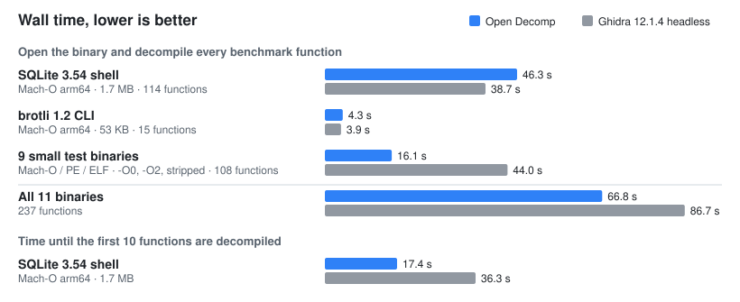

# Open Decomp

Analyze native binaries and decompile individual functions without source code or executing the target. Open Decomp combines instruction decoders with its own typed-IR decompiler to produce C-like or Python-like pseudocode, with SQLite-backed projects and cached analysis. Supports Mach-O ARM64, PE x86-64 and ELF x86-64 through a CLI, MCP for AI clients, and a JavaScript/TypeScript API.

## Why

Open Decomp started as an experiment: how far can a decompiler go when it is written entirely in TypeScript and runs on a plain JavaScript runtime, with no JVM, no native plugins and no Python? Further than expected. The result is about 120,000 lines of TypeScript covering loaders, lifting, SSA, type and struct recovery, control-flow structuring and C/Python-like emitters. Instruction decoding uses the vendored a64js (ARM64) and iced-x86 (WebAssembly) packages; demanglers ship as WebAssembly too.

- **Small.** A 9 MB package, about 50 MB installed with every dependency. Anything that runs Node 24 runs it.
- **On demand.** Functions are analyzed when you ask for them, not after a whole-program pass, and results are cached in a SQLite project next to the binary.
- **Built for agents.** An MCP server, a JS/TS API, and `export`, which writes one greppable file per function.

### A taste

`fts5SentenceFinderAdd` from the SQLite 3.54 shell, compiled for Mach-O arm64 with no debug info. The original source:

```c
static int fts5SentenceFinderAdd(Fts5SFinder *p, int iAdd){
  if( p->nFirstAlloc==p->nFirst ){
    int nNew = p->nFirstAlloc ? p->nFirstAlloc*2 : 64;
    int *aNew;

    aNew = (int*)sqlite3_realloc64(p->aFirst, nNew*sizeof(int));
    if( aNew==0 ) return SQLITE_NOMEM;
    p->aFirst = aNew;
    p->nFirstAlloc = nNew;
  }
  p->aFirst[p->nFirst++] = iAdd;
  return SQLITE_OK;
}
```

`open-decomp decompile sqlite3 --function _fts5SentenceFinderAdd`, from the machine code alone:

```c
/* C-like */
/* open arity (proven args only): sqlite3_realloc64 */
typedef struct struct_054f3b struct_054f3b;
struct struct_054f3b { uint32_t field_0x4; uint32_t field_0x8; uint64_t field_0x10; };
uint64_t fts5SentenceFinderAdd(struct_054f3b* address, uint32_t arg1) {
  uint32_t value0;
  uint32_t value1;
  uint64_t call_result;
  value0 = address->field_0x4;
  value1 = address->field_0x8;
  if (value0 != value1) {
    call_result = address->field_0x10;
  } else {
    value0 = value0 == 0 ? 64 : value0 << 1;
    call_result = sqlite3_realloc64(address->field_0x10, (uint64_t)(int32_t)value0 << 2);
    if (call_result == 0) {
      return 7;
    }
    address->field_0x10 = call_result;
    address->field_0x4 = value0;
    value1 = address->field_0x8;
  }
  address->field_0x8 = value1 + 1;
  *(uint32_t *)(call_result + ((uint64_t)(int32_t)value1 << 2)) = arg1;
  return 0;
}
```

The struct layout, the "double or start at 64" growth and the `SQLITE_NOMEM` (7) exit all come back.

<details>
<summary>Ghidra 12.1.4 on the same function</summary>

```c
undefined8 _fts5SentenceFinderAdd(long param_1,undefined4 param_2)

{
  uint uVar1;
  int iVar2;
  long lVar3;
  int iVar4;

  iVar2 = *(int *)(param_1 + 4);
  iVar4 = *(int *)(param_1 + 8);
  if (iVar2 == iVar4) {
    uVar1 = 0x40;
    if (iVar2 != 0) {
      uVar1 = iVar2 << 1;
    }
    lVar3 = _sqlite3_realloc64(*(undefined8 *)(param_1 + 0x10),
                               -(ulong)(uVar1 >> 0x1f) & 0xfffffffc00000000 | (ulong)uVar1 << 2);
    if (lVar3 == 0) {
      return 7;
    }
    *(long *)(param_1 + 0x10) = lVar3;
    *(uint *)(param_1 + 4) = uVar1;
    iVar4 = *(int *)(param_1 + 8);
  }
  else {
    lVar3 = *(long *)(param_1 + 0x10);
  }
  *(int *)(param_1 + 8) = iVar4 + 1;
  *(undefined4 *)(lVar3 + (long)iVar4 * 4) = param_2;
  return 0;
}
```

</details>

### Speed

<picture>
  <source media="(prefers-color-scheme: dark)" srcset="docs/assets/benchmark-speed-dark.svg">
  
</picture>

Pure JavaScript keeps pace with Ghidra end to end: slower on the large SQLite binary, 2.7× faster on small ones, and first results in half the time because nothing waits for whole-program analysis. On the same 232 functions, a blind LLM judge preferred Open Decomp's listing to Ghidra's 180 times, Ghidra's 6 times, with 46 ties.

<sub>odbench, 2026-10-23: Open Decomp `1239ec9` with 4 request workers; Ghidra 12.1.4 `analyzeHeadless` with default auto-analysis, its time including JVM start and analysis. One run on a 12-core Apple M6 under load. The corpus is a development set the decompiler was tuned against. Method and caveats: [performance](docs/PERFORMANCE.md#roadmap-4-round-result-2026-10-23).</sub>

## Quick setup

Requires **Node.js 24+** and **Bun 1.4.3**. From a checkout:

```sh
bun install --frozen-lockfile
bun run build
```

See [installation](docs/INSTALLATION.md) for runtime/host requirements and installing a packaged release.

## Try it on a binary

```sh
# Find a function in your binary
bun run cli functions ./app --name main

# Decompile using the exact name shown above
bun run cli decompile ./app --function main

# Decompile every function into a directory an LLM agent can grep
bun run cli export ./app --out ./app-decompiled
```

Names may include a prefix such as `_main`; use the name shown in the function list. You can also select a listed function with `--id ID` or `--address va:0x...` when symbols are stripped. Add `--language python-like` to change the output dialect, or `--json` for structured results.

Projects are saved next to the binary in `app.open-decomp/`; repeated commands reuse the imported image and cached analysis. Output is pseudocode, not recovered original source.

Set defaults once (cache root, analysis cache, decompile/export language, view, jobs) in an optional `~/.config/open-decomp/settings.json` (or `$XDG_CONFIG_HOME/open-decomp/settings.json`, or `--settings PATH`); flags always win. See [Settings file](docs/README.md#settings-file) and `open-decomp settings`.

## Documentation

- [CLI, settings file, MCP setup and troubleshooting](docs/README.md)
- [JavaScript / TypeScript API](docs/API.md)
- [Remote MCP and security](docs/REMOTE.md)
- [Core contracts](docs/CORE.md), [fixtures](docs/FIXTURES.md) and [performance](docs/PERFORMANCE.md)
- [Internals: architecture and algorithms](docs/internals/README.md)

## License

[MIT](LICENSE). Bundled dependencies retain their own licenses; see [third-party notices](docs/THIRD-PARTY-NOTICES.md).
