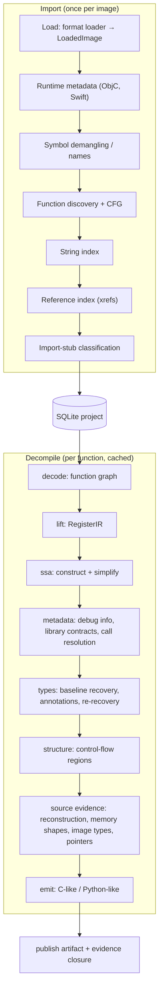
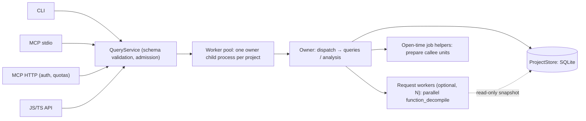

# Open Decomp internals

How the decompiler works: architecture, algorithms, data flow, design decisions and known limits. Written so a human or an LLM can reason about the implementation (and about improving it) without reading the ~120k lines under `src/`. Symbol-level detail is deliberately left out; each page names the directories to open when you need it.

**Code version:** HEAD `5392ed0` (2026-10-23). To refresh: `git diff --stat 5392ed0..HEAD -- src`, update the pages owning the changed directories (module map below), move this hash.

## What it is

A static decompiler for native binaries, written in TypeScript (Bun/Node). The target is never executed. Three complete target pipelines, nothing else:

| Format                    | ISA     | ABI            |
| ------------------------- | ------- | -------------- |
| Mach-O (incl. fat slices) | AArch64 | Darwin arm64   |
| PE                        | x86-64  | Microsoft x64  |
| ELF                       | x86-64  | System V AMD64 |

All little-endian, 64-bit. Any other triple is refused (`unsupported_target`) instead of running a partial pipeline.

Output: C-like or Python-like pseudocode per function, in two views — **source** (readable, rewritten) and **checked** (every machine fact explicit: width casts, helpers) — plus per-span mappings back to SSA nodes, evidence records and per-layer coverage.

## Pipeline

Two phases. **Import** runs once per binary and builds image-wide indexes. **Decompile** runs per function and is cached.

Stage → page:

| Stage           | Consumes                                 | Produces                                                                                                              | Page                                                                                                         |
| --------------- | ---------------------------------------- | --------------------------------------------------------------------------------------------------------------------- | ------------------------------------------------------------------------------------------------------------ |
| load            | file bytes                               | `LoadedImage`: immutable bytes, slices, mappings, sections, symbols, imports/exports, relocations, hints              | [loaders](loaders.md)                                                                                        |
| discovery       | image, decoder                           | function records, CFG blocks, gaps, jump tables, xrefs, strings                                                       | [discovery](discovery.md)                                                                                    |
| decode + lift   | function graph, ABI                      | `RegisterIR` (typed register-form IR) + lift coverage                                                                 | [lifting-ir](lifting-ir.md)                                                                                  |
| ssa             | `RegisterIR`                             | simplified SSA (register cells, block arguments, ordered memory token)                                                | [ssa-values](ssa-values.md)                                                                                  |
| metadata        | image, SSA, indexes                      | debug/library types, call target resolutions, supplied call contracts                                                 | [calls-abi](calls-abi.md), [types-metadata](types-metadata.md)                                               |
| types           | SSA, contracts, debug/library/user types | `TypeRecoveryResult`: types, signatures, memory shapes, conflicts; runs stack recovery + physical call analysis first | [types-metadata](types-metadata.md), [ssa-values](ssa-values.md#5-stack-recovery), [calls-abi](calls-abi.md) |
| structure       | SSA CFG                                  | structured regions (loops, ifs, switches, labels)                                                                     | [structuring-emission](structuring-emission.md)                                                              |
| source evidence | SSA, types, calls, callee summaries      | source model: variables, expressions, frame slots, uncertainties                                                      | [reconstruction](reconstruction.md)                                                                          |
| emit            | structured function + source model       | `Emission`: text, mappings, evidence, inferences, coverage                                                            | [structuring-emission](structuring-emission.md)                                                              |
| publish / cache | emission + identity                      | durable artifact, cache hit on next request                                                                           | [project-cache](project-cache.md)                                                                            |

Ordering details worth knowing:

- Types run twice when user annotations assert a type or signature: baseline recovery → annotation lookup over the subjects it found → re-recovery with the assertions.
- Structuring runs before reconstruction. Reconstruction then refines types again: memory shapes from recovered memory transfers, image-wide types from callee summaries, then pointer evidence propagated over all of them.
- Callee summaries (other functions' prepared IR units) are computed on demand, in call-graph SCC order. They are reused in process (size-bounded LRU) and persisted in the project (`native_summaries`, 256 MiB cap by default); after `project_open` an open-time job prepares and persists every function's callee units in helper processes, callees first. See [project-cache](project-cache.md#4-callee-unit-reuse).

## Process architecture

- **One tool vocabulary** (15 operations: `project_open`, `function_decompile`, `functions_discover`, `xrefs_get`, `memory_read`, `annotations_apply`, `analysis_status`, …) declared once with Zod schemas; every surface speaks it. Validated on the host (fail early) and again in the child (trust boundary).
- **One owner child process per project**, the only writer of its SQLite store. IPC = length-prefixed JSON frames. Pool bounds owners and queue.
- **Optional request workers** (`openBinary({ requestWorkers })`, `export --jobs N`): N processes decompile in parallel over a read-only clone of the project; the owner republishes their artifacts and summaries, so output and per-function work are identical for any N. **Open-time job helpers** prepare every function's callee units after `project_open` and hand them to the owner. See [project-cache](project-cache.md#4a-open-time-job).
- **Durable facts vs derived results.** Images, native records (functions, symbols, strings, references…), evidence, annotations and jobs live in revision-checked store transactions. Recovered types and decompilations live only in published artifacts keyed by a full cache identity; reuse at a newer revision is validated against a recorded dependency readset.

## Module map

Lines are physical `.ts` lines at the code version above (total ≈122k).

| Directory                       | Lines | Role                                                                                    | Page                                            |
| ------------------------------- | ----: | --------------------------------------------------------------------------------------- | ----------------------------------------------- |
| `core`                          |  4.9k | Wire schemas, `LoadedImage`, component contracts, identity, addresses, budgets, errors  | this page                                       |
| `loaders`                       |  4.7k | Mach-O / PE / ELF → `LoadedImage`                                                       | [loaders](loaders.md)                           |
| `decoders`                      |  1.9k | AArch64 (vendored a64js) and x86-64 (iced-x86) decoding                                 | [lifting-ir](lifting-ir.md)                     |
| `lifters`                       |  2.8k | Instructions → `RegisterIR`                                                             | [lifting-ir](lifting-ir.md)                     |
| `ir`                            |  2.8k | Register-form and SSA IR, builder, validator                                            | [lifting-ir](lifting-ir.md)                     |
| `abi`                           |  1.4k | Data layouts, call classification for the three ABIs                                    | [calls-abi](calls-abi.md)                       |
| `analysis`                      | 16.3k | discovery, cfg, targets, references, strings, ssa, values, effects, stack, calls, types | per sub-area                                    |
| `metadata`                      | 14.2k | DWARF, CodeView, symbols, ObjC runtime, library contracts (≈7.5k generated data)        | [types-metadata](types-metadata.md)             |
| `presentation`                  |  1.8k | Control-flow structuring                                                                | [structuring-emission](structuring-emission.md) |
| `reconstruction`                | 23.4k | SSA → source model; proof-carrying rewrites with local validation                       | [reconstruction](reconstruction.md)             |
| `emitters`                      | 20.0k | Shared renderer + C-like / Python-like dialects                                         | [structuring-emission](structuring-emission.md) |
| `service`                       | 15.7k | Analysis orchestration (composition root), query handlers, import preparation           | [project-cache](project-cache.md)               |
| `project`                       |  4.5k | SQLite store, annotations, analysis cache                                               | [project-cache](project-cache.md)               |
| `workers`                       |  2.5k | Owner pool, request workers, framed IPC, job admission/recovery                         | [project-cache](project-cache.md)               |
| `api`, `cli`, `mcp`, `settings` |  4.9k | Surfaces and settings                                                                   | this page                                       |

Dependency shape: `core` is a sink and is semantics-free (declares `Lifter<RegisterIR>` / `Emitter<…>` generically). `service` is the composition root importing almost everything. Backward edges (e.g. reconstruction → emitters) are type-only, so there are no runtime cycles between stages. Component selection is a frozen table keyed by target triple in `src/service/analysis/versions.ts` — not a plugin registry.

## Design principles

- **Never execute the target.** Bytes are immutable; no plugins, no URL fetching.
- **Refuse or mark partial rather than guess.** Unknown target → refusal. Ambiguous function name → error. A pass that cannot produce complete semantics throws `unavailable_semantics`. An unproven call interface stays open (`...`). Guessing only exists behind the opt-in `inference: "likely"` mode, with visible markers.
- **Evidence-bearing output.** Every published claim cites evidence records (binary, analysis, debug, library, user/LLM assertion). The evidence graph is closed before publishing; a missing proof is an internal error.
- **Presentation status ≠ coverage.** Source constructs carry a status (`established`, `inferred`, `asserted`, `hypothesis`, `conflicting`, `assumption`, `unresolved`) separately from per-layer semantic coverage (decode, lift, abi, analysis, reconstruction, provenance).
- **Correctness before readability.** Source-view rewrites must keep fixed-width arithmetic, signedness, memory/call ordering and aliasing; each rewrite class is checked by a local (BDD-based) validator.
- **Determinism and content identity.** IDs are fingerprints of canonical, type-tagged data. Same input + same versions + same budget → same output, including across requests in one process.
- **Budgets everywhere.** One `OperationContext` per request charges actual work; limits on instructions, blocks, IR nodes, work units, deadline and output bytes. The budget is part of the cache key.

## Cross-cutting concepts

**Budgets.** Defaults: 10k instructions, 10k blocks, 100k IR nodes, 10M work units, 30 s, 1 MiB output. Every pass charges the shared counter; exhaustion throws `resource_limit`. Analysis itself may build up to a 16 MiB artifact; only delivery switches to an artifact handle when the inline limit is exceeded. Work accounting is deterministic: shared per-process indexes record their build cost and every request using them pays it once, so results don't depend on request order. Details: [project-cache](project-cache.md).

**Result states.** `complete`, `empty`, `partial`, `queued`, `running`, `unsupported`, `failed`, `cancelled`. Two kinds of `partial`: _semantic_ (a coverage layer incomplete; reason `budget`, `incomplete_index`, `unsupported_subset`) and _delivery_ (`output_limit`: result is complete but delivered as an artifact). A pass returns `{ value, state, diagnostics }`; the orchestrator's gate turns a partial pass into an error before the next stage consumes it.

**Cache identity.** Key = fingerprint of image SHA-256, slice, target, component versions, evidence and annotation revisions, options, budget and function id. Component versions include an analysis composition string (`pipeline/N;discovery/N;…;reconstruction/N`); bumping a stage group's number invalidates every artifact depending on it. Any semantic change to a stage must bump it.

**Revisions.** A project is a sequence of revisions; each successful mutation advances exactly one, transactions are all-or-nothing, and an analysis publishes into the revision it read. Annotations (user/LLM names, types, signatures) are just another revisioned input.

**Addresses.** `{image, space: va|rva|file, value}`; translation distinguishes mapped, zero-fill and unmapped, so memory reads never invent bytes. See [loaders](loaders.md).

## Adding a target

Seams are interfaces in `src/core/contracts.ts`: `Loader` (format), `Decoder` + `Lifter` (ISA), `AbiProfile` (calling convention), `Emitter` (dialect). Then: extend the target schema, add the triple to the component table in `versions.ts`, add the magic sniff in the worker runtime, add a decoder branch where function graphs are built, and bump versions. Until every component exists the correct behaviour is `unsupported_target`.

## Global limits and improvement levers

Measured state ([benchmark](../BENCHMARK.md), roadmap 4 result; odbench full tier, a development set): 235 of 237 functions get text; a blind LLM judge prefers the output to Ghidra 12.1.4's (0.878, 180 wins / 46 ties / 6 losses), LLM comprehension is level with Ghidra's, wrong claims per function stay slightly higher (2.34 vs 2.22). Decompiling after open takes 0.52× Ghidra's whole run with 4 request workers, but a function costs ~0.3 s against Ghidra's ~23 ms once its whole-program analysis is done. Where quality and speed are lost, by pipeline position:

| Lever                                                                                         | Symptom                                                                                                                                                | Owning stage                                    |
| --------------------------------------------------------------------------------------------- | ------------------------------------------------------------------------------------------------------------------------------------------------------ | ----------------------------------------------- |
| Whole-image discovery is bounded/seeded                                                       | Real images stay `partial (incomplete_index)`; stripped ELF/PE selector failures                                                                       | [discovery](discovery.md)                       |
| Unsupported instructions become whole-state `unknown_effect`; both lifters continue past them | Lost argument/return facts, `partial` functions                                                                                                        | [lifting-ir](lifting-ir.md)                     |
| Escaped-object extent unknown                                                                 | Optimized frames stay memory: frame-object members (`frame.local_N`), not locals                                                                       | [reconstruction](reconstruction.md)             |
| Open call arities (`...`) only closed by proof                                                | Indirect calls, hub functions keep `...`                                                                                                               | [calls-abi](calls-abi.md)                       |
| Pointer-ness needs positive evidence; O0 callee spills not followed                           | Integer-typed pointers, casts                                                                                                                          | [types-metadata](types-metadata.md)             |
| Acyclic gotos need reaching-condition structuring                                             | 717 `goto` over 232 odbench functions (Ghidra 781)                                                                                                     | [structuring-emission](structuring-emission.md) |
| Evidence (statement → instruction provenance) grows faster than the text                      | `sqlite3Select`, `sqlite3Pragma` fail with no text; at 100M work they stop at the IR-node budget, the proof catalog bound or the 16 MiB artifact bound | [project-cache](project-cache.md)               |
| Per-function cost is high (callee preparation dominates)                                      | 7 odbench functions above 80% of the 10M work limit; whole-program export not yet measured against Ghidra                                              | [project-cache](project-cache.md)               |

## Glossary

| Term                  | Meaning                                                                                       |
| --------------------- | --------------------------------------------------------------------------------------------- |
| Image                 | One SHA-256-addressed container with all slices, mappings and native facts                    |
| Slice                 | One selectable architecture of a container (e.g. one arch of a fat Mach-O); part of every key |
| Project               | SQLite database `<sha256>.<slice\|default>` under a cache root: revisions, jobs, artifacts    |
| Revision              | Monotonic snapshot number; each mutation advances it by one                                   |
| Artifact              | Immutable published decompilation blob, keyed by cache identity, read in pages                |
| Coverage              | Per-layer completeness with completed/total units and reasons                                 |
| Evidence              | Revisioned typed proof record (binary, analysis, debug, library, assertion)                   |
| Presentation status   | Confidence in a source construct; not a proof of semantic coverage                            |
| Pass                  | Bounded transformation returning value, state and diagnostics                                 |
| Callee summary        | Analysed interface/effects of a called function, reused by its callers                        |
| Source / checked view | Rewritten readable output / literal machine-semantics output                                  |
| Proven / likely       | Inference mode: proof-only (default) / opt-in gated heuristics                                |
