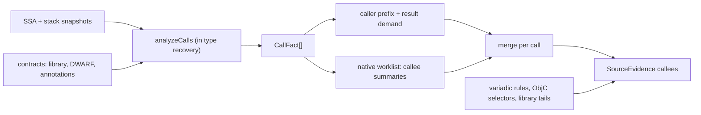
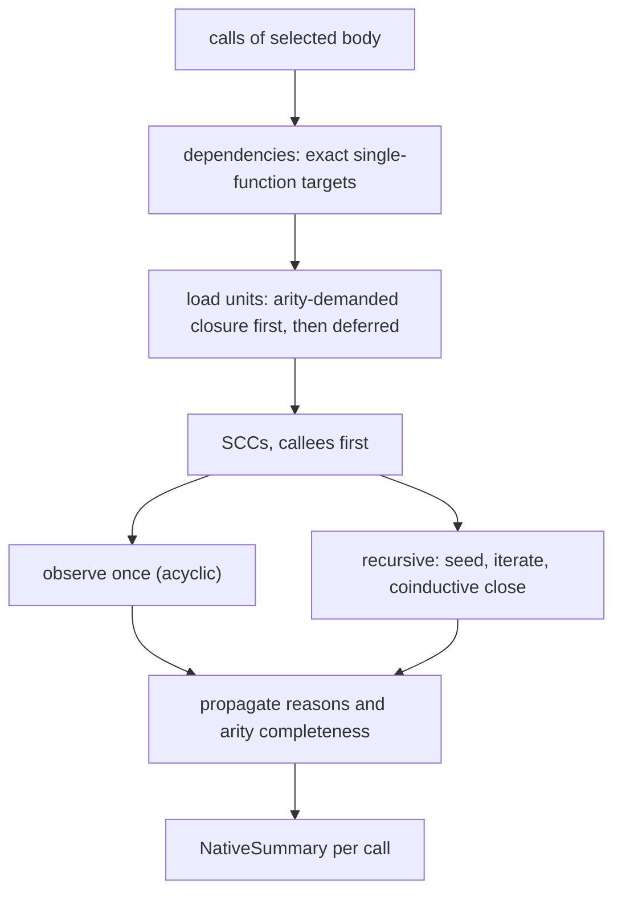

# ABIs, calls and callee summaries

Turns a function's SSA plus an `AbiProfile` into per-call interface facts: which registers and stack slots carry arguments and results, and whether that is proven by a supplied contract, observed at the call site, or summarized from the callee's own body. Physical call analysis runs inside type recovery; callee summaries run after structuring, before reconstruction. Output is _evidence_, not a prototype: whatever is unproven stays an explicit open argument list (`...`).

**Code:** `src/abi/`, `src/analysis/calls/`, `src/service/analysis/` (`calls.ts`, `native-*.ts`, `source-facts.ts`, `likely-arity.ts`, `objc-*.ts`, `source-variadic.ts`)

## Data model

- **`AbiProfile`** (darwin-arm64, sysv-amd64, windows-x64; stateless, never consults names or host): data layout, stack pointer, preserved registers, link register / pushed-return-address size, red-zone capability, clobbers of an unknown call, one pure `classifyCall`.
- **`AbiSignature` → `AbiCallLayout`**: per-parameter _locations_ — register (offset into the _source value_, so HFA members and split 128-bit values fit), stack (offset from callee-entry SP), indirect (pointer + pointee size) — plus hidden-result slot, return locations, stack bytes (lower bound if partial), implicit register inputs (SysV `AL`), and `complete | partial | unsupported`. `argument_count` is `null` for a known prefix.
- **Supplied contract / resolution**: signature + `noreturn` + evidence, keyed by `{address}` or `{import identity}` (never a pointer slot); a resolution says which target a call has (`established | candidate`).
- **`CallFact`** (per call node): targets, status (`unresolved | candidate | established | conflicting`), each matching contract's layout _observed_ in the caller's stack snapshot, noreturn.
- **`NativeInterface` / `NativeSummary`** (callee summary): observed parameter registers/types, stack parameters, written result registers, `parameter_state` (`observed | ambiguous`), closure marker, variadic-stack flag; summary adds `reasons`, `complete`, `arity_complete`.
- **`SourceEvidence.callees` / `source_callees`**: one `InferredCallee` per call that [reconstruction](reconstruction.md) prints.

## Algorithm

### 1. ABI classification

|            | SysV AMD64                                                                       | Win64                                     | Darwin ARM64                                                                                 |
| ---------- | -------------------------------------------------------------------------------- | ----------------------------------------- | -------------------------------------------------------------------------------------------- |
| Arg regs   | rdi rsi rdx rcx r8 r9 / xmm0–7, independent banks                                | 4 positional slots rcx rdx r8 r9 / xmm0–3 | x0–x7 / v0–v7                                                                                |
| Aggregates | eightbyte classes (INTEGER/SSE/SSEUP/X87/MEMORY merge); misaligned leaf ⇒ MEMORY | size 1/2/4/8 → integer, else by pointer   | ≤4 homogeneous float/vector members → consecutive v regs; >16 B → pointer; else integer regs |
| Overflow   | whole argument to stack; first at SP+8                                           | 32 B home space; slot 4 at SP+40          | whole argument to stack (no split, no even-register rounding); first at SP+0                 |
| Result     | rax/rdx, xmm0/1; MEMORY → hidden ptr rdi, returned rax                           | rax / xmm0; indirect → rcx                | x0/x1 or v0–v3; indirect → x8                                                                |
| Variadic   | promote; `AL` = vector-register bound                                            | float also copied to int slot             | every anonymous actual on stack, 8-byte slots                                                |

An unclassifiable parameter on SysV/Darwin stops allocation (later parameters get no location, `stack_bytes` is a lower bound, state `partial`) — never "the rest is on the stack". Win64 allocates by slot position, so only that slot empties. Refused, not guessed: x87 values, AVX-wide aggregates, vectorcall/member functions/non-trivial C++, `_Float16` in variadic tails, other Win64 vector widths, Darwin unprototyped calls.

### 2. Call analysis (`analyzeCalls`)

1. Recover stack first (snapshot at each call and exit); work is shared.
2. Targets per call: direct address; indirect only if the target value is a _proven_ address; plus supplied resolutions. Duplicates are kept so contradictions stay visible.
3. Trust only contracts whose own target is established. Two distinct established targets, or trusted contracts disagreeing on return/parameters/variadic/convention/noreturn ⇒ `conflicting`.
4. `classifyCall` per matching contract, then _observe_ each location in the caller's snapshot (register cells, SP-relative stack reads, pointee reads ≤64 KiB); returns from the call's output snapshot; implicit inputs become satisfied/violated/unknown.
5. `noreturn` only from unopposed contracts; CFG and effects are never edited.

Contracts come from [types-metadata](types-metadata.md#algorithm): library prototypes (import identity _and_ callable stub address), DWARF (direct-call address equals debug function), annotations, ObjC encodings. Names never establish a signature.

### 3. Caller-side prefix and result demand

For calls without an established contract, scan ABI argument slots in order. A slot counts if its whole carrier is covered and some cell was _prepared_ (loaded, computed, constant, or a different incoming value forwarded; untouched entry state, clobbers and the call-target alias do not count). First gap ends the prefix; the tail stays open. Result registers are those whose bits are semantically consumed (backward slice from effects, branches, stores, arguments, returns; bit ranges tracked through extract/truncate/concat), restricted to the primary return register.

### 4. Callee summaries

1. **Dependencies**: direct calls and tail calls (and indirect ones whose target folds to a constant) resolving to exactly one function; imports skipped (contracts cover them). Constant/aliased argument carriers become _context assumptions_ specializing the callee body.
2. **Load**: each callee runs the full pipeline (graph → lift → SSA → types → call analysis); reuse is in [project-cache](project-cache.md#algorithm). Demand-first: callees an _unobserved_ entry argument may reach load first (only they can widen arity); effects/results/shapes callees after.
3. **Budget**: optional pool = half the work left after the selected body; the worklist gets ¾ of it. A load gets ≤¼ of what remains; no new body starts once under half the initial allowance remains; 64 functions, capacity caps, ≤4 contexts per function (then generic body + reason).
4. **Observe a body**: parameters = non-preserved ABI registers read before written by a _semantic_ use (spills, preservation, phi transport don't count). `ambiguous` on: a gap in a bank (x2 read, x1 not), unknown effect/terminator, direct callee without interface, incoming-stack read. Returns = registers written with meaningful bits on _every_ exit (consumption alone is not a write). An exact pointer into the incoming area that escapes ⇒ `va_list`-style variadic.
5. **Closure**: not ambiguous, no stack parameters/escape, every callee that unobserved arguments reach is itself closed. Otherwise open.
6. **Order and fixpoint**: SCCs callees-first; acyclic bodies observed once against final callee interfaces. Recursive groups: seed with locally authored return witnesses, iterate (changed member re-queues in-group callers; ≤64 visits; equality = fingerprint of the whole interface). A least fixpoint never closes a group waiting on itself, so a **coinductive check** assumes all members closed with current parameters, re-observes once, keeps the result only if self-consistent. Memory shapes are not exchanged along recursive edges (no convergence).
7. **Reasons**: partial/limit reasons propagate to callers as a bounded fixpoint; `arity_complete` is inherited only through argument-reaching calls. Budget-worded reasons yield "cut by budget", others "partial".

### 5. Call-site resolution and special cases

- Strongest first: complete established contract ⇒ rendered from it; else callee summary merged with the caller prefix (callee-proven locations win, caller slots fill gaps, ABI order; the merge never closes arity). A refined `source_interface` (context, library tail) sits beside it and is used only when the summary is arity-complete. Else physical call with `...`.
- **Variadics**: allocation is `classifyCall`; closing is separate and evidence-gated. Only an established library rule (`format`, `scanf_format`, `open_flags`) whose argument has a finite value set (≤8 constants/addresses through phis/selects/pure ops) naming an immutable terminated literal closes the tail, and only if every candidate agrees.
- **Objective-C** (Mach-O): selector from a stub entry, or from an exact `__objc_selrefs` load in SEL of `objc_msgSend*`; keyword arity = colons; types from a unique agreeing method encoding, else pointer-sized. Rejected if the caller prepared more registers than the selector names. Indirect tail jumps through an established import likewise bind that contract's register interface.
- **Opt-in `likely` mode**: `callee_reads` (closure ignoring unobserved arguments forwarded to indirect calls) and `caller_consensus` (all discovered direct sites prepare the same prefix). A gate table decides what prints; failing guesses are only recorded.

## Design decisions

- **Evidence, not prototypes.** Call analysis is non-rewriting; a layout never initializes registers or memory. Contracts are explicit typed inputs; observations supplement but cannot create a complete signature.
- **Refuse over guess.** Partial layouts stop allocation; an unobserved callee is `unresolved` (ambiguous, open), never zero-argument; candidates never establish arity or types; conflicts survive as alternatives.
- **Callee bodies are the arity oracle.** Arity closes from the callee's complete reads, not from what callers pass (callers may write unread slots).
- **Determinism under budgets.** Nested fair shares and reserves; limits only stop work and leave explicit reasons; reuse replays the original work charge.

## Limits and improvement levers

- **Open arity is the dominant loss.** Stack-argument reads, `va_list` escapes, ambiguous callees, unused-parameter gaps in a bank and unresolved indirect calls inside the callee all leave `...`. Levers: accept gaps the body proves unread [inference]; closable stack parameters (`observeParameters`).
- **Indirect calls/callbacks**: only proven constants or bounded discovery establish a target; `indirect_call_target` has no passing heuristic. Lever: earlier target resolution (discovery/value analysis).
- **`likely` coverage**: `caller_consensus` is recorded but gated off (pooled precision ~86% < 95%); abstains above 32 callers, on tail calls, on disagreeing prefixes; SQLite closes 76 of 889 open sites.
- **Cost**: each callee repeats lift/SSA/types/calls (~32% of worker CPU in one profile); units over ~8k size are not persisted. Summaries depend on demand/context, so a summary-only cache is hard [inference].
- **Budget-dependent results**: the load reserve decides which callees load, hence summaries and merged image types.
- **Granularity**: return recovery targets primary registers (plus demanded second words); x87/aggregate returns and multi-exit type disagreement are dropped; context caps push hubs onto generic bodies.
- **Coverage**: three profiles only (no Linux/Windows ARM64, no x86-32); noreturn only from contracts.
