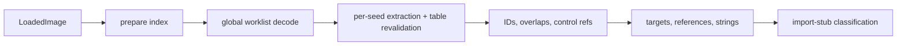

# Function discovery and CFG

Turns an immutable `LoadedImage` plus an architecture decoder into per-function graphs: which bytes are code, where functions end, how blocks connect, which indirect jumps are provable jump tables. Sibling passes run right after: data xrefs, string index, import-stub classification. Sits between [loaders](loaders.md) and [lifting](lifting-ir.md); lifters consume `FunctionGraph` directly.

**Code:** `src/analysis/discovery/`, `src/analysis/cfg/`, `src/analysis/targets/`, `src/analysis/references/`, `src/analysis/strings/`

## Data model

- **Seed** — one per entry VA: evidence ids, names, _boundary claims_ (ranges a loader/user says the function owns), `established` flag. Loader facts at one address merge; established is sticky.
- **Discovery index** — seeds, data-region and executable-range interval indexes, jump-table inventory. Built without decoding; reused by selected-entry queries.
- **`FunctionGraph`** — function record (`boundary` candidate/established/conflicting; `analysis` partial/complete), decoded instructions, blocks with typed edges, gaps, diagnostics, coverage reasons, resolved jump tables. Observed ranges come only from reachable instructions; claimed extents stay separate.
- **Gap** — decode failure kept as data (`data`, `unmapped`, `budget`, `truncated`); never a fabricated instruction.
- **Resolved jump table** — branch, table range, entry width/stride, exact targets, guard, "otherwise" edge. Distinct from _candidates_ (inventory, no edges).
- **`ReferenceRecord`** — call/branch/tail_call/read/write/address; established/candidate/unresolved.

## Algorithm

### 1. Seeds (no decoding)

One gate; no ordering among sources, only merged evidence.

| Source                                      | Established  | Claim                            | Gate                                          |
| ------------------------------------------- | ------------ | -------------------------------- | --------------------------------------------- |
| image entry                                 | yes          | –                                | none                                          |
| function symbol, loader function-start hint | yes          | size                             | executable backing                            |
| import callable entry                       | yes          | –                                | executable backing                            |
| published function (selected-entry only)    | as published | –                                | executable backing                            |
| unknown-kind symbol, non-forwarded export   | no           | size / –                         | not in a data region or object-symbol address |
| unwind region start                         | no           | none (region may span functions) | executable backing                            |
| user assertion                              | no           | its ranges                       | assertion-origin evidence; retracted ignored  |
| direct call target (found later)            | yes          | –                                | executable backing                            |

Data regions (data hints, sized object symbols) veto _candidate_ seeds and stop decoding. No prologue scan, no linear sweep.

### 2. Global worklist

- Queue = seeds sorted by VA; successors append in flow order; each address decoded once.
- Pop: data region → `data` gap + warning; no executable backing → `unmapped`; instruction budget hit → `budget`, mark exhausted, keep draining; else decode one window (≤15 B x86, 4 B ARM64, clipped to backing/data).
- Valid direct call: seed target (established), enqueue; intraprocedural successor is only the continuation — none if the callee is a library-contract `noreturn` import (stops a trailing `bl ___stack_chk_fail` from flowing into the next function).
- One shared successor rule serves traversal and CFG building, so they cannot drift.
- Non-conditional indirect branch → jump-table prover; targets become edges and queue entries. Heuristic _candidates_ (x86 scaled index, ARM64 indexed load into branch register) carry no extent.

### 3. Per-seed extraction: boundary decision

Re-walk decoded instructions from each entry; a function is everything reachable without crossing another seed. At a successor that is another seed:

- unconditional branch → **tail call**: exit edge + `tail_call` reference, no member;
- conditional branch, fallthrough or call continuation → **conflict** (diagnostic cites both seeds);
- jump-table target → table proof rejected, not a conflict.

Further conflicts: claim containing another entry; member outside all claims; reachable data region. Result: `conflicting` if any; else `established` if seed established and non-empty; else `candidate`. `analysis` is `partial` on any gap, invalid instruction, unknown flow, unresolved indirect branch or indirect call.

Data inside claim∪observed envelope becomes data gaps (literal pools). Afterwards: instruction owned by >1 function → `shared_tail` (legal); intersecting encodings → `overlapping_instructions`, owners become `conflicting`+`partial`.

**Selected-entry mode** (per decompilation request): same code, one queued root, every other indexed root a boundary, calls seeded as evidence but not followed.

### 4. Jump-table proof

Walk backwards from the branch over a single-entry straight-line chain (≤64, ≥3 instructions; stops at roots, multi-predecessor addresses, calls, invalid). Replay forward in a symbolic interpreter (hash-consed constants/extensions/add/shift, compare flags, slot forwarding; unmodeled instructions forget state). Accept only if:

1. target is a function of exactly one load `[const_base + index·stride]`;
2. a dominating **unsigned** compare-and-branch on that exact index bounds it (≤256 entries);
3. table bytes lie in one readable, non-writable, relocation-free, file-backed span;
4. every computed target is executable (aligned on ARM64).

The guard's out-of-range successor is `otherwise`. Extraction **revalidates** each proof on the final graph (chain still single-entry, selector and branch in one block, all targets inside); failures drop their edges and extraction repeats (monotone → terminates).

### 5. CFG build

Leaders: entry; successors of any non-fallthrough instruction; addresses with in-degree ≠ 1. Edges from a block's last instruction: call → fallthrough (or `trap` if noreturn); conditional branch → branch + fallthrough; unconditional branch to another root → `tail_call`; proven table → conditional `branch` per distinct target; unresolved indirect/unknown/invalid → `unknown`; return/trap. Targets outside the function keep the address, null block.

### 6. After the graphs

- **Control refs** per instruction; unresolved flow stays `unresolved`.
- **Target recovery** — block-local values per register root; nothing crosses a block, call, store or unknown. Resolves import slots/stubs, ADRP+ADD, RIP-relative, pointer loads. Loaded pointer values are _candidates_ (slot may be writable). Absolute-u64 tables enumerate only from loader data hints with an extent.
- **Reference index** — merge of discovery refs, target refs, loader relocations; an unresolved edge is dropped only by an _established_ target on the same instruction. Established read/address refs promote strings `candidate → referenced`.
- **Strings** — NUL-delimited UTF-8/UTF-16LE in file-backed non-code sections, ≥4 chars, byte/count budgets.
- **Import stubs** — ≤4 inert instructions + indirect jump, one established branch to one non-weak import slot → `import_stub`, `complete`.
- **Lineage** — (entry, member set) match keeps IDs; split/merge/replace mint new ones. Not persisted by import.

## Design decisions

- **Evidence-grounded roots.** A wrong function costs more than a missing one; incompleteness is reported (`partial`), never papered over.
- **Gaps, not guesses**; invalid instructions end flow.
- **Candidate ≠ fact.** Candidate seeds, jump-table inventory and loaded pointer values never create edges. Claims are checked against reachable code, never permission to decode.
- **Observed vs claimed ranges** separate; conflicts recorded, not resolved.
- **Proof, not pattern** for jump tables: exact bound, bytes and targets, or nothing; rechecked per graph.
- **Determinism:** VA-sorted seeds; content-addressed evidence ids; entry/shape-derived entity IDs.
- **Budgets:** instruction exhaustion gives partial graphs; work, block, deadline, cancellation throw and publish nothing. The prepared index's build cost is charged once to each operation that uses it.

## Limits and improvement levers

- **Nothing beyond seeds.** Stripped images without entry/unwind/symbol hints expose only call-reachable code. Levers: candidate seeds from gap/prologue scans; richer loader hints (CFI, unwind) [inference].
- **Tail calls need a seed.** A jump to an unseeded function is absorbed into the caller; a spurious candidate seed (export, unwind start) mid-function turns an internal jump into `tail_call`. No tail-call heuristic, no promotion of branch targets to seeds.
- **Noreturn only from library contracts on imports.** Local `abort`-like wrappers fall through into the next function (conflict, or garbage absorbed). Lever: feed callee-summary noreturn ([calls-abi](calls-abi.md)) back into discovery — needs iteration.
- **Jump tables:** unsigned bound on the exact index node, single-entry chain, ≤256 entries, immutable relocation-free bytes. Misses signed bounds, guards across merged paths, writable or relocated tables (absolute-pointer tables in PIE/dylib/DLL). Failure → `unknown` edge, `partial` function. Rangeless candidates are unusable by target recovery.
- **Global instruction budget** (default 10,000) in import: late-queue roots starve to `budget` gaps and partial ranges. Lever: per-root resumable discovery (`CONTINUE.md`), persisted index.
- **Whole image stays `partial`** while any indirect flow is unresolved (observed on the SQLite/Node imports in `docs/PERFORMANCE.md`).
- **Shared tails and overlapping encodings** are flagged, not canonicalised: each owner keeps its own blocks, so later stages likely repeat work [inference].
- **Target recovery is block-local:** many indirect calls stay unresolved here; later [SSA](ssa-values.md#algorithm) and call resolution recover some.
- **Strings:** executable sections, non-NUL-terminated, compressed or encrypted text invisible.
- **Lineage unpersisted;** function IDs derive from the entry, so same-entry body changes keep the ID.
