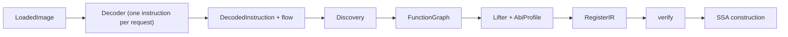
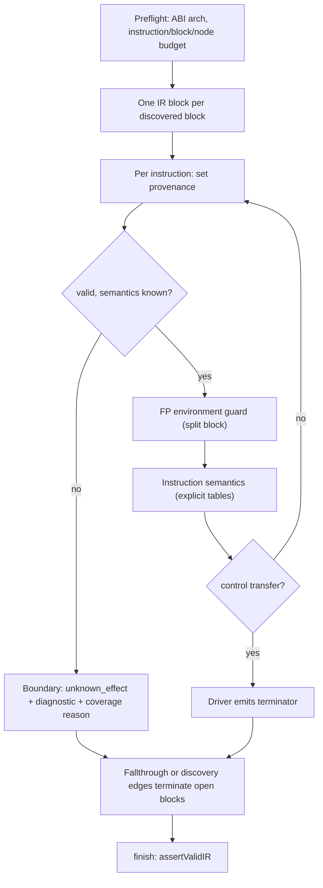

# Decoding, lifting and IR

Decoders turn loaded bytes into structured instructions and control-flow facts; discovery stitches them into a `FunctionGraph` ([discovery](discovery.md)). A lifter expands each instruction into `RegisterIR`: typed, effect-ordered dataflow over _physical_ register slices, tagged with provenance. A verifier checks it at every pass boundary. SSA is a separate pass ([SSA](ssa-values.md)); calls stay signature-less here ([calls and ABI](calls-abi.md)).

**Code:** `src/decoders/`, `src/lifters/`, `src/ir/`, `src/analysis/effects/`, `src/core/decoder.ts`, `src/core/contracts.ts`, `vendor/a64js/`

## Data model

- **`DecodedInstruction`**: address, byte reference (file range, or VA range when one word straddles non-contiguous mappings), `validity` (valid / invalid / undefined / feature_disabled), an architecture-discriminated **payload**, a **flow** fact.
  - Payload = structured operands, ISA-qualified register slices, prefixes/fields; never assembly text. x86 also carries iced's register/memory/flag access sets; ARM64 has none (operand access `unknown`).
  - Flow = fallthrough / branch / call / indirect_branch / return / trap / `unknown`. `trap` is a fact about the instruction (UD2, BRK); undecodable instructions and ARM SVC/HVC are `unknown`.
- **`DecodeGap`**: typed hole (`unmapped`, `data`, `truncated`, `budget`): "not decoded" ≠ "decoded to unknown".
- **`RegisterDescriptor`**: slice of a named _root_ plus a **write rule** (`replace_root`, `zero_extend_root`, `preserve_other_bits`, `discard`). ISA aliasing (EAX→RAX zero-extend, AH preserve, XZR discard) lives here.
- **`RegisterIR`** (`form: 'register'`): blocks, entry, `returns` (empty at lift). Block = data parameters, an _effect parameter_, instructions, one terminator.

| IR element                                             | Contents                                                                                                                                                                                                                            |
| ------------------------------------------------------ | ----------------------------------------------------------------------------------------------------------------------------------------------------------------------------------------------------------------------------------- |
| Types                                                  | signless iN (1–2048), f32/f64, fixed-lane vectors (≤2048 bits), `effect` token                                                                                                                                                      |
| Pure `assign`                                          | constant, static `address`, integer/unary/compare, casts, extract/insert/concat, select, `flag` (carry/borrow/overflow/zero/negative/parity of add/sub with carry-in), float, vector, `indeterminate(undefined \| unknown, reason)` |
| Effectful (each consumes and produces an effect token) | `read_register`, `write_register`, `load`/`store` (endianness, alignment, volatile), `memory_fence`, `call`, `unknown_effect`                                                                                                       |
| Terminators                                            | jump, branch, switch (+ jump-table origin), return, `indirect` (+ tail-call marker), trap, unknown. Edges carry block arguments and the final effect                                                                                |
| Every node                                             | `provenance`: instruction ids, byte ranges, evidence ids, or a mandatory _synthetic_ justification                                                                                                                                  |

- `call` / `unknown_effect` carry **clobbers** (registers, flags, memory: none / read_only / unknown_read_write). A call has no arguments/results until [calls](calls-abi.md) reconstructs them.
- SSA form adds register bindings on effectful nodes and per-block register-state rows; lifters never emit them.
- `analysis/effects`: shared use/def traversal and effect summaries (barrier, may-fault), so every pass agrees on what a node reads, defines and orders.

## Algorithm

### Decoding

1. Normalize requested regions (file / RVA / VA) to merged VA ranges through the image mappings; unbacked parts become `unmapped` gaps.
2. Split at loader **data hints** (cached per immutable image object); data is never decoded.
3. Walk backed bytes. ARM64: aligned 4-byte words; misaligned or short fragments → `truncated` gap. x86-64: iced decoder over ≤64 KiB windows plus 14 bytes of lookahead.
4. Convert native result to the neutral payload; classify validity; derive flow (ARM: from mnemonic + relative operand; x86: iced `FlowControl`).
5. Stop at the instruction budget, leaving a `budget` gap; coverage is `partial` whenever any gap or non-valid instruction exists.

In production discovery asks for **one instruction per request** (ARM 4 bytes, x86 15), bounded by backing and data hints; the window logic serves bulk requests only.

|                | ARM64                                                                                                                                                                                             | x86-64                                                                               |
| -------------- | ------------------------------------------------------------------------------------------------------------------------------------------------------------------------------------------------- | ------------------------------------------------------------------------------------ |
| Library        | `a64js`, **vendored** transpiled-JS snapshot of a pinned upstream commit (MIT; 1,918 runtime modules incl. the generated encoding inventory; per-file SHA-256 in `snapshot.json`; no WASM/native) | `iced-x86` 1.21.0 npm package, **WASM**; native objects freed explicitly per request |
| Operands       | from encoding fields; specialized text-only operands stay `opaque` (never lifted); one adapter-side completion for logical shifted-register words the tables lack                                 | from iced operand/memory info; immediates keep encoded and effective width           |
| Feature gating | recognized-but-unavailable → `feature_disabled`; operands re-extracted with features on, availability stays authoritative; disabled HINT-space ops act as NOP                                     | only with a non-empty feature list; payload kept                                     |
| Invalid word   | `unknown` flow, may fall through (fixed width)                                                                                                                                                    | `unknown` flow, no fallthrough (length unreliable)                                   |

### Lifting

1. **Preflight**: refuse (resource limit) if instructions, blocks, or `3 × blocks` minimum nodes exceed the budget.
2. **Block skeleton**: IR block per discovered block, ids born from the CFG block id; never re-split or merged. Extra blocks are synthetic only: FP/divide guards, external exits, missing entry.
3. **Instruction semantics**, hand-written per ISA, keyed by canonical encoding (ARM) or mnemonic (x86); decoder access metadata is never consulted.
4. **Control flow** in the driver: calls continue in-block; conditional branches build both edges explicitly; transfers outside the function become an `indirect` exit block (tail-call marked when discovery proved it); a branch discovery proved to be a jump table becomes a `switch` (selector captured just before the selecting load; requires one block, all targets discovered; else stays `indirect`).
5. **Termination**: an unterminated block jumps to its single discovery successor, becomes a `trap` if discovery proved the callee noreturn, else an `unknown` boundary.

Conventions:

| Aspect       | Modelling                                                                                                                                                                                                                                     |
| ------------ | --------------------------------------------------------------------------------------------------------------------------------------------------------------------------------------------------------------------------------------------- |
| Flags        | ARM: one 32-bit `nzcv`, four `flag` expressions packed. x86: six 1-bit slices of RFLAGS, **all** written eagerly per instruction; undefined ones get `indeterminate(undefined)`; count-dependent shift flags are `select(count==0, old, new)` |
| Memory       | explicit address arithmetic; typed little-endian accesses, alignment 1 (16 for aligned SSE moves); RIP-relative becomes an `address` constant; FS/GS base is an explicit register                                                             |
| Stack / call | x86 push/pop/call/ret are explicit RSP arithmetic, stores and loads; call pushes the return address, then restores RSP (tail call: no push). ARM BL writes x30. Call has no args/results; clobbers = ABI's unknown-call set                   |
| Return       | `return` with no values. ARM reads the ABI return registers as capacity so SSA keeps them live; x86 pops the slot but ignores the loaded target                                                                                               |
| Division     | ARM: defined (÷0 = 0) via select. x86: explicit #DE guard blocks ending in `trap`                                                                                                                                                             |
| FP           | supported only under nearest-even, gradual underflow, masked exceptions: a runtime guard on FPCR / MXCSR[6:16] branches to an `unknown` exit otherwise; arithmetic NaNs canonical; status register written `unknown`                          |

**Unsupported instructions.** Semantics throw an internal "unsupported"; the driver emits `unknown_effect` clobbering _all_ modelled registers, flags and memory (ARM64 SIMD&FP data processing that reads no general register gets its ISA bound instead: V0–V31, a to-general Rd, NZCV, FPSR, memory `none`; see [ARM64](../ARM64.md#bounded-effects-of-unlifted-simdfp-data-processing)), an `unavailable_semantics` diagnostic and a coverage reason (lift state `partial`). Both lifters then continue with the next instruction if the unsupported one falls through or is a call; any other flow (branch, return, trap, unknown) ends the block with `unknown`. Nothing is dropped; no trap is invented.

### Validation

- Builder: expressions type-checked on creation, no append after a terminator, budget charged before allocation.
- `assertValidIR` runs in `finish`, after lift, SSA construction and simplification (verified objects memoized). Failure throws `IRValidationError` with all problems: the function is refused, never repaired. Entity and evidence identities are tested with the precompiled `isEntityId` / `isEvidenceId` (`src/core/primitives.ts`), which accept exactly what `entityIdSchema` / `evidenceIdSchema` accept (`test/core/id-predicates.test.ts`) without a zod parse per id.

| Class                  | Checks                                                                                                                                                       |
| ---------------------- | ------------------------------------------------------------------------------------------------------------------------------------------------------------ |
| identity, provenance   | unique ids; every node has instruction or synthetic origin; non-empty ranges                                                                                 |
| type                   | operand/result agreement, no implicit extension or signedness, cast direction, i1 conditions, i64 addresses, alignment power of two ≤4096, edge/return types |
| reference              | defined before use in-block; cross-block only from a strictly dominating block (unreachable components rooted separately)                                    |
| effect_order           | each state access consumes the current token; terminator and edges carry the final token; tokens never cross blocks                                          |
| control_flow, semantic | entry/targets exist, arities, unique switch cases; restricted call memory effects need contract evidence; unknown/trap/indirect need reasons                 |
| register               | consistent descriptors and write rules; SSA bindings disjoint and covering                                                                                   |

## Design decisions

- **Facts vs semantics**: decoders state what bytes are; lifters state what they do, from architectural rules. x86 access sets are dependency data only.
- **Refuse rather than guess**: invalid ≠ trap; unsupported ≠ no-op; unresolved indirect ≠ invented edge; no invented call signature.
- **Register form first**: lifters emit plain read/write nodes; SSA is a separate, testable pass. One effect token linearizes registers, memory and calls, so no pass reasons about aliasing implicitly.
- **Physical slices**: write rules carry ISA aliasing into SSA; no sub-register special cases.
- **One reference evaluator** (`evaluateExpression`) defines expression semantics for constant folding in value analysis, stack recovery, reconstruction and emitters. `evaluateIR` (bounded oracle interpreter, test-supplied call oracles) is test-only and never executes target code.
- **Determinism**: ids hash (slice, kind, birth key / per-block sequence); provenance merges are ordered unions; rewrites keep surviving ids.
- **Budgets are structural**: nodes/blocks charged before allocation, since one instruction can expand to dozens of nodes (x86 `cmp` ≈ 22).

## Limits and improvement levers

| Weakness                                                                                                                                                                                             | Effect                                                                                          | Lever                                                                            |
| ---------------------------------------------------------------------------------------------------------------------------------------------------------------------------------------------------- | ----------------------------------------------------------------------------------------------- | -------------------------------------------------------------------------------- |
| x86 gaps: x87/MMX, `REP`/string ops, LOCK/atomics, RCL/RCR, SHLD/SHRD, bit scan, BT/BTC/BTR (BTS is lifted), BMI, AVX/VEX/EVEX, most SIMD shuffles/conversions                                       | inlined `memcpy`/`memset`, AVX code, `long double` become boundaries                            | add families in x86 semantics                                                    |
| ARM gaps: atomics/LSE, fused FP (FMA), FP16, SVE/SME, other barriers, lane-indexed SIMD, multi-register/replicating SIMD loads and stores (only single-lane `ST1`/`LD1` are lifted), opaque operands | common `-O2` output hits unknown effects                                                        | add families; extend `structuredOperands`                                        |
| Unknown effect clobbers _all_ modelled state (one whole-state set per ISA; ARM64 SIMD&FP data processing is bounded)                                                                                 | wipes argument/return facts downstream, pollutes interface inference                            | [inference] bound by iced access sets (x86) or per-encoding def/use tables (ARM) |
| Per-instruction FP guard (two extra blocks each), per-division #DE guards                                                                                                                            | block/node budget burn, noisy CFG until simplified away                                         | [inference] one environment guard per function                                   |
| Eager x86 flags (6 writes per ALU op), long effect chain                                                                                                                                             | IR size, SSA/DCE cost                                                                           | [inference] lift only flags with live readers                                    |
| Loads never removable (even dead; `volatile` never set); alignment mostly 1                                                                                                                          | dead loads and alignment facts survive                                                          | refine effect summaries, carry natural alignment                                 |
| PAC abstracted to logical pointers; FP exception status `unknown`                                                                                                                                    | invisible to later stages                                                                       | none planned                                                                     |
| Single-instruction decode requests repeat decoder setup (a64js decoder creation, iced WASM objects)                                                                                                  | Decode/CFG dominates per-function latency (`PERFORMANCE.md`; mostly discovery); lifting ~1–2 ms | [inference] pool decoder state                                                   |
| ARM64 recognition bounded by pinned a64js tables                                                                                                                                                     | newer encodings read `invalid`                                                                  | re-vendor (`vendor/a64js/README.md`)                                             |
