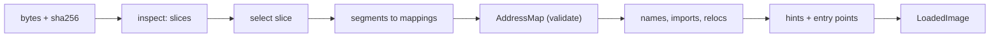

# Loading binaries and addresses

A loader turns an immutable byte container plus one selected slice into a static, immutable `LoadedImage`: address mappings, sections, symbols, imports, exports, relocations, entry points and function/data hints. It never decodes an instruction, never executes anything, and applies no runtime slide. It is the first analysis stage; every later stage ([discovery](discovery.md), [lifting](lifting-ir.md), [metadata](types-metadata.md)) reads this image and nothing else about the file.
**Code:** `src/loaders/macho/`, `src/loaders/pe/`, `src/loaders/elf/`, `src/core/addresses.ts`, `src/core/model.ts`

## Data model

- **`LoadedImage`** — plain frozen record. Holds the _whole container_ bytes (file addresses are container-global), the selected slice, a derived `AddressMap`, and fact collections. `bytes` and `address_map` are runtime-only; the rest is what [the project store](project-cache.md) persists.
- **Address** — `{image_id, space, value}`, `space ∈ va | rva | file`. Never a bare number: cross-image or cross-space mixing is a type/runtime error.
  - `file` = offset in the original container (includes slice offset).
  - `va` = linked/preferred virtual address from load commands / program headers / optional header.
  - `rva` = `va − image_base`.
- **Mapping** — `(va, memory_size, file_offset, file_size, permissions)`. `file_size < memory_size` means a zero-fill tail. Mappings are the _only_ byte-backing authority; sections are metadata on top, never a second overlapping set.
- **`AddressMap`** — validated once at load: unique IDs, no u64 overflow, `file_size ≤ memory_size`, file range inside the slice, VA ranges non-overlapping, file ranges non-overlapping. Ambiguity throws; array order never resolves aliases.
  - `translate` maps one address between spaces → `mapped | zero_fill | unmapped`.
  - `spans` partitions a range into mapped / zero-fill / unmapped pieces. All byte reads in later stages go through it.
- **Fact collections** (all strict, schema-validated):

| Collection                          | Content                                                                                                                                  |
| ----------------------------------- | ---------------------------------------------------------------------------------------------------------------------------------------- |
| headers, sections                   | raw native fields kept verbatim; segments/sections with VA range, optional file range, permissions                                       |
| symbols                             | `original_name` (immutable linkage text), `display_name` (later demangled), kind, binding, address, size                                 |
| imports                             | name, library/ordinal, `slot` (pointer cell the native loader would fill), `callable_entry` (code proven to forward to it), delayed/weak |
| exports                             | address or forwarder, ordinal                                                                                                            |
| relocations                         | kind (`relocation` `rebase` `bind` `chained_fixup`), width, target, addend, authenticated — _recorded, never applied_                    |
| entry points                        | only addresses proven to be executable, file-backed memory                                                                               |
| hints                               | `function` (start, optional exact size), `unwind` (range), `data` (bytes / jump table / literal pool / unknown)                          |
| evidence, diagnostics, capabilities | provenance (file range + claim), refused/degraded metadata, per-layer supported/partial/unsupported                                      |

- **Slice** — `(offset, size, architecture, subtype, supported)`. ID hashes `(image_id, offset, size, architecture)`; image ID hashes the container bytes. One fat file = one image ID, several slice IDs.

## Algorithm

Two-call protocol per format: `inspect` (cheap, enumerates slices and why one is unsupported) then `load` (full parse of one slice). The import worker reads the file (≤ 512 MiB), hashes it, picks the format by magic (`MZ` → PE, `\x7fELF` → ELF, else Mach-O, which diagnoses unknown magic), loads, then hands the image to the [prepare step](project-cache.md) that adds names and discovery.

**Slice selection.** Explicit ID must exist and be supported. No ID: exactly one supported slice or `ambiguous_slice` (with every slice listed) — never "first wins", so adding an architecture to a fat binary cannot silently change what is analysed. PE/ELF have a single whole-file slice.

**Common shape (all formats).**

1. Bound the container (128 MiB parse cap for Mach-O/ELF), identify format/arch/subtype; refuse outside the supported subset.
2. Build mappings from segments/`PT_LOAD`/sections; derive `image_base` (Mach-O: vmaddr of the segment covering file offset 0; PE: `ImageBase`; ELF: lowest `PT_LOAD` VA).
3. Construct `AddressMap` — the structural gate; failures are `malformed_image`.
4. Read symbol tables, imports/exports, relocations; each fact gets an evidence record (deduplicated per range+claim).
5. Derive hints and entry points; every entry point must land in executable file-backed memory.
6. Emit capabilities: what was interpreted, what was retained raw, what is unsupported.

**Mach-O (arm64, executable/dylib).**

- Fat32/64 in either byte order; 1–1024 slices, offsets/alignment/overlap checked, fat table cross-checked against each slice's header.
- Mappings split only where a zero-fill section overrides file backing; encrypted ranges excluded from optional parsing.
- Imports from the indirect symbol table: pointer sections give `slot`, stub sections give `callable_entry`, lazy pointers set `delayed`.
- dyld: legacy rebase/bind opcode streams and chained fixups (several pointer/import formats, 4/16 KiB pages) become relocations + import slots; conflicting signatures at one address → `conflicting_evidence`.
- Exports: iterative trie walk merged with symbol-table exports. Hints: `LC_FUNCTION_STARTS`, data-in-code, compact unwind / `__unwind_info`; `__eh_frame` is framed and retained, no PC ranges invented.
- **Optional** metadata (symbols, trie, dyld, starts, unwind, relocations) failing → warning + `partial` capability; structural failures abort. Budget/cancel errors are never downgraded.

**PE (AMD64 PE32+, native user-mode EXE/DLL).**

- Headers get a read-only mapping; each section maps `max(VirtualSize, RawSize)` with raw size as file backing (rest is zero-fill).
- Import / delay-import descriptors → IAT cell as `slot`, ordinal or hint/name; no `callable_entry`.
- Export address/name/ordinal tables, forwarders detected by RVA-inside-directory.
- Base relocations: only `DIR64` recorded; others diagnosed.
- `.pdata` → function hints with exact size; `UNWIND_INFO` chains validated (≤ 64 records) → unwind hints; TLS callbacks → entry points + function hints; CodeView RSDS/NB10 identity retained; COFF symbols read if present.

**ELF (ELF64 LE x86-64, `ET_EXEC`/`ET_DYN`).**

- Mappings only from `PT_LOAD` (congruence checks); section table is _required_ and cross-checked against segments, `PT_DYNAMIC`, `DT_*` pointers and GNU version tables — contradictions are malformed.
- `.symtab`/`.dynsym` → symbols; exports from `.dynsym` only.
- Relocations: known x86-64 types get width/target; unknown ones keep raw bytes + unsupported diagnostic. `GLOB_DAT`/`JUMP_SLOT`/absolute relocation on a non-executable site → import with `slot`; a possible instruction patch site → import with no slot.

**Debug-info hand-off.** Loaders only retain evidence: Mach-O `__DWARF` segments and `__eh_frame` bytes, ELF `.debug_*` sections, PE CodeView identity. Parsing DWARF / matching dSYMs happens later in [metadata](types-metadata.md) from the image's sections; the loader itself never reads a PDB or DWARF.

**Consumption.** [Discovery](discovery.md) turns entry points, function/unknown symbols, non-forwarder exports, import `callable_entry` and `function` hints into established seeds; `unwind` hints into candidate starts only; `data` hints and sized object symbols into protected data ranges. Reference building tags accesses through an import `slot`; stub classification trusts only imports that have a slot.

## Design decisions

- **Refuse rather than guess.** Unknown commands, relocation types, thread flavors, bound imports without lookup tables, extended ELF indexes → retained raw + diagnostic/capability, never approximated. A load either succeeds with explicit diagnostics or throws; no empty-but-valid image.
- **Facts, not analysis.** Slots are storage addresses, not resolved values; relocations are recorded, not applied; exports may be interposed at runtime. Analyses cite the native range that claims it.
- **Linked addresses only.** No ASLR slide, no dyld/ld.so emulation. Keeps output deterministic and cache keys content-derived.
- **Single backing authority.** One mapping set validated up front; every consumer reads via `spans`, so zero-fill and holes are visible, never silently shortened.
- **Hostile-input posture.** Every read bounds-checked, every count capped (≈100k records, 4–8 KiB strings, 65k load commands, 1024 slices) and charged to the operation budget. Mach-O alone separates "structural" from "optional"; PE/ELF fail whole.
- **Evidence-bearing, immutable.** `ImmutableBytes` owns one copy, exposes no mutable view; IDs derive from slice + kind + native birth key, so reloading yields identical IDs.
- **Names untouched.** `original_name` is never rewritten; demangling is a later layer producing `display_name`.

## Limits and improvement levers

| Weakness                                                                                                                             | Effect                                                                                                                    | Lever                                                                                                                   |
| ------------------------------------------------------------------------------------------------------------------------------------ | ------------------------------------------------------------------------------------------------------------------------- | ----------------------------------------------------------------------------------------------------------------------- |
| Targets: Mach-O arm64 only; PE/ELF x86-64 only; no 32-bit, big-endian, ARM64 PE/ELF, ET_REL, kernelcache, dyld shared cache          | Whole file refused                                                                                                        | New loader + extend the target vocabulary (format × ISA × ABI) in `src/core/primitives.ts`; decoders/ABI must exist too |
| Mach-O x86_64 slices of universal files reported but unsupported                                                                     | Rosetta-era fat files analyse arm64 only                                                                                  | Slice-level, needs an x86 Mach-O ABI                                                                                    |
| ELF: no PLT callable entries, IFUNC, TLS symbols, RELR, Android packed relocs, `SHN_XINDEX`, sectionless images                      | PLT stubs are plain code; indirect calls through GOT work only via relocation slots; stripped/section-less images refused | Synthesise `callable_entry` from PLT shape (discovery already classifies stubs after the fact)                          |
| PE imports have no `callable_entry`; only `DIR64` base relocs; bound imports without lookup tables refused; CLR/PE32/drivers refused | Thunks depend on discovery's stub classifier                                                                              | Add PE thunk entries; broaden reloc types                                                                               |
| Mach-O imports appended per mechanism (indirect table _and_ chained fixups)                                                          | Several records per symbol, differing slot/stub roles                                                                     | Merge by name+slot (consumers key by ID today, so it is redundancy, not loss) `[inference]`                             |
| Mach-O `__eh_frame` retained but not turned into PC ranges; compact unwind is the only unwind-based function-boundary source there   | Function starts rely on `LC_FUNCTION_STARTS`/unwind/symbols                                                               | A DWARF CFI consumer producing `unwind`/`function` hints                                                                |
| ELF DWARF and PDB types are not recovered (ELF: explicit `unavailable_semantics`; PE: identity only)                                 | Signatures/types come from heuristics, not debug info                                                                     | Debug recovery in `src/metadata/debug/`, not the loader                                                                 |
| PE/ELF metadata failures are all-or-nothing                                                                                          | One bad optional table rejects an otherwise usable image                                                                  | Port Mach-O's structural/optional split `[inference]`                                                                   |
| Linear mapping lookup in `translate`/`spans`                                                                                         | Fine for tens of mappings; hot if a consumer translates per instruction `[inference]`                                     | Index mappings by VA once in `AddressMap`                                                                               |
| 128 MiB parse cap (Mach-O/ELF) vs. 512 MiB import cap                                                                                | Large binaries fail at load, not import                                                                                   | Raise cap with streaming/lazy table reads                                                                               |

Cost profile `[inference]`: loading is linear in table sizes, dominated by dyld/chained-fixup and symbol-table walks; it is cheap relative to discovery and lifting.
