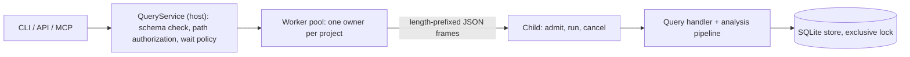
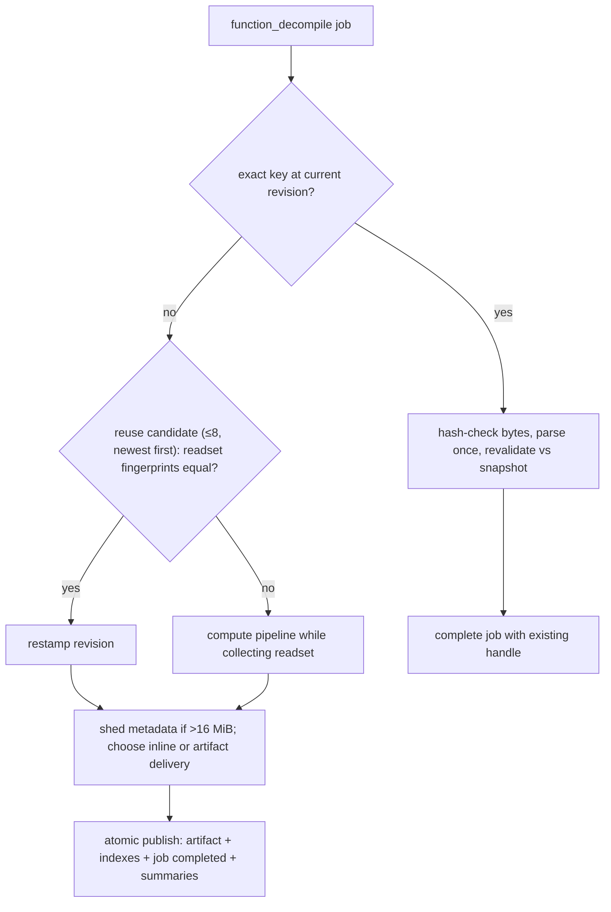

# Projects, Cache and Execution

The container around the analysis pipeline. A binary becomes a content-addressed SQLite _project_; every request becomes a durable _job_ run by one persistent child process per project; decompilation results are published as immutable _artifacts_ that later requests reuse only if they provably still hold. Owns persistence, cache validity, process model and work accounting; stages live on the other pages ([README](README.md)).

**Code:** `src/project/` (store, cache, annotations), `src/workers/`, `src/service/` (queries, analysis orchestration), `src/core/operation.ts`, `src/settings/`

## Data model

| Concept            | What it holds                                                                                                                                                                                                                                          |
| ------------------ | ------------------------------------------------------------------------------------------------------------------------------------------------------------------------------------------------------------------------------------------------------ |
| Project directory  | `<sha256>.<slice\|default>` under the cache root: `project.sqlite`, `images/<sha256>`, `artifacts/<id>`. Name = pure function of bytes + slice. Files immutable, hash-checked on read.                                                                 |
| Revision           | One global integer naming one complete, immutable view of all facts. Rows are "latest version ≤ revision". Advances only on image-import commit and committed mutations (annotation batches), never on artifact or job writes.                         |
| Native facts       | Loaded-image metadata ([loaders](loaders.md)), records (function, string, reference, symbol, import, export — [discovery](discovery.md)), evidence, and an explicit per-kind _index state_ (complete / partial / not started). Written at import only. |
| Annotations        | Versioned rows per ID; removal = tombstone with actor; retraction = status. Never promoted into facts. Subjects: durable entities, or a _trusted catalog_ taken from a published artifact at the exact revision.                                       |
| Job                | Durable state machine `queued → running → completed / cancelled / failed / stale`, with input revision, progress, diagnostics, artifact handles.                                                                                                       |
| Artifact           | One JSON payload (≤16 MiB): decompilation result + semantic catalog (subjects, types, proofs) + optional _readset_. Indexed by exact cache key, by a revision-free _reuse scope_, and by contained entity/proof IDs.                                   |
| Native summary     | Persisted prepared callee unit with its replay ledger; Brotli, 64 MiB cap per project.                                                                                                                                                                 |
| `OperationContext` | Per-job work counter, monotonic deadline, abort signal, progress sink, and the `Budget` (instructions, blocks, IR nodes, work, deadline, output bytes).                                                                                                |

Entity IDs are content-derived and never renamed; project, job and artifact IDs are random.

## Algorithm

### 1. Import

1. Host hashes the input (regular file ≤512 MiB, no symlink, re-stat to catch changes); the hash names the project. Same bytes → same project.
2. Child re-reads the file, picks the loader by magic, writes `images/<sha>` atomically, commits revision +1.
3. Derived native facts (runtime metadata, name decoration, discovery, string/reference indexes, import-stub classification) are prepared **outside** SQLite; failure commits nothing derived.
4. One transaction writes facts, index states and the completed job → revision +1. A fresh project's first complete snapshot is revision 2.
5. Resume never replays an import; unfinished metadata reopens `partial`. Repair is an explicit resume-mode import of the same bytes and slice.

### 2. Job lifecycle

- Host validates, reserves a queue slot, authorizes paths, sends _admit_; child saves the `queued` job **before** acknowledging. One job runs at a time per project; the child is single-threaded and its analysis synchronous.
- _Run_ re-checks the revision: import, mutations and decompilation need the _current_ revision (else `stale`); navigation reads accept any past revision.
- **Cancellation:** unstarted jobs are dropped. A running job cannot see a signal inside a synchronous pass, so the host kills the child (SIGTERM, then SIGKILL) and reopens the project; open terminalizes every non-terminal job — `cancelled` only if explicitly cancelled and the revision is unchanged, else `failed`. Nothing is retried.
- Deadlines: a host timer from submit plus an absolute deadline clamped into the child's context.
- Results are schema-validated in the child and bounded by `min(output_bytes, transport limit, 2 MiB frame)`; larger ones become artifact handles, paged at 512 KiB. Async clients poll the durable job; `wait: auto` returns the handle after 10 s.

### 3. Decompile cache decision

- **Exact key** = image hash, slice, full target, all component versions, revision, function, options (emitter, view, inference mode…), and the _whole request budget_. A hit still proves itself: bytes hash, identity, type/proof closure, emitter version, catalog trust.
- **Readset.** The pipeline runs on a proxy store recording every read at the working revision as selector + fingerprint: records, function frontiers, signatures, types, proofs, annotations, and _negative_ reads as whole record-scope version tokens (so "nothing here" stays valid). Closures run to a fixed point. Reuse replays the ledger at the new revision; first mismatch → miss. No readset → exact-revision only.
- **Ledger fingerprint.** A context-specialized native dependency's evidence names the fingerprint of the whole ledger at that point (`fingerprint({version: 1, complete: true, reads})`). The ledger is append-only and every `finish()` snapshot is a prefix of it, so `AnalysisDependencyCollector.readsetFingerprint` keeps a `LedgerHasher` (`src/core/identity.ts`: a running SHA-256 over the canonical prefix, each read in its own `canonicalIdentity`, copied to absorb the closing text) and hashes only the reads added since the previous call. A readset the collector did not `finish()`, or an older snapshot than the hashed prefix, is hashed in full; the digest is identical either way (`test/project/cache/dependencies.test.ts`).
- A reused result is **republished** at the new revision: the exact-key index, the annotation-catalog lookup (exact revision) and later hits all depend on it.
- Size shedding: readset first, then provenance classes (inferences, mappings, requirements), each recorded as `output_limit` partial coverage. Pseudocode text is never shed; if it alone exceeds the bound the job fails.
- `--no-analysis-cache` (trusted host setting) disables every derived read/write; charges stay identical; artifact delivery uses a memory-only transient artifact.

### 4. Callee-unit reuse

Decompiling prepares many callee bodies ([calls-abi](calls-abi.md#algorithm)), the dominant cold cost. Two tiers: in-process per loaded image (size-bounded LRU), then `native_summaries`. Key: revision, image, target, versions, ABI/lifter, supplied native types. Only units that hit no limit (`!budget_truncated && !limited`) and have a complete call analysis are kept (`retainablePreparation`); reasons that are facts of the body rather than limits, such as `unresolved control flow` from an indirect call, do not prevent retention, because the unit replays them identically under every allowance it is reused under. The request-local evidence set (`admit`) still cites only units without reasons, so evidence never depends on which units were retained. The stored row requires `budget_truncated: false` and `limited: false` and allows any reasons (summary format 5). A row is a _candidate_: digest, identity and a replay of its recorded dependency reads must pass. Oversized units are not persisted (encode+load exceeds preparing). Writes are deferred, batched and off the request path (flush points in §7); a write failure never fails a request.

### 5. Budgets and deterministic work accounting

- Work is a count, not time; one cumulative counter, never reset by a pass. The deadline is the only wall-clock limit (sampled every 32 charges).
- **Hard stages** (lift, [SSA](ssa-values.md#algorithm), values, types, structuring, emission) fail the job with `resource_limit`; nothing is published. **Optional stages** (native dependency worklist, image-type merge, likely-mode votes, optional validation) get sub-budgets — a fraction of the work _remaining_ when they start — and degrade to `partial` with a diagnostic. The callee-summary pool and the image-type merge never take the selected body's tail reserve (300 work per IR node, `optionalWorkPool`); a render that cannot pay full metadata plus its text-only replacement prints the text first (omissions with reason `budget`, see [structuring-emission](structuring-emission.md)).
- **Catalog bounds** (`boundedEvidence`, `src/service/analysis/catalog.ts`): more than 10,000 published proofs or a catalog type citing more than 1,000 no longer fail the job. Required proofs (diagnostics, annotations, signature) close first, then the emission's proof table whole (else its metadata classes are shed), then type citations in order while their closures fit; the rest are dropped, counted in an `evidence` omission (`output_limit`), and every published record still cites only published proofs.
- **Invariant:** a request's charged work, its readset and every remaining-budget decision must not depend on process history. Three mechanisms:
  1. _Per-process image indexes_ (discovery index, record materialization, call/symbol/data/ObjC indexes) are built once per process uncharged; the measured cost is stored on the result and every operation using it pays that cost once on the **root** context (never a sub-budget wrapper). Built or found built → same work. An operation that finds the native record materialization built makes the record-scope reads its build made (`rereadScopes`, `src/service/queries/scope.ts`), so it records the same reads with the same capture charges.
  2. _Cached work results_ (function graphs, prepared units) replay the exact recorded charge and dependency reads; a unit is reused only if the remaining allowance is at least the minimum under which preparing it provably returns the same unit.
  3. _Identities are content-derived._ The context type/evidence scope of native dependencies is a fingerprint of image bytes, slice, revision and supplied native types, never of the random project ID (which made context evidence IDs, and with them the emitter's reference interning and work, differ between two projects of the same binary).
- **Charge-exact unit reuse** (`nativeUnitLoader`, `prepareNativeUnit`). Every work limit inside a unit preparation is set from the worklist allowance A remaining when it is set: SSA takes 3/4, optional type/stack work 1/4 of what then remains, nested analyses are bounded by what their enclosing limit has left, and the variadic footprint stage sees no remaining-work figure (its structuring and validation allowances are fixed). Limits only stop work, and every stop sets `PreparedNativeUnit.limited`, also where a nested pass turns the limit into a partial result (structuring inside the footprint). A unit that is not `limited` and charged W under A is therefore the same unit, with the same charge W and the same reads in the same order, under every allowance ≥ min(A, 4W + 3) and every capacity it fits; that minimum is the entry's `allowance`. A load reuses an entry only when its allowance is at least that and the replayed charge (W on the load's context, then the reads not yet captured with their capture charges) fits every enclosing allowance. A `limited` unit is a function of its allowance: it is prepared afresh on every load and never closes an argument list (a cut footprint can hide a `...`). Build payments of per-process indexes are not part of W: they are charged on the root, and a request's selected body has paid every index a preparation uses before its worklist runs. Measured on one instrumented SQLite lane run (2,343 loads: 1,186 preparations, 105 of them `limited`, and 1,157 reuses): every unit that is not `limited` charged one amount across all its preparations and reuses.
- Effect: serial, parallel and restarted runs give identical output and per-function work (request order once changed struct names; two odbench runs once differed in about 22 SQLite functions).

### 6. Annotation commit

Check `expected_revision` → validate edits against the snapshot (subjects, evidence, types, ABI) → derive assertion evidence → one synchronous transaction commits annotations, evidence and completed job; the response is validated in the commit hook, so failure rolls everything back. Stale → `stale_revision`; no merge, no retry.

### 7. Durability and flush points

What is durable when, in the order a decompile request meets it:

| Point                                                 | Durable how                                                                                                                                                  | Acknowledged before?                 |
| ----------------------------------------------------- | ------------------------------------------------------------------------------------------------------------------------------------------------------------ | ------------------------------------ |
| Admission (`queued` job)                              | SQLite commit, `synchronous=FULL`                                                                                                                            | yes: the child acknowledges after it |
| Publication (artifact file, indexes, `completed` job) | Artifact file `fsync` then rename, then one `synchronous=FULL` commit of the rows and the job                                                                | yes: the response is sent after it   |
| Native callee summaries                               | Queued in memory; written in a separate transaction at `synchronous=NORMAL` (no fsync; WAL frames reach disk with the next full commit, checkpoint or close) | no: derived data                     |

- **Flush points of summaries.** (1) Idle: the worker schedules a write 200 ms after its last command finished (cancelled by the next command; 8 rows per slice, so a command arriving meanwhile waits for one slice, and a slice is skipped while a command is pending). (2) Queue bound: when the queued rows' reported retained size exceeds 65,536 (a quarter of the process tier's bound; larger bounds kept about 0.5 GB more resident in a SQLite run) the queueing call flushes. (3) Close. Nothing flushes in a request's commit or before its response. A request's rows become readable at its end (`releaseNativeSummaries`), served from the queue exactly as the written row would be.
- **Crash after acknowledge.** Killing the child (SIGKILL) after a response loses only queued, unwritten summaries: the job is `completed`, its artifact is readable and hash-valid, the database passes `integrity_check`, and a later request prepares the missing units again (`test/project/store/native-summaries.test.ts`, `test/workers/lifecycle.test.ts`). An OS crash can additionally lose summary rows written at NORMAL since the last full commit; every row is digest-checked on use.
- **What is not deferred, and why.** The artifact `fsync` and the `FULL` commit of publication stay on the request path (measured about 6 ms and 7 ms per publication, under 1% of a SQLite decompile). The completed job is job state: "durable before acknowledged" covers it, and deferring either would let an acknowledged result, handle or `completed` job vanish after a power loss. Only data a request can recompute is deferred.

## Design decisions

- **Trust split.** Host never deserializes target bytes; the child accepts no SQL, module names or target-derived paths. Fault containment, not a sandbox.
- **Immutable snapshots.** Old reads stay valid; mutations are compare-and-swap on the global counter; one exclusive writer per project.
- **Durable before acknowledged.** A lost connection leaves an inspectable job, not an orphan; the job row is authoritative. Job state (admission and publication) is fsynced before its acknowledgement; only derived caches are written later (§7).
- **Existence is not authority.** Artifacts, summaries and candidates are verified (hash, identity, readset) on every use; damage → recompute or `invalid_input`.
- **Budget in the key.** Sub-budget decisions make small-budget and large-budget results differ.
- **Refusal over guessing:** no stale-batch merge, no retry of interrupted mutations; settings (flag/option/request > file > default) are never read implicitly and an invalid file is an error.

## Limits and improvement levers

- **Coarse cache key.** All six budget fields, incl. `deadline_ms` and `output_bytes`, are in key and reuse scope; changing any recomputes. [inference] Only work-affecting fields need to key results; output size is delivery-only. Lever: key construction.
- **Every annotation commit costs the cache.** The revision bump kills exact hits; each function then needs readset replay plus a full republish (≤16 MiB); only 8 candidates are tried; any unscoped annotation read pins the broad "all annotations" selector. Prepared units are keyed by revision (their evidence IDs embed it), so **no** unit survives a commit: the first decompile after an edit is cold. Levers: revision-free native evidence; finer annotation selectors.
- **Cold cost is per process.** Image indexes, image decode and module load repeat per CLI process (~0.4 s fixed, `PERFORMANCE.md`); oversized units stay cold.
- **Concurrency ceilings.** One owner and one running job per project; pool default 2 workers, queue 16. A second process on the same project fails after ~1 s lock wait. Export runs N workers on clonefile copies: no shared artifacts or summaries, indexes and units rebuilt per worker, ~1.2 GB RSS each on SQLite-size images.
- **Cancellation is a process kill;** every in-process cache dies with it. [inference] A queued job whose deadline expires (timer includes queue wait) also restarts the child and fails jobs in flight.
- **Hard-limit failures are all-or-nothing.** Brotli `main` (9.24 M), SQLite `whereLoopAddBtreeIndex` (9.45 M) and `sqlite3Fts3Incrmerge` (9.87 M) sit under the 10 M default (docs/PERFORMANCE.md, "Roadmap 3: round result"); beyond it, no partial output. Levers: more degradable stages, per-stage budgets (TODO.md C3).
- **No retention.** Artifacts, historical rows and jobs are never pruned; open scans every job; every call, even navigation, writes job rows.
- **Dead schema.** `types`, `signatures`, `lineage` tables have readers, no production writer; recovered types live only in artifacts.
- **Open trust items:** foreign project directory trust check, stdio cancellation cleanup, poisoned-cache cases beyond digest-checked summaries and artifact bytes.
