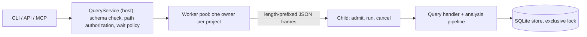
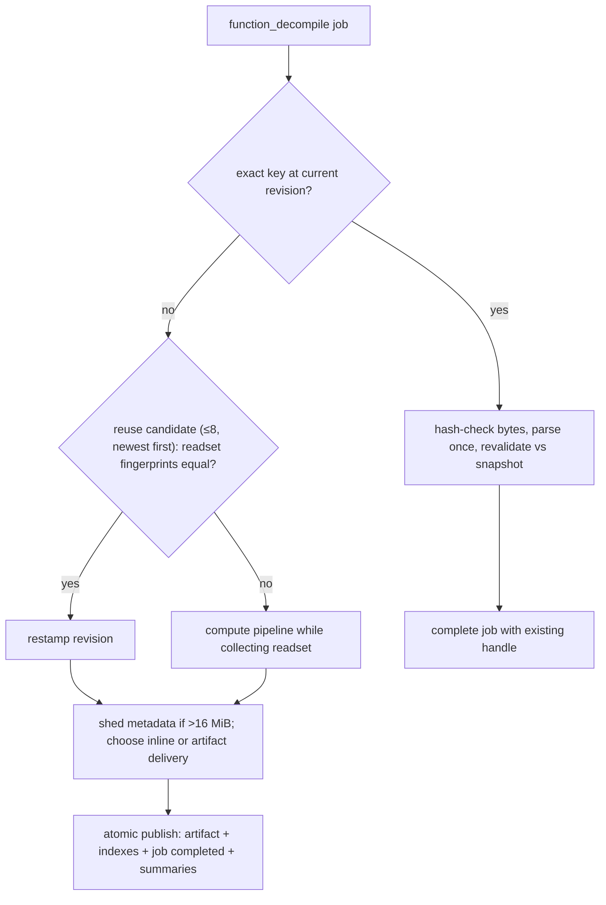

# Projects, Cache and Execution

The container around the analysis pipeline. A binary becomes a content-addressed SQLite _project_; every request becomes a durable _job_ run by one persistent child process per project; decompilation results are published as immutable _artifacts_ that later requests reuse only if they provably still hold. Owns persistence, cache validity, process model and work accounting; stages live on the other pages ([README](README.md)).

**Code:** `src/project/` (store, cache, annotations), `src/workers/`, `src/service/` (queries, analysis orchestration), `src/core/operation.ts`, `src/settings/`

## Data model

| Concept            | What it holds                                                                                                                                                                                                                                          |
| ------------------ | ------------------------------------------------------------------------------------------------------------------------------------------------------------------------------------------------------------------------------------------------------ |
| Project directory  | `<sha256>.<slice\|default>` under the cache root: `project.sqlite`, `images/<sha256>`, `artifacts/<id>`. Name = pure function of bytes + slice. Files immutable, hash-checked on read.                                                                 |
| Revision           | One global integer naming one complete, immutable view of all facts. Rows are "latest version ≤ revision". Advances only on image-import commit and committed mutations (annotation batches), never on artifact or job writes.                         |
| Native facts       | Loaded-image metadata ([loaders](loaders.md)), records (function, string, reference, symbol, import, export — [discovery](discovery.md)), evidence, and an explicit per-kind _index state_ (complete / partial / not started). Written at import only. |
| Annotations        | Versioned rows per ID; removal = tombstone with actor; retraction = status. Never promoted into facts. Subjects: durable entities, or a _trusted catalog_ taken from a published artifact at the exact revision.                                       |
| Job                | Durable state machine `queued → running → completed / cancelled / failed / stale`, with input revision, progress, diagnostics, artifact handles.                                                                                                       |
| Artifact           | One JSON payload (≤16 MiB): decompilation result + semantic catalog (subjects, types, proofs) + optional _readset_. Indexed by exact cache key, by a revision-free _reuse scope_, and by contained entity/proof IDs.                                   |
| Native summary     | Persisted prepared callee unit with its replay ledger; V8 clone + frozen-container list, zstd; 256 MiB cap per project (`unitStoreBytes`).                                                                                                             |
| `OperationContext` | Per-job work counter, monotonic deadline, abort signal, progress sink, and the `Budget` (instructions, blocks, IR nodes, work, deadline, output bytes).                                                                                                |

Entity IDs are content-derived and never renamed; project, job and artifact IDs are random.

## Algorithm

### 1. Import

1. Host hashes the input (regular file ≤512 MiB, no symlink, re-stat to catch changes); the hash names the project. Same bytes → same project.
2. Child re-reads the file, picks the loader by magic, writes `images/<sha>` atomically, commits revision +1.
3. Derived native facts (runtime metadata, name decoration, discovery, string/reference indexes, import-stub classification) are prepared **outside** SQLite; failure commits nothing derived.
4. One transaction writes facts, index states and the completed job → revision +1. A fresh project's first complete snapshot is revision 2.
5. Resume never replays an import; unfinished metadata reopens `partial`. Repair is an explicit resume-mode import of the same bytes and slice.

### 2. Job lifecycle

- Host validates, reserves a queue slot, authorizes paths, sends _admit_; child saves the `queued` job **before** acknowledging. With one request worker (the default) one job runs at a time per project; the child is single-threaded and its analysis synchronous. With `request_workers` N > 1 (§4b) up to N `function_decompile` jobs run at once in request workers while the owner runs one other job, and a mutation (import, annotations, discovery) starts only when nothing runs and every job admitted before it has started and finished, so jobs admitted after it wait for it.
- _Run_ re-checks the revision: import, mutations and decompilation need the _current_ revision (else `stale`); navigation reads accept any past revision.
- **Cancellation:** unstarted jobs are dropped. A running job cannot see a signal inside a synchronous pass, so the host kills the child (SIGTERM, then SIGKILL) and reopens the project; open terminalizes every non-terminal job — `cancelled` only if explicitly cancelled and the revision is unchanged, else `failed`. Nothing is retried.
- Deadlines: a host timer from submit plus an absolute deadline clamped into the child's context.
- Results are schema-validated in the child and bounded by `min(output_bytes, transport limit, 2 MiB frame)`; larger ones become artifact handles, paged at 512 KiB. Async clients poll the durable job; `wait: auto` returns the handle after 10 s.

### 3. Decompile cache decision

- **Exact key** = image hash, slice, full target, all component versions, revision, function, options (emitter, view, inference mode…), and the _whole request budget_. A hit still proves itself: bytes hash, identity, type/proof closure, emitter version, catalog trust.
- **Readset.** The pipeline runs on a proxy store recording every read at the working revision as selector + fingerprint: records, function frontiers, signatures, types, proofs, annotations, and _negative_ reads as whole record-scope version tokens (so "nothing here" stays valid). Closures run to a fixed point. Reuse replays the ledger at the new revision; first mismatch → miss. No readset → exact-revision only.
- **Ledger fingerprint.** A context-specialized native dependency's evidence names the fingerprint of the whole ledger at that point (`fingerprint({version: 1, complete: true, reads})`). The ledger is append-only and every `finish()` snapshot is a prefix of it, so `AnalysisDependencyCollector.readsetFingerprint` keeps a `LedgerHasher` (`src/core/identity.ts`: a running SHA-256 over the canonical prefix, each read in its own `canonicalIdentity`, copied to absorb the closing text) and hashes only the reads added since the previous call. A readset the collector did not `finish()`, or an older snapshot than the hashed prefix, is hashed in full; the digest is identical either way (`test/project/cache/dependencies.test.ts`).
- A reused result is **republished** at the new revision: the exact-key index, the annotation-catalog lookup (exact revision) and later hits all depend on it.
- Size shedding: readset first, then provenance classes (inferences, mappings, requirements), each recorded as `output_limit` partial coverage. Pseudocode text is never shed; if it alone exceeds the bound the job fails.
- `--no-analysis-cache` (trusted host setting) disables every derived read/write; charges stay identical; artifact delivery uses a memory-only transient artifact.

### 4. Callee-unit reuse

Decompiling prepares many callee bodies ([calls-abi](calls-abi.md#algorithm)), the dominant cold cost. Two tiers: in-process per loaded image (size-bounded LRU), then `native_summaries`. Key: revision, image, target, versions, ABI/lifter, supplied native types. Only units that hit no limit (`!budget_truncated && !limited`) and have a complete call analysis are kept (`retainablePreparation`); reasons that are facts of the body rather than limits, such as `unresolved control flow` from an indirect call, do not prevent retention, because the unit replays them identically under every allowance it is reused under. The request-local evidence set (`admit`) still cites only units without reasons, so evidence never depends on which units were retained. The stored row requires `budget_truncated: false` and `limited: false` and allows any reasons (summary format 7). A row is a _candidate_: digest, identity and a replay of its recorded dependency reads must pass. There is no size bound: a unit is stored unless its encoding fails the store's graph bound (128 MiB / 12 M nodes uncompressed) or exceeds 16 MiB compressed. Writes are deferred, batched and off the request path (flush points in §7); a write failure never fails a request.

A unit that is not kept leaves its preparation **prefix** in a second in-process LRU of the same tier (`prefixes`, bounded at 64k size units apart from the unit LRU, never persisted): the lift segment (lift with environment writers, `boundIR`, entry register prefix) and, when SSA completed within its limit, the SSA segment (construct, simplify, verify). Each segment carries the work it charged and its traced reads; the rules for replaying them are in §5 (prefix reuse). The graph is not part of the prefix: it is loaded on every preparation (see §5). The two LRUs are bounded apart on purpose: when prefixes shared the unit LRU they evicted retained units, which later requests then took from their persisted rows or prepared again, and 24 SQLite functions charged different work than the baseline (texts unchanged; measured on one lane run).

A persisted row is checked (trace verification, index creation) under the cancellation and deadline of the request that loads it (`NativeUnitPersistence.load(fn, context)`), never of the request that created the tier: that request may be cancelled or past its 30 s deadline by then, which once failed later requests with `Operation deadline exceeded` once prefix entries had evicted their units from the process tier (SQLite `isDate`, `fts3auxDisconnectMethod`).

- **Payload format (summary format 7).** `encodeStoredClone`: the V8 serializer over the row value plus the indexes of the containers that were frozen, frozen again on decode; then zstd level 3. It keeps `Map`, bigint, `undefined` fields, -0, NaN and shared substructure. Frozenness matters for work: IR verification memoizes only frozen register descriptors, so a decoded unit whose descriptors were not frozen charged a reused body different work than a fresh one (the former JSON graph codec, brotli `main` −1,776 in a second process). Measured on SQLite: loading a stored unit (decode, trace check, rebuild) costs 1.3 / 4.2 / 11.2 / 38.7 ms at sizes about 150 / 620 / 1.9k / 6.5k against 19 / 40 / 95 / 244 ms to prepare them; encoding costs about the same as decoding. A unit is mostly unique identifiers (IR values, evidence, traced reads): SQLite's 3.4k retained units take about 600 MB compressed, and dense generated arithmetic reaches the 128 MiB uncompressed graph bound near size 8k.
- **Byte cap (`unitStoreBytes`, CLI/MCP `--unit-store-mib`, default 256 MiB).** Past it the oldest revision, then the oldest write (`seq`), is evicted, in the write's transaction. Missing rows only cost preparation: output and work are identical.

### 4a. Open-time job

After `project_open` (CLI, MCP `project_open`, the odbench lane; the API runs it only with `openJob: {}`), the project's worker runs `runNativeOpenJob` (`native-open-job.ts`) over the revision the open left. It does **not** complete discovery: that would change the function index requests see (all 114 SQLite corpus functions changed work in a first version), and a request completes discovery itself when its selection needs it, after which the job's rows belong to an older revision and are dropped by the next write.

1. Functions of the index without a row of the current scope (`nativeSummaryFunctions`), callees first (`calleesFirst`: postorder of the direct-call graph, cycles broken at the back edge, then unreached functions; index order).
2. `copyProject`: queued summaries are written, then `VACUUM INTO` plus a clonefile copy of the image bytes; each helper process (`workers/units-entry.ts`; default half the cores, at most 8, at least 16 functions each) gets its own copy, so the project keeps one owner.
3. Batches of 8 functions. A helper prepares each unit through `nativeUnitLoader` exactly as a request's worklist load under the largest allowance such a load can receive (`nativeLoadAllowanceBound(10M)` = 937,500) and the default capacity. A retained unit is stored with its exact charge and reads; a unit that hits a limit keeps nothing but a marker row (allowance `MAX_SAFE_INTEGER`, never served) so a later open does not prepare it again. T6 prefixes are not kept (process-local). After each batch the helper writes its rows and reports their bytes.
4. The owner stops handing out batches when the job's work budget (default 1G) is spent, when the helpers wrote what the byte cap leaves room for, or on cancellation (its own `signal`, the open's signal, or the worker command `cancel_units`, acted on as it arrives: helpers are killed).
5. `importNativeSummaries(copies, scope, order)`: one candidate per function (the smallest allowance any copy holds), digest re-checked; a present row the import cannot improve stays; candidates are taken callees first while they fit the cap and written in reverse order, so eviction (oldest write first) drops callers before the callees many functions share. Cancelled or failed jobs import nothing.

The job never fails the open: every outcome is a report (`completed`, `limited`, `cancelled`, `failed`, `skipped`) with its time, work, helper count, prepared/retained/stored counts and bytes (`session.openJob`, odbench `open_job_ms` / `open_job_work`). It is skipped when nothing is pending, when analysis caching is off, or when less than a sixteenth of the cap is free (a capped store stays nearly full: requests' rows replace the oldest). Reuse is the request path's (§4): exact charge replay, only when the load's allowance is at least the row's and the replayed charge fits, so texts and per-request work are identical whether the job ran, ran partly or did not run (`request-determinism.test.ts`).

**API default.** `openBinary` runs the job only with `openJob: {}`: it starts helper processes and spends CPU (SQLite: 6 helpers, 3,531 functions, 719M work, about 25 s uncapped) that a library caller did not ask for, and test suites open many small projects. The CLI, MCP servers and the odbench lane pass it explicitly (`--no-open-job` turns it off).

**Cap choice (SQLite, 114 corpus functions, one process: open with the job, then every decompile; built `dist/`, 6 helpers).**

| Cap      | Job ms | Job work | Units kept | `decompile_ms_total` |
| -------- | -----: | -------: | ---------: | -------------------: |
| no job   |      0 |        0 |          0 | 87.6 / 83.8 / 84.5 s |
| 64 MiB   |  3,840 |      88M |        396 |               84.6 s |
| 128 MiB  |  6,244 |     170M |        781 |        82.6 / 85.1 s |
| 256 MiB  | 10,778 |     327M |      1,558 |               81.7 s |
| 512 MiB  | 20,113 |     646M |      3,135 |               80.4 s |
| uncapped | 24,692 |     719M |      3,531 |               81.6 s |

Every run charged exactly the baseline lane's per-function work. The first no-job run started at load average 11 (the others 2-4). The gain within one process is small (about 2-4 s of about 84 s). Counted in the request process (temporary instrumentation of `nativeUnitLoader`, one run each): without the job, 610 preparations took 21.3 s and 52 persisted loads 0.5 s; with the whole image stored, 548 loads took 4.0 s and 168 preparations still took 15.0 s. The job removes the cheap preparations (about 14 ms each, where loading costs about 7 ms); the expensive ones remain: units cut by a limit (never stored; marker rows) and rows a load rejects because its allowance is below the row's or the replayed charge does not fit. The process tier already serves every repeated callee after its first preparation. The store pays off across processes (later opens, `export --jobs`, T9's parallel workers). 256 MiB keeps the gain of the whole set at 40% of the job's time and storage.

**Store/worker contract (for parallel request workers).** Rows are keyed by `nativeSummaryScope(preparedUnitIdentity(input))`, so they belong to one revision and component set. One process owns the project database and is its only writer; helpers work on private copies and their rows come back only through `importNativeSummaries`. A stored unit is reused through `nativeUnitLoader` only under the request-path rules above, so request work does not depend on which process prepared it. Marker rows are never served as units; any stored unit replaces a marker.

### 4b. Request workers

`openBinary({ requestWorkers: N })` (`WorkerPoolOptions.request_workers`, the owner's `open` command; CLI `export --jobs N`, odbench `--jobs N`) gives the project's owner N request worker processes (`workers/request-pool.ts`, `request-worker.ts`, entry `request-entry.ts`). They analyse `function_decompile` jobs in parallel; everything else stays in the owner.

1. **Snapshot.** At the end of the open-time job, or at the first pooled job, the owner writes queued summaries, checkpoints its write-ahead log and clones `project.sqlite` (`snapshotDatabase`; copy-on-write, no `VACUUM`). Every worker opens that one file read-only and without locking (`SqliteProjectStore.openSnapshot`, SQLite `immutable=1`), and reads images and artifacts from the owner's project directory (immutable, content-checked files). The unit store and the image indexes are therefore shared read-only; each worker still decodes the image and keeps its own in-process tiers. A job of a newer revision (after discovery or annotations) starts a new generation over a new snapshot; the old workers stop after their current job.
2. **Run.** The owner saves the job `running` exactly as before and hands the worker the job, the request and its absolute deadline. The worker runs the same `executeRequest` as the owner (context, handler, release of queued summaries, result validation) against a `RequestStore`: reads come from the snapshot; the request's job saves and publications (`publishArtifact`, `publishTransientArtifact`) are held with the same checks the owner's store makes; summaries go to the worker's private outbox database.
3. **Publish.** The worker returns the result, its last job state and its publications (artifact bytes and analysis index in files of its outbox directory). The owner, still the only writer, repeats each publication in the project under the artifact identity the result already carries (`artifact_id`), then saves the terminal job, in its command order. A publication the project refuses (the revision moved on, the job was cancelled) fails the job exactly as it would have failed in the owner. Publication order does not change artifacts: each is the content of one request.
4. **Close.** Closing the project asks each worker to write its outbox, imports the outboxes (`importNativeSummaries(outboxes, null, [])`: every scope at the current revision, digest re-checked, within the cap) and removes the snapshot. A worker whose owner dies exits when its stdin closes (the owner kills its workers on `SIGTERM`).

**Determinism.** A worker is a fresh process with its own history, so the guarantee is the T2 one: a request's text and work do not depend on what its process served before. `request-determinism.test.ts` decompiles every function of its fixture at three budgets with one and with four workers (identical texts and work), and `export.test.ts` writes byte-identical files with `--jobs 1` and `--jobs 4` (fresh caches). One history dependence surfaced and is fixed: a cached callee graph (`graphs.ts`) charged its recorded work in one charge even where that charge did not fit the remaining allowance, where a fresh build charges part of it before failing; it is now reused only where the charge fits (a fresh build then cannot fail either), so `root` at work 100k charges 69,637 cold and after `mid_three` (was 69,594 after it). **Measured (full tier, idle host, load 5.2 → 4.9):** `--jobs 4` against `--jobs 1`: 237/237 texts and states identical, per-function work identical for 236/237; `sqlite3-arm64/jsonTranslateTextToBlob` charges 6,674,484 with four workers and 6,675,115 with one (the one-worker value equals `od-main-54c36fa`). The four-worker value is the function's cold value (a fresh process decompiling only it); the one-worker lane charges 631 more because `jsonConvertTextToBlob` (`0x100089f80`, earlier in corpus order) ran before it in the same process (bisected). The units that request prepared are reused there with replayed charges, and the remaining difference sits in the reuse/prefix replay of the native worklist (open: a residual T2/T6 history dependence, not caused by the pool). Speed: SQLite decompile after open 37.0 s (one worker 81.4 s; Ghidra 38.7 s, 0.96×), first 10 SQLite functions 4.58 s (7.01 s), brotli 3.2 s (5.0 s; Ghidra 3.9 s), all binaries 48.5 s (95.5 s; Ghidra 86.7 s, 0.56×).

### 5. Budgets and deterministic work accounting

- Work is a count, not time; one cumulative counter, never reset by a pass. The deadline is the only wall-clock limit (sampled every 32 charges).
- **Hard stages** (lift, [SSA](ssa-values.md#algorithm), values, types, structuring, emission) fail the job with `resource_limit`; nothing is published. **Optional stages** (native dependency worklist, image-type merge, likely-mode votes, optional validation) get sub-budgets — a fraction of the work _remaining_ when they start — and degrade to `partial` with a diagnostic. The callee-summary pool and the image-type merge never take the selected body's tail reserve (300 work per IR node, `optionalWorkPool`); a render that cannot pay full metadata plus its text-only replacement prints the text first (omissions with reason `budget`, see [structuring-emission](structuring-emission.md)).
- **Catalog bounds** (`boundedEvidence`, `src/service/analysis/catalog.ts`): more than 10,000 published proofs or a catalog type citing more than 1,000 no longer fail the job. Required proofs (diagnostics, annotations, signature) close first, then the emission's proof table whole (else its metadata classes are shed), then type citations in order while their closures fit; the rest are dropped, counted in an `evidence` omission (`output_limit`), and every published record still cites only published proofs.
- **Invariant:** a request's charged work, its readset and every remaining-budget decision must not depend on process history. Three mechanisms:
  1. _Per-process image indexes_ (discovery index, record materialization, call/symbol/data/ObjC indexes) are built once per process uncharged; the measured cost is stored on the result and every operation using it pays that cost once on the **root** context (never a sub-budget wrapper). Built or found built → same work. An operation that finds the native record materialization built makes the record-scope reads its build made (`rereadScopes`, `src/service/queries/scope.ts`), so it records the same reads with the same capture charges.
  2. _Cached work results_ (function graphs, prepared units) replay the exact recorded charge and dependency reads; a unit is reused only if the remaining allowance is at least the minimum under which preparing it provably returns the same unit.
  3. _Identities are content-derived._ The context type/evidence scope of native dependencies is a fingerprint of image bytes, slice, revision and supplied native types, never of the random project ID (which made context evidence IDs, and with them the emitter's reference interning and work, differ between two projects of the same binary).
- **Charge-exact unit reuse** (`nativeUnitLoader`, `prepareNativeUnit`). Every work limit inside a unit preparation is set from the worklist allowance A remaining when it is set: SSA takes 3/4, optional type/stack work 1/4 of what then remains, nested analyses are bounded by what their enclosing limit has left, and the variadic footprint stage sees no remaining-work figure (its structuring and validation allowances are fixed). Limits only stop work, and every stop sets `PreparedNativeUnit.limited`, also where a nested pass turns the limit into a partial result (structuring inside the footprint). A unit that is not `limited` and charged W under A is therefore the same unit, with the same charge W and the same reads in the same order, under every allowance ≥ min(A, 4W + 3) and every capacity it fits; that minimum is the entry's `allowance`. A load reuses an entry only when its allowance is at least that and the replayed charge (W on the load's context, then the reads not yet captured with their capture charges) fits every enclosing allowance. A `limited` unit is a function of its allowance: it is prepared afresh on every load (from its memoized prefix where that is exact, below) and never closes an argument list (a cut footprint can hide a `...`). Build payments of per-process indexes are not part of W: they are charged on the root, and a request's selected body has paid every index a preparation uses before its worklist runs. Measured on one instrumented SQLite lane run (2,343 loads: 1,186 preparations, 105 of them `limited`, and 1,157 reuses): every unit that is not `limited` charged one amount across all its preparations and reuses.
- **Prefix reuse** (`prepareNativePrefix`, `loadNativeGraph`, `liftNativeUnit`, `nativeSSA`). Preparation splits after SSA. The graph is always loaded afresh: a graph found in the graph cache skips the root payments of the per-process indexes its discovery uses (`imageDataIndex` in jump-table proofs), so replaying graph loads made 50 of 114 SQLite functions on one lane run charge 4–9k less than the baseline, in requests where no other preparation paid that index (measured). The lift sets no limit from the allowance; the SSA limit is `nativeSSALimit`, 3/4 of what remains after the lift. A completed SSA with work W returns the same IR, work and reads under every SSA limit ≥ W (limits only stop work, `src/analysis/ssa/budget.ts`); an SSA that hit its limit keeps only the lift. A load replays each recorded segment (its reads with `replayTrace`, then its work on the worklist context) only when running it could not have failed or differed: the freshly loaded graph is untruncated with the recorded instruction and block counts, the lifted and SSA blocks and peak nodes stay under the capacity (as for a unit), the charge fits every enclosing allowance (`fits`), and for SSA the limit preparing would set now, after the lift, is ≥ W. Otherwise that segment runs for real. The allowance-dependent rest (types/stack, call analysis, variadic footprint, indexes, dependencies) always runs. So a prefix hit charges, reads and returns exactly what a cold preparation would (`test/service/analysis/native-unit-reuse.test.ts`: equal unit, work and reads under SSA limits above and below the recorded SSA work, for an SSA that completed and one that hit its limit); a unit's retention and `allowance` come from its whole charge, as before.
- Effect: serial, parallel and restarted runs give identical output and per-function work (request order once changed struct names; two odbench runs once differed in about 22 SQLite functions).

### 6. Annotation commit

Check `expected_revision` → validate edits against the snapshot (subjects, evidence, types, ABI) → derive assertion evidence → one synchronous transaction commits annotations, evidence and completed job; the response is validated in the commit hook, so failure rolls everything back. Stale → `stale_revision`; no merge, no retry.

### 7. Durability and flush points

What is durable when, in the order a decompile request meets it:

| Point                                                 | Durable how                                                                                                                                                  | Acknowledged before?                 |
| ----------------------------------------------------- | ------------------------------------------------------------------------------------------------------------------------------------------------------------ | ------------------------------------ |
| Admission (`queued` job)                              | SQLite commit, `synchronous=FULL`                                                                                                                            | yes: the child acknowledges after it |
| Publication (artifact file, indexes, `completed` job) | Artifact file `fsync` then rename, then one `synchronous=FULL` commit of the rows and the job                                                                | yes: the response is sent after it   |
| Native callee summaries                               | Queued in memory; written in a separate transaction at `synchronous=NORMAL` (no fsync; WAL frames reach disk with the next full commit, checkpoint or close) | no: derived data                     |

- **Flush points of summaries.** (1) Idle: the worker schedules a write 200 ms after its last command finished (cancelled by the next command; 8 rows per slice, so a command arriving meanwhile waits for one slice, and a slice is skipped while a command is pending). (2) Queue bound: when the queued rows' reported retained size exceeds 65,536 (a quarter of the process tier's bound; larger bounds kept about 0.5 GB more resident in a SQLite run) the queueing call flushes. (3) Close. Nothing flushes in a request's commit or before its response. A request's rows become readable at its end (`releaseNativeSummaries`), served from the queue exactly as the written row would be.
- **Crash after acknowledge.** Killing the child (SIGKILL) after a response loses only queued, unwritten summaries: the job is `completed`, its artifact is readable and hash-valid, the database passes `integrity_check`, and a later request prepares the missing units again (`test/project/store/native-summaries.test.ts`, `test/workers/lifecycle.test.ts`). An OS crash can additionally lose summary rows written at NORMAL since the last full commit; every row is digest-checked on use.
- **What is not deferred, and why.** The artifact `fsync` and the `FULL` commit of publication stay on the request path (measured about 6 ms and 7 ms per publication, under 1% of a SQLite decompile). The completed job is job state: "durable before acknowledged" covers it, and deferring either would let an acknowledged result, handle or `completed` job vanish after a power loss. Only data a request can recompute is deferred.

## Design decisions

- **Trust split.** Host never deserializes target bytes; the child accepts no SQL, module names or target-derived paths. Fault containment, not a sandbox.
- **Immutable snapshots.** Old reads stay valid; mutations are compare-and-swap on the global counter; one exclusive writer per project.
- **Durable before acknowledged.** A lost connection leaves an inspectable job, not an orphan; the job row is authoritative. Job state (admission and publication) is fsynced before its acknowledgement; only derived caches are written later (§7).
- **Existence is not authority.** Artifacts, summaries and candidates are verified (hash, identity, readset) on every use; damage → recompute or `invalid_input`.
- **Budget in the key.** Sub-budget decisions make small-budget and large-budget results differ.
- **Refusal over guessing:** no stale-batch merge, no retry of interrupted mutations; settings (flag/option/request > file > default) are never read implicitly and an invalid file is an error.

## Limits and improvement levers

- **Coarse cache key.** All six budget fields, incl. `deadline_ms` and `output_bytes`, are in key and reuse scope; changing any recomputes. [inference] Only work-affecting fields need to key results; output size is delivery-only. Lever: key construction.
- **Every annotation commit costs the cache.** The revision bump kills exact hits; each function then needs readset replay plus a full republish (≤16 MiB); only 8 candidates are tried; any unscoped annotation read pins the broad "all annotations" selector. Prepared units are keyed by revision (their evidence IDs embed it), so **no** unit survives a commit: the first decompile after an edit is cold. Levers: revision-free native evidence; finer annotation selectors.
- **Cold cost is per process.** Image indexes, image decode and module load repeat per CLI process (~0.4 s fixed, `PERFORMANCE.md`); units past the byte cap and units cut by a limit stay cold.
- **Concurrency ceilings.** One owner (the only writer) per project; pool default 2 projects, queue 16. A second process on the same project fails after ~1 s lock wait. With `request_workers` N (§4b) up to N decompiles run at once, the owner runs one other job meanwhile and a mutation runs alone. **Memory budget per request worker:** about a one-worker owner's analysis memory, because each worker decodes the image and keeps its own prepared-unit and graph tiers (full tier, `--jobs 4`, peak RSS: SQLite request workers 1.36–2.11 GB, owner 0.72 GB, bench host 0.52 GB; brotli request workers 0.50–0.74 GB). Plan owner + N × 2.1 GB on SQLite-size images (N = 4: about 9 GB, besides the open-time job's helpers, about 1.1–1.3 GB each, which exit before decompiles start). Export and odbench default to N = min(4, cores/2).
- **Cancellation is a process kill;** every in-process cache dies with it. [inference] A queued job whose deadline expires (timer includes queue wait) also restarts the child and fails jobs in flight.
- **Hard-limit failures are all-or-nothing.** Brotli `main` (9.24 M), SQLite `whereLoopAddBtreeIndex` (9.45 M) and `sqlite3Fts3Incrmerge` (9.87 M) sit under the 10 M default (docs/PERFORMANCE.md, "Roadmap 3: round result"); beyond it, no partial output. Levers: more degradable stages, per-stage budgets (TODO.md C3).
- **No retention.** Artifacts, historical rows and jobs are never pruned; open scans every job; every call, even navigation, writes job rows.
- **Dead schema.** `types`, `signatures`, `lineage` tables have readers, no production writer; recovered types live only in artifacts.
- **Open trust items:** foreign project directory trust check, stdio cancellation cleanup, poisoned-cache cases beyond digest-checked summaries and artifact bytes.
