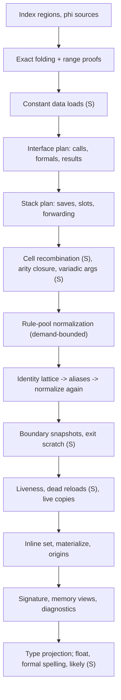

# Source reconstruction

Turns one structured, immutable SSA function plus recovered types and native source evidence into a source-shaped model: which values are live and which print inline, what each call/return means as a C interface, which stack slots become locals, and under which proof or assumption each rewrite was applied. Runs after [structuring](structuring-emission.md#algorithm), before text emission; never restructures the CFG or mutates the IR. It reads only the first layout's blocks, transfers and loop membership (the FP-guard rewrite checks guard ownership on the CFG), so the source view's provisional first layout and its second structuring with block contents (G2, `restructure` in the renderer) see the same reconstruction. The renderer's variable decisions (cross-statement inlining, coalescing, names) are covered here too; control layout and printing belong to [structuring & emission](structuring-emission.md).

**Code:** `src/reconstruction/`, `src/emitters/source-inlining.ts`, `src/emitters/source-control.ts` (variable partition)

## Data model

- **Input** (`EmissionInput`): region tree of SSA blocks with parallel-copy transfers ([SSA](ssa-values.md#data-model)), `TypeRecoveryResult` ([types](types-metadata.md#data-model)), and for native code `SourceEvidence`: ABI profile, observed/proven callee interfaces, address facts, caller result demands, variadic signatures, opt-in likely guesses ([calls](calls-abi.md#data-model)). Without evidence only declared-or-physical boundary projection runs (no source plan).
- **`Reconstruction`**: a view keyed by original SSA ids.
  - rewritten pure definitions (operands stay original ids);
  - demand: live values, retained statements, use counts, live edge copies (no copy into a forced-inline alias or into a proven stack-address phi: that phi prints as its frame address and every incoming value has the same offset);
  - inline set: definitions the renderer may expand;
  - origins: each original statement → the printed statement that consumes it;
  - boundary projections per call/return/tail: `source` (declared), `inferred` (observed) or `physical` (registers), with argument-list completeness, out-of-line exit scratch, likely-arity mark;
  - memory field views, diagnostics, validation session.
- **`SourcePresentation`** (syntax-neutral): formals and names, return type(s), value/formal/local types, float spellings, promoted locals, frame saves, forwarded reloads, void-like result, requirements, likely guesses, synthesized definitions.
- **Synthesized values** get deterministic `entity_<fingerprint>` ids; an alias is a forced-inline bitcast definition. No original identity is replaced.
- **Evidence ledger**: `LocalValidationSession` holds verified/unverified/rejected records, vetoed values, proof allowance and ABI assumptions; published as `emission.local_validation` and `emission.requirements`.

## Algorithm

One linear function (`reconstruct`) over shared maps; order fixed and visible.

(S) = source view only.

1. **Index**: worklist over regions records ownership, defined values and each block parameter's incoming sources. Duplicate ownership is `invalid_input`; sizes are charged to the budget.
2. **Exact folding** (both views): identity bitcasts, neutral operands, compare-from-subtract; `x-x`, `x*0`, `x^x` refused (would erase a possibly-unknown operand). With native evidence, interval analysis proves upper concat lanes zero so concats narrow.
3. **Constant data** (S): aligned loads from immutable, relocation-free bytes become literals.
4. **Interface plan**: each call resolves by strength — variadic format signature (S) → identical established contracts → one ABI-matching declaration → inferred callee → physical. Binding requires cells that tile a location exactly; gaps/overlaps refuse. Entry formals: ABI-classify a synthetic call with 16 integer + 16 double parameters; a candidate is a formal only if the entry binds it and it stays live. A complete declaration replaces inferred formals and suppresses result heuristics. Declarations with stack, variadic or hidden-result parameters (S9, S only, `planSource(…, extended)`): the function's own declaration also resolves structures of known size and alignment to ABI aggregates; its named layout is classified as a call with no anonymous argument (`argument_list_complete`). A scalar stack parameter of its slot's exact size becomes a declared value bound only through `incomingStack` (S1 binds the slot's loads to it); at most one by-value aggregate in a stack slot becomes the incoming object's formal (`incomingObject(offset, end)` returns it when the object starts at its slot and every kept byte lies inside it); a hidden result pointer register binds at entry as the first formal `result` (`SourcePresentation.hidden_result`: the renderer spells it and, when the ABI returns it in rax, the result as a pointer to the declared result type, otherwise `void`); a declared `...` needs each named formal in one register or one stack slot and fixes the first anonymous offset (Win64 `8 + 8n`, else the 8-aligned end of the named stack arguments) that `variadic.area`/`variadic.list(named, overflow)` must see, and `variadic.named` must report exactly the declared named registers. `declaredExtension` lists these parts; `reconstruct` replans the whole function without them (`extended` false, today's output and signature drop) when the stack plan found no `va_start` footprint for a declared `...`, when the entry SP stays live other than as the declared `...`'s `va`, or when the `declared_signature` record is refused. Results: observed written results → primary-result choice (defined on every exit; caller demand, then last-written carrier; an untyped FP carrier holding only a vector copy/fill temporary — the datum of a ≥128-bit store, a constant its defining instruction shares with such a datum, or a call result left in place — is `incidental_result` and leaves the integer carrier to decide; otherwise an untyped FP carrier written after the integer carrier on every exit path whose leaves are consumed only by exits, with literal-zero cells above one 32/64-bit scalar write on every non-literal exit, is the `float`/`double` result under the "scalar FP-bank result is IEEE" premise) → typed FP slice → changed low cell. Without a declaration, integer exits are harmonized to the widest exit width W, decided from all exits first; a narrower exit is zero-extended, except (S) an exit bound from the integer return location whose remaining changed return-root cells tile exactly bits [narrow, W): it binds the whole location at W (`concat` of its cells, `exit_result_width` record) and drops those overlays, so step 6 sees a joint read of the join phi. Likely mode only marks an arity guess; analysis keeps the list open ([calls](calls-abi.md#algorithm)).
5. **Stack plan**: affine fixpoint gives entry-SP offsets; taint follows expressions, phis, memory. Escapes give a _reach floor_: in S, bytes at or above the lowest escaped offset stay memory and slots wholly below are classified per slot; unknown effects keep the whole frame. The _incoming floor_ (`incomingFloor`, S only) is the lowest floor of exposures that can designate incoming bytes: a known base ≥ 0 (mixed-sign phis and reloads included), an unknown base or a floor ≥ 0; call arguments, open-call argument registers, stored and returned addresses and the addresses of indexed/dynamic accesses all count. An ABI word parameter slot that is only loaded, exact, nonvolatile, unoverlapped and wholly below it (or with no such exposure) binds as the incoming formal (`incoming_formal`, ABI premise `incoming_arguments_private`: callers, callees, globals, unknown stores and loaded or returned pointers never designate this activation's incoming area), regardless of open calls and stores through unknown pointers; C keeps the whole-function gates (no escape, no unknown store, clear snapshot alias flags). Classes: frame save, return-address push, incoming stack formal, private local, explicit memory. Private slots either _forward_ (each load becomes its reaching stored value, a bit range, or concatenated pieces; accesses vanish), become one scalar local (type puns convert by exact reinterpretation), or stay memory. Possible open-call argument slots keep stores but may forward reloads. Each promotion passes the byte-path validator (definite initialization on bounded acyclic paths). In S, explicit memory below the entry SP is one _frame object_ (`frameLayout`): a struct ending at the entry SP, starting stack-aligned, with one scalar member per exact (offset, width) access set (a group of overlapping accesses whose narrowest intervals are disjoint scalars, that no wider access cuts and whose every wider access is a transport access (`transport(node)`: a load used only as store datum, directly or through bitcast/extract/concat, or a store of a constant or load result; register bindings of loads and stores are not uses) keeps them as scalar members with byte-array padding members over the uncovered bytes of its span: the wide access is a cast at the member holding its first byte and is in no member's `access_ids`; an address taken inside the span at a non-member start or an indexed base inside it keeps one byte array) and byte arrays where other accesses overlap, an address points inside a member or an indexed base starts (with the accesses continuing it without a gap); taken addresses in gaps start byte arrays, padding fills the rest. Accesses print `frame.local_38`, `*(T *)&frame.local_1ac[4]`, `(uint8_t *)&frame + k`; no access is forwarded, removed or reordered. Only a live address at or above the entry SP (incoming arguments, return address) keeps `entry_sp`; an escaped frame then records the `frame_object` ABI premise (frame addresses stay inside the frame; outside pointers never designate it). The plan keeps two address maps. The analysis map (every value with a stack fact, reloads included) drives taint, escape, floors and slot classes. In S the presentation map, returned as `addresses` (→ `source.stack_addresses`, liveness, inline set, frame extent and taken addresses), drops the results of loads that stay in the program (not hidden) and every value computed from them: such a reload prints through its declared variable, and a stored address ≥ 0 itself requires `entry_sp`. C presents the analysis map. The renderer's `assignmentText` assigns only a variable the declaration pass declared (`declaredVariable`): otherwise a pure definition prints nothing and a load is a bare read. When the entry SP is live, `frame()` lays the object out from the retained accesses with `end ≤ 0` and the live negative addresses and stores the entry SP in the object's `entry` (`frame_object_beside_entry_sp`; an escaped frame adds the `frame_object` premise that arithmetic on an address ≥ 0 never reaches the object); the renderer prints offsets ≥ 0 as `entry_sp + k` and negative ones through `frame.*`, and `validate.ts` admits retained accesses ≥ 0 only beside a set `entry`. An access spanning the entry SP or an empty layout keeps the whole frame in entry-SP form.
   Incoming object (S only, S4): when there is no incoming floor and no unbounded escape, and every non-hidden access ending above the first incoming byte (`stack_return_address_bytes`) starts at or above it, the planner's `incomingObject(offset)` creates one source-only formal (inferred interfaces only; pointer-width carrier, `parameter_names` `stack_args`, `formal_stack_offsets` at the first incoming byte), recorded by the `incoming_object` presentation. Presented addresses at or above that byte require it instead of `entry_sp` (`requiresIncoming`; `requiresEntry` excludes them), `frame()` omits their accesses and addresses, and `incomingStorage(retained, live)` lays the object out with `frameLayout(…, 'above')` (starts at the first incoming byte, ends at its last member; a taken address above every member starts a byte array to the next stack-alignment boundary) and records the `incoming_object` ABI premise. `finalize` appends it after the ABI formals and before the entry SP; `validate.ts` checks the live formal, ordered members, and that retained incoming accesses lie inside it. The renderer resolves both objects through `stackObject(offset)` (incoming object from its start up, frame object below the entry SP) and spells the struct (C preamble `struct stack_args_XXXX { … };`, Python-like `struct{…}` annotation).
   Variadic area (S6, `classifyVariadicArea` in `source-variadic.ts`, after the incoming-formal and argument-slot passes): `expose()` also records the floors of exposures whose bases are all known and ≥ 0; when one equals the incoming floor `a`, every access below `a` is a bound incoming formal (or the return-address load), and the ABI footprint holds (Darwin: `a` = 0 or the end of contiguous named stack formals; Win64: `a = 8 + 8n`, one entry-block home store per anonymous integer register before any call or home-area access, no other use of the anonymous positions' argument bits by a backward closure from effects, control, call/tail arguments, projected results and non-pass-through exits), the planner's `variadic.area(offset, named)` makes the source-only `va` value. It replaces `entryStack()` as `entryStorage` (the SP binding aliases `va - a`), so `requiresEntry`, liveness and `frame()` (`entry` = `va`) work unchanged; the home stores join `hidden` (`va_start` record, `variadic_convention` premise). `SourcePresentation.variadic = { area, offset }` drives the renderer: `...` after the formals, `va_list va; va_start(va, last);` after the declarations, `va` printed as `(uintptr_t)va`, and stack addresses rebased by `offset`; `validate.ts` accepts `va` as a defined entry base. `finalize` puts the Win64 named-position formals first even when dead. S7 reuses `variadic.area`, `SourcePresentation.variadic` and the renderer's `...`/`va_start` plumbing.
   SysV `va_start` (S7, `classifySysvVaStart`, after the frame-object decision): gated on a complete stack fact set and no frame exposure of unknown origin (`frameExposed`, not `reachAll`: split 32-bit register cells of a stepped overflow pointer leave its floor unbounded); the footprint stores join `hidden`, `SourceVariadic` takes the `va_list` variant (`offset`, `anchor`, `guard`), `frame()` reserves the 24-byte member `va` in `frameLayout` (every member over those bytes merges into it) and drops taken and indexed offsets inside the register save area; `reconstruct` and `validate-uses` skip the guard's condition; the planner's `variadic.list(named)` hook puts the named formals first. `entryRegisterUses` (shared with S6) treats an exit binding that still holds its own entry bits on some path (through phis and slices) as no use.
   Fixed prefix of a variadic library contract (K3, `source-planner.ts` after the complete-contract branch): source view, an established non-conflicting contract with `variadic` that no format/open-flags rule closed binds each fixed parameter through `bind` at its ABI register location (`classifyCall` with the list open), kind `inferred`, `argument_list_complete: false`, no result (the declared result stays unbound so a void caller keeps its void-like exit); `library_fixed_prefix` presentation + `abi_conformance`. `observePreparedCallInterfaces` still skips established calls, so no `InferredCallee` exists for them.
   Variadic callers (S8): an inferred callee with `variadic` (published by its native unit from the same S6/S7 classification) binds through `createVariadicCallBinder` instead of `observedArguments`, in calls and direct tails: the named prefix exactly, then the anonymous locations `createRegisterWrites` proves written for the transfer (SysV integer prefix and `al`-bounded vector registers; Win64 positions, FP-duplicated ones as the double), kind `inferred`, list open, never closed by `callee_reads` or a likely guess; `variadic_call_arguments` + `variadic_call_convention`. Darwin anonymous stack slots stay with `planVariadicStackArguments`, which also accepts `variadic` callees, starts after the named stack bytes, ignores stack addresses in registers outside the callee's named prefix, requires no written integer argument register beyond that prefix, and accepts an unknown-initialization slot value only with no barrier between its store and the call. A boundary whose SP is an exact entry-SP offset at or above a slot's end (a tail call after the epilogue) never sees that slot (K1, under the recorded `darwin_variadic_stack_arguments` premise). A slot merged at the call block's entry (written on several branches) binds when every incoming edge's predecessor block holds one eligible store of one common size and type that owns the slot at its exit, the call block writes and calls nothing before the call, and no other boundary or load sees the slot: the argument is the value `sourceStackArgumentParts`' join proof finds (one dominating value or an existing block parameter), else a source-only block parameter (`variadic-join:<call>:<offset>`) that each edge assigns its stored value through the ordinary transfer copies (`StackJoinStorage`); every store is consumed and `variadic_stack_join` names the stores and predecessor exits.
   Frame saves are qualified by `frameSaveQualifier` against an explicit exit list (returns, discovery tail calls and accepted indirect tails). Before that, `classifyIndirectTails` (S, `source-tails.ts`) turns an unresolved indirect exit into a tail call of its runtime target when its SP is the entry SP, the target's expression cone (≤128 values, loads are leaves) has a non-constant leaf and no value that is a code address of an executable mapping, no frame address escapes, and the return location holds the entry return address: the link register is its entry value or a reload of a slot that qualifies as a frame save with this exit included (records `abi_conformance`), or, with a pushed return address, no store reaches those bytes and no store has an unknown address. The exit gets an `indirect_tail_call` record and a `TailProjection` with `target: null`, the target value and the observed argument-register prefix (`observePreparedTailInterfaces`, open list); a switch-like or unproven exit keeps `indirect_exit`.
   Escaped slots and the save area (A3, S only, in `frame()` after `frameLayout`; no unbounded escape, no live entry SP): `expose()` records each bounded floor in `escapeFloors`, marked exact when the floor is the exposure's only base. When `saveBytes` tile `[lowest save, 0)` and no retained access, live address, indexed base, escape floor or `va` lies there, `frameLayout(…, top)` ends the object at that slot (gap arrays run to it; `frame_object_save_area` + `frame_save`). `escapedSlots` gives each floor below `top` a reach to the lowest save byte above it (exact floors) or to `top`, merges overlapping reaches, and marks a member `independent` (entity id `source-frame-local`) when it equals a merged reach, no `below` access crosses its bounds and no indexed base or escape floor lies inside it except at its start (`escaped_slot_object` + `frame_object_base`, plus `frame_save` when the reach ends at a save); the object is then re-spanned over the remaining members and reaches (aligned like `frameLayout`; size 0 with no member left). The renderer declares independent members as plain locals (`frameLocal`), spells their accesses and addresses without the struct (`StackObjectView.member`), omits the struct when every member is independent, and pads the struct to `minimum_offset + size`; `validate.ts` accepts accesses inside independent members and an object end at or below the entry SP.
6. **Cell recombination** (S): phi groups whose register cells move together become one whole value. A group whose cells are constants on every edge becomes one whole-width parameter with one constant per edge; each constant is proved by exact evaluation of the cells (`validateConstantCells`), and source-fact discovery offers the whole constants as candidate addresses so symbol naming applies. Range-folded constant cells count as cells of the group: beside all-constant edges, or beside an edge carrying a wider value (`value`/`group`, with `zero_extend` and carried-group edges allowed) whose slice for each folded cell is non-constant (the interval proof) or the folded constant itself; unknown and instruction-output edges keep a folded group split. An edge whose cells are the unprojected register outputs of one call or unknown effect (cells without a definition, tiling the root) is an `outputs` edge: `plan.outputs` gives the instruction one whole output of the root (`SourcePresentation.register_outputs`, read through `registerOutputs()` by validators, renderer origins, boundary tuples, `source-control`, demand roots and exit-scratch tracing; a source call's projection lists it too) and the cells become slices of it. Adjacent cells of one such instruction read by a concat outside any phi get the same whole output. Bound results are definitions (planner aliases), so they never form an `outputs` edge.
7. **Normalization**: worklist fixpoint over definitions inside a conservative demand closure. Operands resolve through identity chains; the ordered rule pool (`EXPRESSION_RULES`) is tried and the _first_ match wins; the site is revisited, ≤32 rewrites per value. Priority: condition flags (truth-table enumeration → `&&`/`||` relations), cell/bit-slice recombination, constant folding, cast wiring, packing shifts, strength-reduced multiply, magic division/remainder/narrowing, slice narrowing, joins, shift/rotate idioms, compare canonicalization, integer identities, extension folding. Checked has a small own subset (`x<<k` as `x*2^k`).
8. **Identity lattice** (unreached / identity / conflict) over copies and bitcasts, ignoring unreached back edges, so unchanged loop-carried registers resolve to entry values. Identities become aliases; normalization drains again.
9. **Boundaries**: snapshots drop slices equal to entry state. In S, an inferred return slice tracing only to same-register entry values or unprojected call clobbers becomes _ABI scratch_; a computed slice excluded by an established primary or void-like interface becomes _computed scratch_; slices overlapping caller demand stay results.
10. **Liveness** from effects, boundary values, conditions and exit overlays; a phi source is demanded only if its destination is live. S drops dead covered frame reloads and jump-table reads, iterating to stability; formals reached only through uncertain overlays are demoted.
11. **Inline set**: constants, addresses, and pure single-use same-block definitions with expansion ≤48 operands and depth ≤10; rotation operands stay variables; aliases bypass limits. Live synthesized definitions are materialized at their anchors; folded definitions join their consumer's origins.
12. **Finish**: signature (dropped if `entry_sp` stays live, i.e. an address at or above the entry SP is live, except the `va` of a declared `...`; with S9 parts the function is replanned instead); memory views (dropped if ambiguous, conflicting or width-mismatched); `unavailable_semantics` warnings for live unknowns, unknown effects, open/physical calls, unresolved returns and control.
13. **Types**: project complete source types (both views); S then picks float spellings, formal pointer/narrow-integer/slot-pointer/narrow-return spellings, then likely pointer guesses for formals still plain integers.

### Variable recovery

`reconstruct` runs once per emission; each render attempt forks the validation session. In the source view the renderer then:

- **names** (`planSourceNames`, also checked with fewer rules): supplied symbols/annotations > declared parameter names > field names > library interface names (only without a loop/shift/callback role, element or condition) > one role (`index`, `count`/`remaining`, `accumulator`, …) > generic stems; two roles give no name. Names never feed semantics.
- **inlines across statements** (`planSourceInlining`): single-use pure integer expressions move to their dominated use; FP ones only with no call, unknown effect or register write between; loads only to an unconditional same-block use with no intervening store, call or independent load; same-type copies propagate; cheap single-reader ops repeat (≤4); a pointer-width `x ± k` read only as load/store addresses (≤8 uses, also through inline `± k` terms and other such sums; a worklist drops sums with any other use and their dependents) is rematerialized at every access (`address_rematerialization`, `Use.address`/`Use.offset`); a single-use call result may sit in the next test.
- **partitions** (`partitionVariables`, `variable_partition`): one variable partition from exact SSA live-range interference (simultaneous block parameters conflict; an equal source at a definition does not): block parameters join the variables their edge arguments read, then same-width aliases and unsigned widenings, then in-place updates (`y = f(x)`, same presented type), then same-type values one register holds at block boundaries. Members share machine storage and FP presentation; presented types may differ between scalar integer/pointer spellings (a rigid member such as a formal or call result fixes the type, else the most-read spelling of the widest members; a differing member converts once at its definition). Formals stay representatives; names are chosen per variable. An edge copy inside one variable prints nothing; `edgeCopies` gives every planner the printed copy count.
- **omits FP environment guards** (`sourceFpPresentation`, `source-fp.ts`): exact lifter FPCR/MXCSR guards whose state is an entry or call-clobber epoch, directly or through phis and bitcasts. Acceptance is a greatest fixpoint over that transport web (members with an input of any other kind, and every member they reach, are rejected), so a loop whose call feeds the header phi qualifies; any explicit environment write keeps every guard. A mark pass then hides the web the omitted conditions read unless a member has another use: call-clobber placeholders and edge copies into its phis do not print (`printedCopies`), recorded as `fp_unobserved_epoch`.
- **native FP under escapes** (`sourceFpPresentation`, `source-fp.ts`): an operation whose NaN payload escapes (memory, call argument, integer use) still prints natively when it can never produce a NaN (`fp_nan_free`): integer-to-float conversions always; add/sub/mul, division by a finite nonzero literal and format conversion when a memoized magnitude pass bounds every operand (literals, conversions 2^(W-1)/2^W, arithmetic with a rounding margin, phi/select maximum; cycles and entry values unbounded). The emitter (`expressions.ts`) converts the narrower operand of an IR zero extension (or, signed, a sign extension): `(double)arg0`, not `(double)(int32_t)arg0`.

Checked applies none of these beyond direct-copy naming.

## Design decisions

- **One pipeline, two views.** `checked` refuses every rewrite justified by presentation or ABI convention (saves, scratch, cells, flags, idioms, per-slot promotion, float spelling) but still folds exact identities and projects declarations. `source` = checked + recorded rewrites.
- **Proof classes**: `structural` wiring may be vetoed by the BDD checker while allowance lasts; `bitvector` rules keep the original once it is exhausted; `own` rules (outcome tables, closed-form division bounds) carry their proof plus boundary tests. A counterexample vetoes the value for later passes.
- **Admission gate**: each source rewrite must store a presentation record; at 256 records (atomic per rewrite) it fails and the explicit form stays. ABI premises become `abi_conformance` requirements and never refuse. Once the proof allowance is exhausted, unattempted bitvector candidates and later phi-copy checks each fold into one function-level limitation record (`skipExhaustedBitvector`, `check`), so they no longer fill the bound.
- **Refuse rather than guess**: partial coverage, disagreeing paths, unknown offsets, open arities, conflicting types fall back to explicit form plus diagnostic; likely guesses stay marked.
- **Uncertainty channels**: projection kind/completeness, requirements (`fp_environment`, `abi_conformance`, `unresolved`), validation records, diagnostics, likely marks.
- **Ordering**: interfaces before stack (outgoing args decide privacy); stack before normalization (forwarded values feed rules); aliases before identities; type spelling last (needs final liveness, formals, slots).
- **Bounded**: every loop charges the budget; proof allowance is `min(8000, remaining/64)`. [inference] Proof outcomes, hence text, can depend on budget left at entry.

## Limits and improvement levers

| Weakness                                                            | Effect                                                                                   | Lever                                                    |
| ------------------------------------------------------------------- | ---------------------------------------------------------------------------------------- | -------------------------------------------------------- |
| Escaped object extent unknown                                       | All slots above the lowest escape stay memory, as frame-object members (`frame.local_N`) | Extent facts from [types](types-metadata.md); stack plan |
| Path-dependent slot parts                                           | Memory form kept                                                                         | Partial-update spelling                                  |
| Return carrier choice                                               | Real result can become scratch (`heldout_weighted` `double`, PERFORMANCE.md round 4)     | Caller demand; result selection                          |
| Open arities                                                        | `...` stays; likely mode ships one formal heuristic, none for results                    | [calls](calls-abi.md#limits-and-improvement-levers)      |
| Pointer spelling needs local evidence                               | Casts; declared `char *` prints `int8_t*`                                                | Type projection                                          |
| First-match rule order, no cost model                               | Early rule may block a better one [inference]; ABI-implied sign extension missed         | Rule pool                                                |
| BDD fragment (64 leaves, 12k ops, integer)                          | Candidates unverified or unapplied                                                       | Validator                                                |
| Two inlining layers (fixed limits here, liveness-based in renderer) | Split ownership of temporaries [inference]                                               | One planner                                              |
| Partition is speculative beyond phis                                | Register reuse may give unrelated same-type values one name                              | Role-aware representative naming                         |
| Cost                                                                | ~780k work per brotli `main` reconstruction; normalization runs twice                    | Incremental normalization                                |
