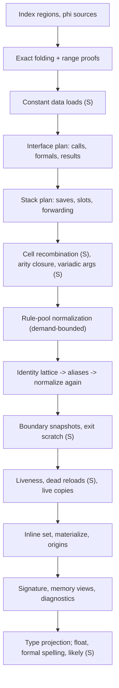

# Source reconstruction

Turns one structured, immutable SSA function plus recovered types and native source evidence into a source-shaped model: which values are live and which print inline, what each call/return means as a C interface, which stack slots become locals, and under which proof or assumption each rewrite was applied. Runs after [structuring](structuring-emission.md#algorithm), before text emission; never restructures the CFG or mutates the IR. It reads only the first layout's blocks, transfers and loop membership (the FP-guard rewrite checks guard ownership on the CFG), so the source view's provisional first layout and its second structuring with block contents (G2, `restructure` in the renderer) see the same reconstruction. The renderer's variable decisions (cross-statement inlining, coalescing, names) are covered here too; control layout and printing belong to [structuring & emission](structuring-emission.md).

**Code:** `src/reconstruction/`, `src/emitters/source-inlining.ts`, `src/emitters/source-control.ts` (variable partition)

## Data model

- **Input** (`EmissionInput`): region tree of SSA blocks with parallel-copy transfers ([SSA](ssa-values.md#data-model)), `TypeRecoveryResult` ([types](types-metadata.md#data-model)), and for native code `SourceEvidence`: ABI profile, observed/proven callee interfaces, address facts, caller result demands, variadic signatures, opt-in likely guesses ([calls](calls-abi.md#data-model)). Without evidence only declared-or-physical boundary projection runs (no source plan).
- **`Reconstruction`**: a view keyed by original SSA ids.
  - rewritten pure definitions (operands stay original ids);
  - demand: live values, retained statements, use counts, live edge copies;
  - inline set: definitions the renderer may expand;
  - origins: each original statement → the printed statement that consumes it;
  - boundary projections per call/return/tail: `source` (declared), `inferred` (observed) or `physical` (registers), with argument-list completeness, out-of-line exit scratch, likely-arity mark;
  - memory field views, diagnostics, validation session.
- **`SourcePresentation`** (syntax-neutral): formals and names, return type(s), value/formal/local types, float spellings, promoted locals, frame saves, forwarded reloads, void-like result, requirements, likely guesses, synthesized definitions.
- **Synthesized values** get deterministic `entity_<fingerprint>` ids; an alias is a forced-inline bitcast definition. No original identity is replaced.
- **Evidence ledger**: `LocalValidationSession` holds verified/unverified/rejected records, vetoed values, proof allowance and ABI assumptions; published as `emission.local_validation` and `emission.requirements`.

## Algorithm

One linear function (`reconstruct`) over shared maps; order fixed and visible.

(S) = source view only.

1. **Index**: worklist over regions records ownership, defined values and each block parameter's incoming sources. Duplicate ownership is `invalid_input`; sizes are charged to the budget.
2. **Exact folding** (both views): identity bitcasts, neutral operands, compare-from-subtract; `x-x`, `x*0`, `x^x` refused (would erase a possibly-unknown operand). With native evidence, interval analysis proves upper concat lanes zero so concats narrow.
3. **Constant data** (S): aligned loads from immutable, relocation-free bytes become literals.
4. **Interface plan**: each call resolves by strength — variadic format signature (S) → identical established contracts → one ABI-matching declaration → inferred callee → physical. Binding requires cells that tile a location exactly; gaps/overlaps refuse. Entry formals: ABI-classify a synthetic call with 16 integer + 16 double parameters; a candidate is a formal only if the entry binds it and it stays live. A complete declaration replaces inferred formals and suppresses result heuristics. Results: observed written results → primary-result choice (defined on every exit; caller demand, then last-written carrier; an untyped FP carrier holding only a vector copy/fill temporary — the datum of a ≥128-bit store, a constant its defining instruction shares with such a datum, or a call result left in place — is `incidental_result` and leaves the integer carrier to decide) → typed FP slice → changed low cell. Without a declaration, integer exits are harmonized to the widest exit width W, decided from all exits first; a narrower exit is zero-extended, except (S) an exit bound from the integer return location whose remaining changed return-root cells tile exactly bits [narrow, W): it binds the whole location at W (`concat` of its cells, `exit_result_width` record) and drops those overlays, so step 6 sees a joint read of the join phi. Likely mode only marks an arity guess; analysis keeps the list open ([calls](calls-abi.md#algorithm)).
5. **Stack plan**: affine fixpoint gives entry-SP offsets; taint follows expressions, phis, memory. Escapes give a _reach floor_: in S, bytes at or above the lowest escaped offset stay memory and slots wholly below are classified per slot; unknown effects keep the whole frame. The _incoming floor_ (`incomingFloor`, S only) is the lowest floor of exposures that can designate incoming bytes: a known base ≥ 0 (mixed-sign phis and reloads included), an unknown base or a floor ≥ 0; call arguments, open-call argument registers, stored and returned addresses and the addresses of indexed/dynamic accesses all count. An ABI word parameter slot that is only loaded, exact, nonvolatile, unoverlapped and wholly below it (or with no such exposure) binds as the incoming formal (`incoming_formal`, ABI premise `incoming_arguments_private`: callers, callees, globals, unknown stores and loaded or returned pointers never designate this activation's incoming area), regardless of open calls and stores through unknown pointers; C keeps the whole-function gates (no escape, no unknown store, clear snapshot alias flags). Classes: frame save, return-address push, incoming stack formal, private local, explicit memory. Private slots either _forward_ (each load becomes its reaching stored value, a bit range, or concatenated pieces; accesses vanish), become one scalar local (type puns convert by exact reinterpretation), or stay memory. Possible open-call argument slots keep stores but may forward reloads. Each promotion passes the byte-path validator (definite initialization on bounded acyclic paths). In S, explicit memory below the entry SP is one _frame object_ (`frameLayout`): a struct ending at the entry SP, starting stack-aligned, with one scalar member per exact (offset, width) access set and byte arrays where accesses overlap, an address points inside a member or an indexed base starts (with the accesses continuing it without a gap); taken addresses in gaps start byte arrays, padding fills the rest. Accesses print `frame.local_38`, `*(T *)&frame.local_1ac[4]`, `(uint8_t *)&frame + k`; no access is forwarded, removed or reordered. Only a live address at or above the entry SP (incoming arguments, return address) keeps `entry_sp`; an escaped frame then records the `frame_object` ABI premise (frame addresses stay inside the frame; outside pointers never designate it). The plan keeps two address maps. The analysis map (every value with a stack fact, reloads included) drives taint, escape, floors and slot classes. In S the presentation map, returned as `addresses` (→ `source.stack_addresses`, liveness, inline set, frame extent and taken addresses), drops the results of loads that stay in the program (not hidden) and every value computed from them: such a reload prints through its declared variable, and a stored address ≥ 0 itself requires `entry_sp`. C presents the analysis map. The renderer's `assignmentText` assigns only a variable the declaration pass declared (`declaredVariable`): otherwise a pure definition prints nothing and a load is a bare read.
6. **Cell recombination** (S): phi groups whose register cells move together become one whole value. A group whose cells are constants on every edge becomes one whole-width parameter with one constant per edge (range-folded constant cells count as cells of the group, but only for all-constant edges); each constant is proved by exact evaluation of the cells (`validateConstantCells`), and source-fact discovery offers the whole constants as candidate addresses so symbol naming applies.
7. **Normalization**: worklist fixpoint over definitions inside a conservative demand closure. Operands resolve through identity chains; the ordered rule pool (`EXPRESSION_RULES`) is tried and the _first_ match wins; the site is revisited, ≤32 rewrites per value. Priority: condition flags (truth-table enumeration → `&&`/`||` relations), cell/bit-slice recombination, constant folding, cast wiring, packing shifts, strength-reduced multiply, magic division/remainder/narrowing, slice narrowing, joins, shift/rotate idioms, compare canonicalization, integer identities, extension folding. Checked has a small own subset (`x<<k` as `x*2^k`).
8. **Identity lattice** (unreached / identity / conflict) over copies and bitcasts, ignoring unreached back edges, so unchanged loop-carried registers resolve to entry values. Identities become aliases; normalization drains again.
9. **Boundaries**: snapshots drop slices equal to entry state. In S, an inferred return slice tracing only to same-register entry values or unprojected call clobbers becomes _ABI scratch_; a computed slice excluded by an established primary or void-like interface becomes _computed scratch_; slices overlapping caller demand stay results.
10. **Liveness** from effects, boundary values, conditions and exit overlays; a phi source is demanded only if its destination is live. S drops dead covered frame reloads and jump-table reads, iterating to stability; formals reached only through uncertain overlays are demoted.
11. **Inline set**: constants, addresses, and pure single-use same-block definitions with expansion ≤48 operands and depth ≤10; rotation operands stay variables; aliases bypass limits. Live synthesized definitions are materialized at their anchors; folded definitions join their consumer's origins.
12. **Finish**: signature (dropped if `entry_sp` stays live, i.e. an address at or above the entry SP is live); memory views (dropped if ambiguous, conflicting or width-mismatched); `unavailable_semantics` warnings for live unknowns, unknown effects, open/physical calls, unresolved returns and control.
13. **Types**: project complete source types (both views); S then picks float spellings, formal pointer/narrow-integer/slot-pointer/narrow-return spellings, then likely pointer guesses for formals still plain integers.

### Variable recovery

`reconstruct` runs once per emission; each render attempt forks the validation session. In the source view the renderer then:

- **names** (`planSourceNames`, also checked with fewer rules): supplied symbols/annotations > declared parameter names > field names > library interface names (only without a loop/shift/callback role, element or condition) > one role (`index`, `count`/`remaining`, `accumulator`, …) > generic stems; two roles give no name. Names never feed semantics.
- **inlines across statements** (`planSourceInlining`): single-use pure integer expressions move to their dominated use; FP ones only with no call, unknown effect or register write between; loads only to an unconditional same-block use with no intervening store, call or independent load; same-type copies propagate; cheap single-reader ops repeat (≤4); a single-use call result may sit in the next test.
- **partitions** (`partitionVariables`, `variable_partition`): one variable partition from exact SSA live-range interference (simultaneous block parameters conflict; an equal source at a definition does not): block parameters join the variables their edge arguments read, then same-width aliases and unsigned widenings, then in-place updates (`y = f(x)`, same presented type), then same-type values one register holds at block boundaries. Members share machine storage and FP presentation; presented types may differ between scalar integer/pointer spellings (a rigid member such as a formal or call result fixes the type, else the most-read spelling of the widest members; a differing member converts once at its definition). Formals stay representatives; names are chosen per variable. An edge copy inside one variable prints nothing; `edgeCopies` gives every planner the printed copy count.

Checked applies none of these beyond direct-copy naming.

## Design decisions

- **One pipeline, two views.** `checked` refuses every rewrite justified by presentation or ABI convention (saves, scratch, cells, flags, idioms, per-slot promotion, float spelling) but still folds exact identities and projects declarations. `source` = checked + recorded rewrites.
- **Proof classes**: `structural` wiring may be vetoed by the BDD checker while allowance lasts; `bitvector` rules keep the original once it is exhausted; `own` rules (outcome tables, closed-form division bounds) carry their proof plus boundary tests. A counterexample vetoes the value for later passes.
- **Admission gate**: each source rewrite must store a presentation record; at 256 records (atomic per rewrite) it fails and the explicit form stays. ABI premises become `abi_conformance` requirements and never refuse.
- **Refuse rather than guess**: partial coverage, disagreeing paths, unknown offsets, open arities, conflicting types fall back to explicit form plus diagnostic; likely guesses stay marked.
- **Uncertainty channels**: projection kind/completeness, requirements (`fp_environment`, `abi_conformance`, `unresolved`), validation records, diagnostics, likely marks.
- **Ordering**: interfaces before stack (outgoing args decide privacy); stack before normalization (forwarded values feed rules); aliases before identities; type spelling last (needs final liveness, formals, slots).
- **Bounded**: every loop charges the budget; proof allowance is `min(8000, remaining/64)`. [inference] Proof outcomes, hence text, can depend on budget left at entry.

## Limits and improvement levers

| Weakness                                                            | Effect                                                                                   | Lever                                                    |
| ------------------------------------------------------------------- | ---------------------------------------------------------------------------------------- | -------------------------------------------------------- |
| Escaped object extent unknown                                       | All slots above the lowest escape stay memory, as frame-object members (`frame.local_N`) | Extent facts from [types](types-metadata.md); stack plan |
| Path-dependent slot parts                                           | Memory form kept                                                                         | Partial-update spelling                                  |
| Return carrier choice                                               | Real result can become scratch (`heldout_weighted` `double`, PERFORMANCE.md round 4)     | Caller demand; result selection                          |
| Open arities                                                        | `...` stays; likely mode ships one formal heuristic, none for results                    | [calls](calls-abi.md#limits-and-improvement-levers)      |
| Pointer spelling needs local evidence                               | Casts; declared `char *` prints `int8_t*`                                                | Type projection                                          |
| First-match rule order, no cost model                               | Early rule may block a better one [inference]; ABI-implied sign extension missed         | Rule pool                                                |
| BDD fragment (64 leaves, 12k ops, integer)                          | Candidates unverified or unapplied                                                       | Validator                                                |
| Two inlining layers (fixed limits here, liveness-based in renderer) | Split ownership of temporaries [inference]                                               | One planner                                              |
| Partition is speculative beyond phis                                | Register reuse may give unrelated same-type values one name                              | Role-aware representative naming                         |
| Cost                                                                | ~780k work per brotli `main` reconstruction; normalization runs twice                    | Incremental normalization                                |
