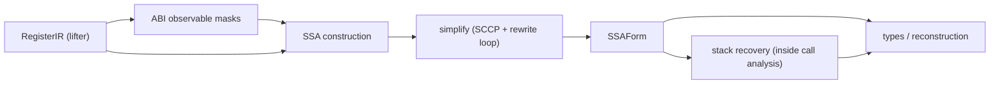
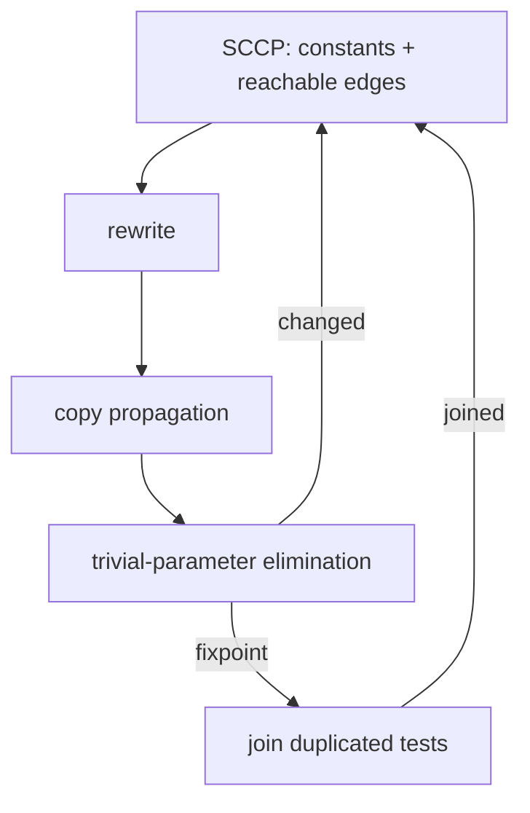

# SSA, values and stack

Turns the lifted register-form IR (explicit register reads/writes, no data on CFG edges) into SSA over architectural register _cells_, folds and prunes that graph, and separately interprets the machine stack byte by byte. Output: a simplified SSA graph plus per-instruction stack facts consumed by [calls](calls-abi.md), [types](types-metadata.md) and [reconstruction](reconstruction.md). Follows [lifting](lifting-ir.md).

**Code:** `src/analysis/ssa/`, `src/analysis/values/`, `src/analysis/stack/`, `src/analysis/effects/`, `src/service/analysis/` (sequencing only)

## Data model

- **Register cell.** Disjoint bit-slice of one architectural root (`x0[0..32)`, one flag), versioned independently. Wide roots are cut every 2048 bits.
- **SSAForm.** Same blocks as the input (simplification drops unreachable ones and adds one block per [joined duplicated test](#3-simplification)), but: register effects are gone; blocks carry _parameters_ and edges carry _arguments_ (block-argument SSA, no phis); every cell reference is one dominating value. Loads, stores and calls carry a full register snapshot (the architectural state at that point); calls also carry clobber outputs (fresh values per clobbered cell). A sparse per-block row lists only cells bound at entry or rebound in the block; full state is derived along the dominator tree. Exits list every cell.
- **Effect token.** Memory is _not_ SSA. One token threads through loads, stores, calls, fences and unknown effects in original order; edges carry it.
- **Value fact.** Three-point lattice per value: absent (bottom) / exact bit pattern / varying.
- **Stack facts.** Entry-SP-relative world: _value_ (constant, absolute address, `SP+k`, a slice of `SP+k`, dynamic-stack, unknown, undefined) × _initialization_ (initialized / uninitialized / maybe / unknown), plus contributing value IDs, evidence and the entry registers it depends on. A snapshot = register facts + byte map + SP fact + `escaped` / `aliased` flags. Also per-access records (offset, size, region), a frame summary (min/max offset, dynamic, escaped, aliased) and a fact per SSA value.

## Algorithm

### 1. ABI observable masks

Probe `classifyCall` on a catalogue of synthetic signatures (pointers, ints, floats, vectors, aggregates; parameter lists grown until one spills) and union every register slice touched, plus SP and preserved registers. Result: per root, the bits an ABI boundary can observe. Bounds cell count, not signatures.

### 2. SSA construction

1. **Cut sets.** Per root: `{0, width}` ∪ edges of every slice the body reads/writes ∪ every clobbered slice ∪ 2048-bit strides. Roots touched _only_ by call clobbers and not ABI-observable get no cells at all; roots only clobbered but observable are cut along mask runs.
2. **Definition sites.** A block defines a cell if it writes it, zero-extends its root (AArch64 `w` writes zero the rest), or a call/unknown effect clobbers it. Zero registers read as 0; discard writes define nothing.
3. **Parameter placement.** Minimal SSA: iterated dominance frontier of each cell's definition blocks. Dominator-tree roots (entry and every unreachable component) bind _all_ cells as parameters.
4. **Rename** along the dominator tree with an undo log. Read = the covering cell's value, or a `concat` of several; write = rebind contained cells (an `extract` per cell for wide writes); zero-extend rebinds the rest to 0. Calls snapshot, then rebind clobbered cells to fresh values. Edges pass merged cell values simultaneously, backedges included; dropped register writes leave their provenance on the terminator.

### 3. Simplification

Loop until no change; at each fixpoint, join duplicated tests and loop again:

- **SCCP.** Block worklist; results evaluated with the trusted bit-vector/FP evaluator. Parameters take facts only from _executable_ incoming edges; a second distinct constant → varying. Branch/switch on a constant selects one edge. Loads, call results, clobbers are varying.
- **Rewrite**, in this order per assignment: unreachable blocks dropped; [flag → comparison](#4-comparison-recovery); constant fact → constant; `select` on constant condition → arm; identity with constant right operand (`x+0`, `x*1`, `x&~0`, shifts by 0…) → copy; value rules (`zext(trunc v)` → `v` when an upper-bound walk proves `v` fits; `x cmp x` → constant unless an unknown/undefined may reach `x`). Then constant branches/switches → jumps; global liveness DCE; jump threading through empty pass-through blocks. Every changed node merges provenance of the operands' definers.
- **Copy propagation.** Same-type bitcasts become aliases.
- **Trivial parameters** (Braun-style): a non-root parameter fed only by one value (or itself) is replaced; worklist over dependents.
- **Duplicated tests** (`values/join.ts`, Ghidra's `ConditionalJoin`): two branch blocks with the same two destinations, same or swapped (a 1-bit `not` root or a complemented integer predicate), whose conditions match structurally over each block's own pure assignments become one new block: both jump to it, it holds a copy of the condition cone and the branch. A pair of differing leaves, a pair of differing destination arguments and a cell whose state differs between the two block ends each become one parameter (keyed by value; constants by their bits); the new block's entry row binds the differing cells. Loads, calls and unknown effects are leaves and stay in their block. Distinct constants are a different test unless a destination edge or cell already carries that pair (a loop's initial against its next value). A destination one side reaches through an effect-free forwarding block that only it enters (a loop preheader setting constants) is shared: the new block enters it on both sides and it takes a parameter per jump argument or state-row value the other side holds differently; a constant it computes is materialized on its own side for the edge. A rotated loop's guard and bottom test thus become one header test (`while (c)`). Before a join is applied, each incoming edge is checked: the joined condition with the parameters replaced by that edge's arguments expands, through both blocks' pure assignments, to the predecessor's own condition term (its negation for swapped destinations); any mismatch keeps both tests. Cones are bounded (32 copied nodes, 256 checked expansions).
- Liveness roots: effectful nodes' operands _including their register snapshots_, terminators, edges, register-state rows. So dead loads stay (they may fault) and pin every cell live at them.

### 4. Comparison recovery

Structural matcher over typed flag expressions (never architecture names): `sub` flags with zero carry-in → `eq` / `uge` / `ult`; `negative xor overflow` → signed `<`; `xor 1`/`not` → complement; `or`/`and` of two comparisons on identical operands → combined predicate via a lt/eq/gt bit-mask table; `eq/ne` of a comparison against 0/1. Look-through: same-width bitcasts only.

### 5. Stack recovery

Non-rewriting abstract interpreter over the final SSA; the first step of call analysis.

1. **Entry.** SP cell = `SP+0` (or a slice); all other registers unknown; memory empty. Offsets `<0` are local candidates; `≥0` classified by ABI (return address, Win64 shadow space, incoming args).
2. **Worklist.** Reverse-postorder-ranked heap over blocks (entry component first, then the rest); remote users of a changed value are rescheduled; edge arguments transfer simultaneously.
3. **Transfer.** `SP±const` stays affine (64-bit wrap); casts/extract/concat of stack values preserve or reassemble pointers only when every bit survives; everything else goes through the constant evaluator, else dynamic-stack if any operand was stack-derived, else unknown. A SP-cell value that is no longer stack-derived is promoted to _dynamic stack_ (taint is sticky). Stores at a known offset write exact bytes (value + byte index, endian-aware; non-byte widths degrade). Loads at a known offset read bytes back (store-to-load forwarding when all bytes agree).
4. **Barriers.** Store at an unknown / non-stack-derived address, or any call/effect with unknown read-write memory contract → every tracked byte becomes unknown and `aliased` latches. `escaped` latches when a stack-derived value is a call argument, sits in a non-SP register input or in a tracked stack byte at a call, is stored through an unknown pointer, or leaves via the return value or a non-preserved exit register.
5. **Join.** Different values → unknown (dynamic-stack if either side is stack). Byte maps join per byte; a byte absent below entry SP is _uninitialized_ until an alias barrier, unknown above. Finite-height lattice: no widening needed. A joined fact's `value_ids`/`evidence_ids` are the sorted union of the inputs'; `sortedUnion` merges lists that are already strictly increasing (the form every combined fact has) and otherwise takes the Set-and-sort path, so the order is the same either way (`test/analysis/stack/sorted-union.test.ts`).
6. **Record pass.** After the fixpoint, replay each reachable block once, recording pre-effect snapshots at every load/store/call/unknown effect (exit snapshot at the terminator), access records and frame bounds.

## Design decisions

- **Cells, not registers.** Sub-register aliasing becomes explicit `extract`/`concat`; no later stage needs overlap logic.
- **Minimal SSA, block arguments.** Parameters only at IDF; irreducible and unreachable components need no special case. Construction does not prune; simplification does.
- **Unobservable clobbers don't exist.** Masks keep unobservable caller-saved/vector slices out of the graph; the call node keeps its original clobber metadata.
- **Memory stays ordered, never forwarded.** The SSA layer does no alias guessing; only the stack interpreter models memory, and only the function's own frame.
- **Unknown stays unknown.** Constant folding never treats unknown/undefined as a number; `x-x` and `x*0` are deliberately not folded; reflexive-compare folding checks the definition cone (≤128 nodes) for indeterminate sources.
- **Transactional budget.** One abstract work counter (default 1M, shared with the operation's global budget). Construction failing returns the register IR; simplification returns the last complete graph; value analysis and stack recovery return _no_ facts. The service treats any partial pass as failure; only native-dependency preparation downgrades it to "no summary for this callee".

## Limits and improvement levers

| Weakness                                                                                                                                                                                                                                                                                                                                                                                                    | Where                                                                                     |
| ----------------------------------------------------------------------------------------------------------------------------------------------------------------------------------------------------------------------------------------------------------------------------------------------------------------------------------------------------------------------------------------------------------- | ----------------------------------------------------------------------------------------- |
| Value domain is constant/varying only: no ranges, known bits, congruence, pointer offsets. Constants never cross memory.                                                                                                                                                                                                                                                                                    | `values/`: richer lattice would strengthen branch folding, bounds-checked switch recovery |
| Identity rules see only the right operand; no reassociation                                                                                                                                                                                                                                                                                                                                                 | rewrite step                                                                              |
| Comparison recovery is structural: only `sub`-based flags with zero carry-in; no `sbb`/`adc`, no look-through of extract/insert, so flags packed into an NZCV word and re-extracted survive as bit logic                                                                                                                                                                                                    | comparison recovery                                                                       |
| Stack barriers are whole-frame: _any_ store through a non-stack-derived pointer (global, heap, parameter) or _any_ call wipes all tracked bytes, even for a frame that never escaped. No `none`/`read_only` memory contract is produced anywhere, so every call is a full barrier. `[inference]` gating the barrier on `escaped` / address provenance would keep spill facts across calls and global stores | stack `Barriers` step                                                                     |
| A store through a dynamic stack address (indexed local array) is also a barrier; loads through unknown addresses return unknown                                                                                                                                                                                                                                                                             | transfer                                                                                  |
| Escape is a single frame-wide bit; no extent for escaped objects, so consumers promote nothing above the lowest escaped offset; the frame-object spelling of roadmap 2 item G7 (`git show f61e1a1:TODO.md`) names such memory without promoting it                                                                                                                                                          | stack facts → reconstruction                                                              |
| Offsets below entry SP are only _candidates_ (no red-zone/frame-size proof); incoming bytes are always unknown                                                                                                                                                                                                                                                                                              | region classification                                                                     |
| Cliff on exhaustion: stack work/byte-bound overrun discards _all_ stack facts, and call analysis then returns partial immediately                                                                                                                                                                                                                                                                           | budget policy                                                                             |
| Snapshot cost: every load/store/call materializes one binding per cell, and those bindings pin all cells live at memory ops, limiting DCE; cost scales with memory ops × cells. Reconstruction later removes the plumbing                                                                                                                                                                                   | construction, liveness roots; `[inference]` reference derived state instead of copying    |
| SSA/simplify/stack/call analysis re-run for every native callee unit prepared                                                                                                                                                                                                                                                                                                                               | service native preparation                                                                |

Native-context specialisation (assumed entry constants) reuses simplify; value analysis then makes constant indirect calls direct ([calls](calls-abi.md)).
