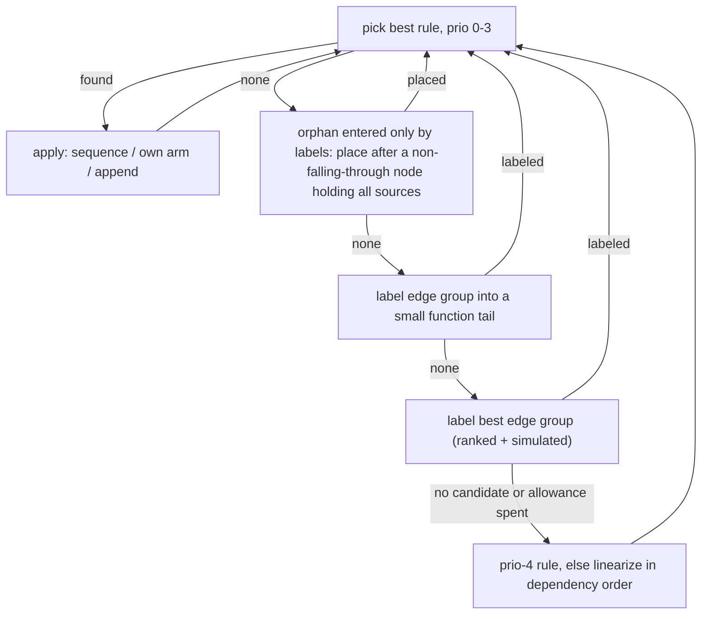
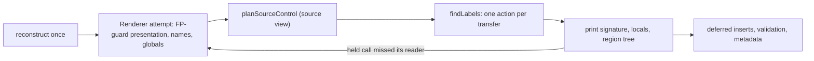

# Structuring and emission

Turns a function's validated SSA control-flow graph (CFG) into a region tree, then prints it as C-like or Python-like pseudocode mapped back to machine code. Structuring runs once per decompile, after type recovery, for both dialects and views. Emission reads the tree plus the [reconstruction](reconstruction.md); it is the last stage before publication.

**Code:** `src/presentation/`, `src/emitters/` (`renderer.ts`, `source-control.ts`, `expressions.ts`, `writer.ts`), `src/service/analysis/index.ts`

## Data model

- **`StructuredFunction`** holds a `Region` tree plus coverage: every block, statement and terminator, including unreachable ones. A region is one of three kinds.
  - **block**: one SSA block; its id is also its label. It holds the block's statements, its dominator, its register rows, and a single control (jump, if, switch, or terminal). Each if/switch arm is a transfer, optionally with a body region the arm owns.
  - **sequence**: lexical order only. Each block's transfers still decide where execution goes.
  - **loop**: a header and a body, which mean `while (true)` with explicit transfers. The emitter, never the structurer, may attach a `LoopForm` (`while`, `do_while`, `for`).
- **`ParallelTransfer`**: exactly one per CFG edge. It holds the target, a mode (`next`, `goto`, or `break`/`continue` plus a loop id), the simultaneous block-argument copies, and an effect token.

## Algorithm

### 1. Region structuring

1. Compute reverse postorder (RPO), predecessors and dominators. RPO breaks every remaining tie.
2. Structure each scope: first the function, then every loop body recursively. A scope's header backedges are hidden so that nested loops show up.
   1. **Loops.** Each cyclic strongly connected component becomes a loop, headed by its first entry in RPO. Its other entries (irreducible loops) stay labeled.
   2. **Follow.** One exit becomes the loop's continuation. The choice prefers the fewest labeled exits (other non-tail exits, absorbed blocks where exit paths from different loop blocks meet, other exits flowing into a block the follow also flows into), then a follow that is not a small tail, then the exit of a single bottom test that only the loop enters (a `do-while` with the code after the loop following it, like Ghidra's `LoopBody::findExit` tail-first order), then fewer tail exits, a header exit, a latch exit. Acyclic blocks entered only from the body are added to the body. Edges to the follow become `break`; any other exit becomes a pending label.
   3. **Collapse** inner loops and blocks as nodes (diagram below).
3. The collapse rules, highest priority first:

| prio | rule                  | applies when                                                                                                                |
| ---: | --------------------- | --------------------------------------------------------------------------------------------------------------------------- |
|    0 | sequence              | all structured out-edges go to one node, which is entered only from here                                                    |
|    1 | if-no-exit            | an arm target has no structured exit                                                                                        |
|    2 | clause                | the target's single exit J is where each other successor goes too, directly or through a clause (if, if-else, switch cases) |
|    3 | short-circuit operand | the target's two exits include this node's other successor                                                                  |
|    4 | last resort           | any other single-entry target of an arm, or of a jump that ends an arm                                                      |

- **Switches:** when several case arms are the only way into a target, the first of those cases owns it.
- **Loop exits:** in a loop body, a branch whose other arm repeats the loop owns the exit path. This keeps the repeat edge last in the body, which bottom tests need.
- **Forward-only labels:** a target with pending labels can be absorbed only after all their sources. The two arms of an `if` count as ordered: the printer puts the arm a goto leaves before the arm holding its label (`branch_order` when that inverts the test), so a side exit into the other arm keeps the if/else (Ghidra's `else { LAB: … }`).
- **Depth bound** (default 32, maximum 64): a collapse that would nest deeper is skipped, and its edge stays labeled.

4. **Goto selection** picks which group of edges between two nodes becomes labeled.
   - Edges into small tails go first. A small tail is a chain of at most 4 blocks, with at most 4 stores or calls each, that ends in a return, trap or indirect jump.
   - Any other group is ranked by whether labeling it orphans its target, then by the collapses it enables one step ahead, then by size and RPO.
   - The top 8 groups are simulated on a copy of the graph.
   - Selection work is capped at 64·(blocks+edges)+20,000. Past the cap, the remaining nodes are placed in dependency order; ranking returns before its edge scan (the cap only falls, so the scan could no longer rank anything), and a layout without the search (`search: false`) charges no scan at all.
5. Each transfer's mode follows from its loop scope chain. An arm that owns its body is `next`.

### 2. Emission

Source-view planning starts after [variable recovery](reconstruction.md#variable-recovery). The steps below run in order, and each records a presentation rule:

| step               | effect                                                                                                                                                                                                                                                                                                                                                                                                                                                                                                                                                                                                                                                                                                                       |
| ------------------ | ---------------------------------------------------------------------------------------------------------------------------------------------------------------------------------------------------------------------------------------------------------------------------------------------------------------------------------------------------------------------------------------------------------------------------------------------------------------------------------------------------------------------------------------------------------------------------------------------------------------------------------------------------------------------------------------------------------------------------- |
| `foldSwitchGuards` | a proven jump-table range guard and its switch print as one switch                                                                                                                                                                                                                                                                                                                                                                                                                                                                                                                                                                                                                                                           |
| `planLayout`       | a labeled edge into a small tail gets its own copy of the tail (at most 128 copied blocks). A copy is refused if its transfer would print two different ways                                                                                                                                                                                                                                                                                                                                                                                                                                                                                                                                                                 |
| `planFlagTests`    | an O0 flag-local chain prints as `&&`/`\|\|`                                                                                                                                                                                                                                                                                                                                                                                                                                                                                                                                                                                                                                                                                 |
| `planLoopForms`    | `while (c)` when the header prints only its test, or one statement that test holds (`while ((x = p->next) != 0)`, the jump block alone entering the test may hold it; `loop_comma_condition`; a header like that with a valid C bottom test stays `do-while`); C only: `do-while` with one repeat edge and a re-proved test; `for` with induction init/step copies, or (Ghidra's `BlockWhileDo::finalTransform`) a top-tested loop whose copy-free sole repeat edge follows the body's last statement assigning a variable the test (or its held statement) reads and nothing else in the loop writes: that statement is the step, the statement ending the entry block or the entry edge's copy into that variable the init |
| `restructure`      | structure again with block contents (G2, see Design decisions): short-circuit conditions first, comma operands, constant-return tail edges labeled first                                                                                                                                                                                                                                                                                                                                                                                                                                                                                                                                                                     |
| `planSharedArms`   | `if (a && b) {F} else {X}` for conditions the structurer did not form                                                                                                                                                                                                                                                                                                                                                                                                                                                                                                                                                                                                                                                        |
| `planLoopExits`    | a multi-level exit sets a flag that is re-tested after each scope; no flag when a guard cannot be reached with it clear or is followed by the same `break`                                                                                                                                                                                                                                                                                                                                                                                                                                                                                                                                                                   |

Printing:

- **Transfers.** `transferAction` gives each occurrence one action: fallthrough, `goto`, `break` or `continue`. The same transfer must get the same action everywhere; only `goto` targets get labels.
- **Silent blocks.** The lexical follow of a transfer is the first block after it, but a block that prints nothing and jumps silently to the next (no statement, definition, note or printed copy; not a loop header or repeated tail copy; `quietJump`) is transparent: `findLabels` visits regions last to first, records such a block's jump target (`silentNext`), and `transferAction` asks whether control entering the follow reaches the target (`reaches`) instead of comparing identities. A goto from the end of an `if` to the block after a silent chain prints nothing, and a goto out of the innermost loop to the block after a silent block following the loop is a `break` (G6: `allocateBtreePage` printed five `goto label_101` to the label right after its loop; `sqlite3BtreeSavepoint`/`sqlite3BtreeRollback` printed a goto immediately before its label). The edge is recorded as `fallthrough`/`break` with `through`, the blocks it crosses; both validators check that each crossed block is a once-occurring, non-header jump block recorded as falling through, in order from the follow (rule `silent_block_crossing`). Labels stay where they were, the ones no goto uses disappear.
- **`if`.** An empty arm is dropped and the test inverted; an `else` arm that prints nothing (including the false arm of a shared-arm `||` condition) prints no `else`. An arm that cannot fall through ends the `if`, with no `else`. A nested `if` with nothing else in either body merges into `&&`. An `else` arm that prints exactly one `if` statement continues as `else if` (`elif`) at the outer depth. A test leaving by a copy-free `goto`/`break`/`continue` whose other arm starts with later tests leaving the same way for the same target (each printing at most its comma statement) prints as one `if (a || (x = f()) == 0) goto L;` (`joined_exit_condition`); the later exits record the same jump without printing it.
- **`switch`.** Cases that share a body are grouped, and an empty `default` is dropped.
- **Copies.** Dependency-ordered; a temporary breaks cycles.
- **Local integer types.** Before partitioning, `chooseLocalTypes` gives pointer types (`planLocalTypes`) and then, C only, signed or low-slice integer types (`planIntegerSpellings`, `source-local-types.ts`) to sets of locals connected by copies, by counting the conversions each spelling prints at the reads (users of live printed expressions, other reads from `use_counts`). A chosen set gets its own partition storage identity, so a variable never mixes it with other values; uses print through `declaredInteger` (signed: `(uintN_t)x` carrying the signed operand, which signed contexts read back), definitions through C assignment conversion (`assigned`: `signedContext`, or the operand of the final reduction/zero extension for a narrow local).
- **Table declarations.** `declareDataTables` prints an indexed read-only table's bytes (`tableContents`, record `table_extent`). The declared length is a symbol size or an accessed range inside `span_bound` (`indexedDataAccesses`, `source-tables.ts`: width, masks, dominating guards, a guarded `x - c`); `span_bound` alone never sizes it. Up to 64 bytes print in full, otherwise one 16-byte row (`name[]` and `further elements not shown` when no extent is established).
- **Checks.** After printing, validators re-derive every emitted edge, scope and exit flag. Every coverage entry must be mapped.

|        | C-like                                                              | Python-like                      |
| ------ | ------------------------------------------------------------------- | -------------------------------- |
| loops  | `while (true)`, `while`, `do-while`, `for`                          | `while True:`, `while c:`        |
| switch | `switch` (captures `break`: an in-case loop exit becomes goto/flag) | `match`/`case a \| b:`           |
| labels | `goto L;` / `L:;`                                                   | pseudocode `goto L` / `label L:` |

### 3. Retry and fallback under limits

| limit                                                         | behaviour                                                                                                                                                       |
| ------------------------------------------------------------- | --------------------------------------------------------------------------------------------------------------------------------------------------------------- |
| structuring work or cancellation                              | the operation fails; no partial text                                                                                                                            |
| selection allowance, depth                                    | more labels, still correct                                                                                                                                      |
| goto-search sub-allowance (`search_work`)                     | the renderer's restructure stops the search once the request's remaining work minus the text reserve (120 per render unit) is spent; more labels, still correct |
| a held single-use call misses its reader                      | `CallInliningRetry`: render again with those calls as statements; the 5th attempt prints every call as a statement                                              |
| metadata bound                                                | rerun without metadata, same text                                                                                                                               |
| remaining work below 450 per render unit after reconstruction | the text renders first without metadata (same text); omissions carry reason `budget`                                                                            |
| presentation record bound                                     | the rewrite is skipped; a call becomes a comma operand only after its `call_effects` record is admitted at planning                                             |
| validation allowance exhausted                                | later phi-copy checks fold into one `parallel-copy` limitation record, so the record bound stays available                                                      |
| optional searches                                             | at most 1/16 of the remaining work each; keep the best found so far                                                                                             |
| text over `output_bytes`                                      | `resource_limit`, never truncated text                                                                                                                          |

Attempts share one reconstruction, validated once; each forks the validation session. A retry reuses an earlier attempt's `restructure` when every structuring condition that attempt asked (operand, copies, constant-return edge), asked again in the same order, answers the same: structuring is deterministic in the shared graph and those answers (`AttemptPlans.structures`). At a 40M measurement budget, `sqlite3Select` and `sqlite3Pragma` reuse the first attempt's in attempts 2–4 (0.89M and 7.8M of work each; the fifth attempt prints every call as a statement and structures again), and `sqlite3WhereCodeOneLoopStart` in all four of its attempts (full and metadata-omitted).

## Design decisions

- **Labels are always valid.** Every edge keeps its own transfer, and every block prints once, apart from bounded tail copies. The structurer never guesses.
- **Structure again with block contents (G2).** The service structures the source view once without the goto search (`search: false`, a `provisional` layout that only feeds reconstruction: blocks, edges, loops). After the variable partition the renderer structures the reconstruction's CFG again (`restructure`, recorded as `short_circuit_structure`), with three content facts: which blocks may be later short-circuit operands (print their test alone, or exactly one statement the test reads: `commaOperands`, `comma_condition`), how many copies each edge prints, and which edges print only constants their return tail returns. Ghidra's `collapseConditions` (`ruleBlockOr`) then runs before every other rule; a condition's exits to one clause count as one edge, so the clause can be the head's arm (a shared arm). Branch edges copying only returned constants into a small tail with other entries are labeled first, so the tail is copied onto them (`return k`). A non-provisional layout (tests, hand layouts) is kept when nothing collapses or is labeled. Reconstruction does not depend on the first layout: its ownership walk and validators index blocks and transfers, loop roles read loop membership (the same in every structuring), and the FP-guard rewrite became a CFG check (`source-fp.ts`). Moving structuring after reconstruction was not chosen: reconstruction needs loops and transfer objects, and the restructure reuses the first structuring's transfer objects so every map keyed by them stays valid. Measured cost: see Limits.
- **Nothing is hoisted.** Conditions are evaluated after their block's statements, and no reaching-condition guards are used.
- **Forward-only labels.** On the sample, backward gotos fell from 54 to 2, but total gotos rose from 193 to 200.
- **Audited presentation.** Rewrites are recorded and validators check them independently. A layout bug fails with `invalid_input` rather than producing a wrong edge.
- **Determinism.** Choices use lexicographic keys ending in RPO, and every search runs within charged work.

## Limits and improvement levers

- **Remaining gotos.** On the structure-gotos sample (214 functions), output still has 200 gotos, down from 214.
  - Most are acyclic joins from arms of different branches.
  - The rest are non-follow loop exits, edges inside C switches, and 2 backward gotos to loop headers.
  - Lever: reaching-condition guarded regions; the unmerged `wt/r2d` prototype only reached 195.
- **Per-function regressions.** Forward labels made some functions worse: `whereLoopAddBtree` went from 14 to 26 gotos. Selection is greedy with an 8-candidate lookahead; a wider search is a possible lever [inference].
- **Content facts (G2).** Only comma operands that are an assignment, load or single-result call whose value the test reads join a condition (C prints `(x = f(), test)` or `(x = f()) op k`, Python-like only the direct `(x := f()) op k`). Void calls (`(f(x), test)`) and calls inlined into the test do not, so `sqlite3BtreeClose` (#39) and `sqlite3ExprCodeExprList` (#83) keep their gotos. On the 26-function comma subset (main `cd7be17` → G2) C gotos fell 209 → 182 and jump statements 237 → 211 (Ghidra 184), Python-like jumps 254 → 232 with 25 walrus lines, and no function prints more jump statements (`sqlite3BtreeOpen` 41 → 40 once a loop's repeat path is kept last). Most of the drop comes from joined exits (`whereLoopAddBtree` 42 → 32). The restructure costs 0.38M (`whereLoopAddBtreeIndex`) / 1.04M (brotli `main`) work and the provisional first layout saves 0.35M / 0.75M, but optional callee summaries take half of the remaining work (`source-facts.ts`), so the totals still rise (docs/PERFORMANCE.md, G2).
- **Narrow recognition.**
  - Switches come only from jump tables.
  - The sample had only 3 `for` loops; on the 21-function G3 subset statement steps raised them 2 → 4 (`p = p->next` steps in `sqlite3BtreeTripAllCursors`, `btreeLockCarefully`). A step that is not the body's last statement keeps `while` (e.g. `list_sum`, where the accumulator update prints after `p = p->next`).
  - Python-like has no `do-while` or `for`.
  - Irreducible regions get no node splitting.
- **Cost.** Each inlining retry re-runs the attempt-dependent source planning (inlining plan, liveness, coalescing), for up to 5 attempts, doubled when metadata is omitted; source-name, character and indexed-data plans are shared, and a retried attempt publishes no mappings. brotli `main` and SQLite `whereLoopAddBtreeIndex` finish ~0.55M / ~0.95M under the 10M work limit. `renderer.ts` is one ~7.9k-line class.
- **Measurement gap.** The dev loop prints 0 gotos, so structuring is measured only on the sample.
