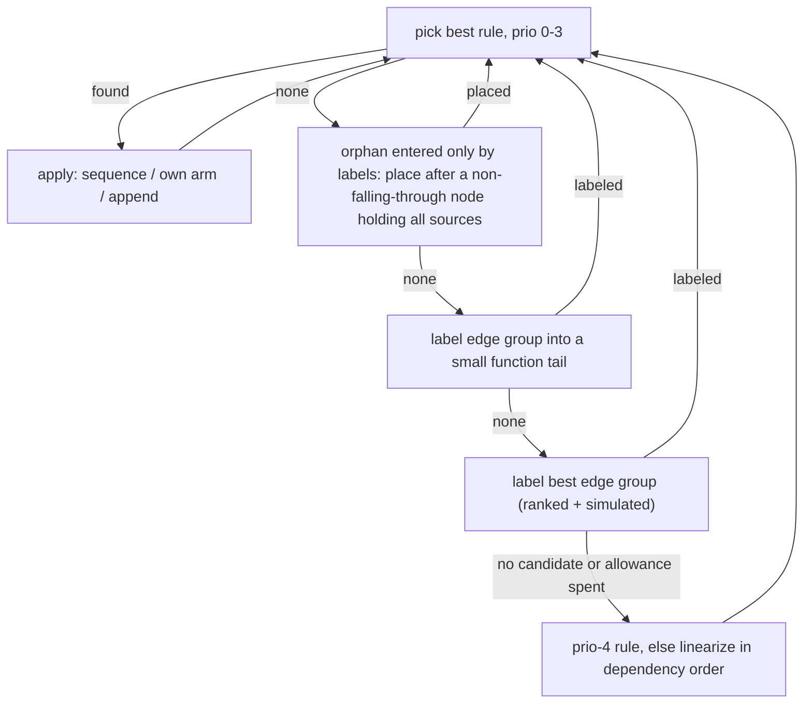
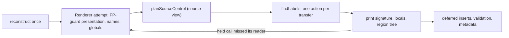

# Structuring and emission

Turns a function's validated SSA control-flow graph (CFG) into a region tree, then prints it as C-like or Python-like pseudocode mapped back to machine code. Structuring runs once per decompile, after type recovery, for both dialects and views. Emission reads the tree plus the [reconstruction](reconstruction.md); it is the last stage before publication.

**Code:** `src/presentation/`, `src/emitters/` (`renderer.ts`, `source-control.ts`, `expressions.ts`, `writer.ts`), `src/service/analysis/index.ts`

## Data model

- **`StructuredFunction`** holds a `Region` tree plus coverage: every block, statement and terminator, including unreachable ones. A region is one of three kinds.
  - **block**: one SSA block; its id is also its label. It holds the block's statements, its dominator, its register rows, and a single control (jump, if, switch, or terminal). Each if/switch arm is a transfer, optionally with a body region the arm owns.
  - **sequence**: lexical order only. Each block's transfers still decide where execution goes.
  - **loop**: a header and a body, which mean `while (true)` with explicit transfers. The emitter, never the structurer, may attach a `LoopForm` (`while`, `do_while`, `for`).
- **`ParallelTransfer`**: exactly one per CFG edge. It holds the target, a mode (`next`, `goto`, or `break`/`continue` plus a loop id), the simultaneous block-argument copies, and an effect token.

## Algorithm

### 1. Region structuring

1. Compute reverse postorder (RPO), predecessors and dominators. RPO breaks every remaining tie.
2. Structure each scope: first the function, then every loop body recursively. A scope's header backedges are hidden so that nested loops show up.
   1. **Loops.** Each cyclic strongly connected component becomes a loop, headed by its first entry in RPO. Its other entries (irreducible loops) stay labeled.
   2. **Follow.** One exit becomes the loop's continuation. The choice prefers the fewest other non-tail exits, then a header exit, then a latch exit. Acyclic blocks entered only from the body are added to the body. Edges to the follow become `break`; any other exit becomes a pending label.
   3. **Collapse** inner loops and blocks as nodes (diagram below).
3. The collapse rules, highest priority first:

| prio | rule                  | applies when                                                                                                                |
| ---: | --------------------- | --------------------------------------------------------------------------------------------------------------------------- |
|    0 | sequence              | all structured out-edges go to one node, which is entered only from here                                                    |
|    1 | if-no-exit            | an arm target has no structured exit                                                                                        |
|    2 | clause                | the target's single exit J is where each other successor goes too, directly or through a clause (if, if-else, switch cases) |
|    3 | short-circuit operand | the target's two exits include this node's other successor                                                                  |
|    4 | last resort           | any other single-entry target of an arm, or of a jump that ends an arm                                                      |

- **Switches:** when several case arms are the only way into a target, the first of those cases owns it.
- **Loop exits:** in a loop body, a branch whose other arm repeats the loop owns the exit path. This keeps the repeat edge last in the body, which bottom tests need.
- **Forward-only labels:** a target with pending labels can be absorbed only after all their sources.
- **Depth bound** (default 32, maximum 64): a collapse that would nest deeper is skipped, and its edge stays labeled.

4. **Goto selection** picks which group of edges between two nodes becomes labeled.
   - Edges into small tails go first. A small tail is a chain of at most 4 blocks, with at most 4 stores or calls each, that ends in a return, trap or indirect jump.
   - Any other group is ranked by whether labeling it orphans its target, then by the collapses it enables one step ahead, then by size and RPO.
   - The top 8 groups are simulated on a copy of the graph.
   - Selection work is capped at 64·(blocks+edges)+20,000. Past the cap, the remaining nodes are placed in dependency order.
5. Each transfer's mode follows from its loop scope chain. An arm that owns its body is `next`.

### 2. Emission

Source-view planning starts after [variable recovery](reconstruction.md#variable-recovery). The steps below run in order, and each records a presentation rule:

| step               | effect                                                                                                                                                       |
| ------------------ | ------------------------------------------------------------------------------------------------------------------------------------------------------------ |
| `foldSwitchGuards` | a proven jump-table range guard and its switch print as one switch                                                                                           |
| `planLayout`       | a labeled edge into a small tail gets its own copy of the tail (at most 128 copied blocks). A copy is refused if its transfer would print two different ways |
| `planFlagTests`    | an O0 flag-local chain prints as `&&`/`\|\|`                                                                                                                 |
| `planLoopForms`    | `while (c)` when the header prints only its test; C only: `do-while` with one repeat edge and a re-proved test; `for` with induction init/step copies        |
| `planSharedArms`   | `if (a && b) {F} else {X}`                                                                                                                                   |
| `planLoopExits`    | a multi-level exit sets a flag that is re-tested after each scope                                                                                            |

Printing:

- **Transfers.** `transferAction` gives each occurrence one action: fallthrough, `goto`, `break` or `continue`. The same transfer must get the same action everywhere; only `goto` targets get labels.
- **`if`.** An empty arm is dropped and the test inverted. An arm that cannot fall through ends the `if`, with no `else`. A nested `if` with nothing else in either body merges into `&&`. An `else` arm that prints exactly one `if` statement continues as `else if` (`elif`) at the outer depth.
- **`switch`.** Cases that share a body are grouped, and an empty `default` is dropped.
- **Copies.** Dependency-ordered; a temporary breaks cycles.
- **Checks.** After printing, validators re-derive every emitted edge, scope and exit flag. Every coverage entry must be mapped.

|        | C-like                                                              | Python-like                      |
| ------ | ------------------------------------------------------------------- | -------------------------------- |
| loops  | `while (true)`, `while`, `do-while`, `for`                          | `while True:`, `while c:`        |
| switch | `switch` (captures `break`: an in-case loop exit becomes goto/flag) | `match`/`case a \| b:`           |
| labels | `goto L;` / `L:;`                                                   | pseudocode `goto L` / `label L:` |

### 3. Retry and fallback under limits

| limit                                    | behaviour                                                                                                          |
| ---------------------------------------- | ------------------------------------------------------------------------------------------------------------------ |
| structuring work or cancellation         | the operation fails; no partial text                                                                               |
| selection allowance, depth               | more labels, still correct                                                                                         |
| a held single-use call misses its reader | `CallInliningRetry`: render again with those calls as statements; the 5th attempt prints every call as a statement |
| metadata bound                           | rerun without metadata, same text                                                                                  |
| presentation record bound                | the rewrite is skipped                                                                                             |
| optional searches                        | at most 1/16 of the remaining work each; keep the best found so far                                                |
| text over `output_bytes`                 | `resource_limit`, never truncated text                                                                             |

Attempts share one reconstruction, validated once; each forks the validation session.

## Design decisions

- **Labels are always valid.** Every edge keeps its own transfer, and every block prints once, apart from bounded tail copies. The structurer never guesses.
- **Structuring ignores block contents.** Loop syntax, tail copies and short-circuit conditions are chosen later, once reconstruction knows which blocks print nothing.
- **Nothing is hoisted.** Conditions are evaluated after their block's statements, and no reaching-condition guards are used.
- **Forward-only labels.** On the sample, backward gotos fell from 54 to 2, but total gotos rose from 193 to 200.
- **Audited presentation.** Rewrites are recorded and validators check them independently. A layout bug fails with `invalid_input` rather than producing a wrong edge.
- **Determinism.** Choices use lexicographic keys ending in RPO, and every search runs within charged work.

## Limits and improvement levers

- **Remaining gotos.** On the structure-gotos sample (214 functions), output still has 200 gotos, down from 214.
  - Most are acyclic joins from arms of different branches.
  - The rest are non-follow loop exits, edges inside C switches, and 2 backward gotos to loop headers.
  - Lever: reaching-condition guarded regions; the unmerged `wt/r2d` prototype only reached 195.
- **Per-function regressions.** Forward labels made some functions worse: `whereLoopAddBtree` went from 14 to 26 gotos. Selection is greedy with an 8-candidate lookahead; a wider search is a possible lever [inference].
- **Content blindness.** Which blocks end up silent, and which copies survive, is known only after structuring. Leftover copies can block loop forms [inference]. Lever: feed "prints nothing" facts into collapse.
- **Narrow recognition.**
  - Switches come only from jump tables.
  - The sample has only 3 `for` loops.
  - Python-like has no `do-while` or `for`.
  - Irreducible regions get no node splitting.
- **Cost.** Each inlining retry re-runs all source planning, for up to 5 attempts, doubled when metadata is omitted. brotli `main` and SQLite `whereLoopAddBtreeIndex` finish within ~0.4M of the 10M work limit. `renderer.ts` is one ~7.9k-line class.
- **Measurement gap.** The dev loop prints 0 gotos, so structuring is measured only on the sample.
