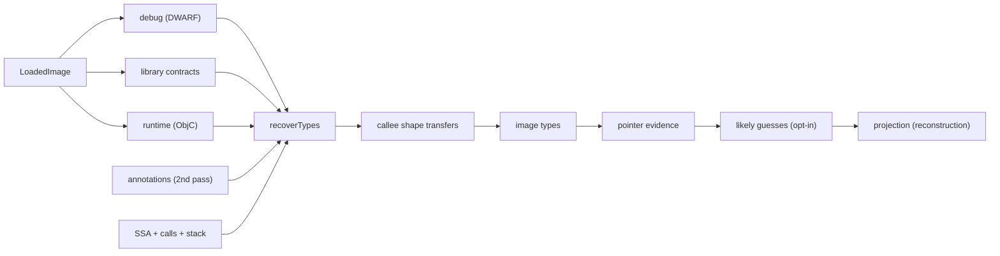
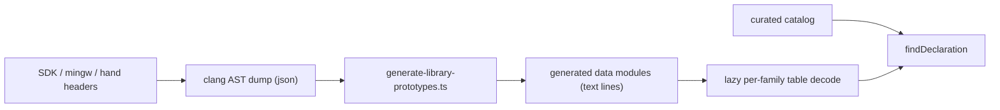

# Types and metadata

Turns typed SSA plus three external knowledge sources (debug info, library prototypes, language-runtime metadata) into **source-type constraints**: which source type each value, field or stack slot may carry, which memory layouts were observed, which signatures apply. It never changes an IR value's machine type; [reconstruction](reconstruction.md) decides what is printed. Runs after [SSA](ssa-values.md) and [call/ABI analysis](calls-abi.md), before [structuring](structuring-emission.md).

**Code:** `src/analysis/types/`, `src/metadata/`, `src/service/analysis/image-types.ts`, `scripts/generate-library-prototypes.ts`

## Data model

- **Type vocabulary** — void, unknown, integer, float, pointer, array, vector, structure. Pointers are 64-bit and reference their target by ID (recursion is ordinary). `null` size/alignment/count = _not established_, never zero. Unions, bitfields, enums, function types are unrepresentable → `unknown`.
- **Type record** — ID + definition + `source` (analysis, debug, library, runtime, user, llm) + `status` (candidate, established, asserted, hypothesis, conflicting) + evidence. One ID may hold several records; disagreement is data.
- **Association** — "subject carries type" with source/status/evidence and three coordinates: offset in the source object, offset in the machine value, width. Subjects: SSA values, struct fields, entry-SP-relative stack slots, call nodes. Partial coordinates matter for structs split across registers.
- **Memory shape** — incomplete view of one base (SSA value or stack frame): fields (signed offset, width, read/write, proven stride, float vs int, "used as call target"), observed extent, alias/escape flags. Its synthesized struct has size and alignment `null`, except for a fresh constant-size allocation.
- **Conflict** — `incompatible_types`, `incompatible_signatures`, `overlapping_accesses`, `layout_mismatch`; all alternatives survive.
- **Image type class** — compatible shapes from several functions: one name, one layout.
- **Metadata results** — `DebugRecovery` (types, signatures, lines, variables), `LibraryContracts` (per-import signature, noreturn, effects), `RuntimeMetadata` (ObjC/Swift records, symbols).

## Algorithm

### Seeds

1. **Debug (DWARF).** Only DWARF embedded in the selected Mach-O slice is read. DIE tree → structural types (struct only if every member has a type and in-bounds offset; 8-byte pointers; arrays; base types), function ranges and signatures, line tables, single-storage variable locations. A signature is accepted for a prototyped (or concrete empty C) function with default calling convention whose range is file-backed; overlapping definitions null both signatures and conflict. Anything else → `unknown` + diagnostic, and the recovery is flagged `undecoded`. Signatures apply to the selected function (exact entry VA) and direct calls to it.
2. **Library contracts.** Per import: exact normalized C name **and** a library path identifying a declaration family. Curated catalog first (memory footprints, captures, variadic rules, noreturn, `allocates`), else the generated family table. Weak imports and imports bound through a nonzero addend are refused. Contracts sharing an entry/slot with different semantics conflict. ABI-dependent typedefs (`off_t`, `time_t`…) resolve per target ABI.
3. **Runtime (ObjC).** Static Mach-O ARM64 sections → class/category/protocol/method/ivar records. A method implementation without a durable or debug signature gets one from its type encoding; `self` points to a struct built from the class's and in-image superclasses' ivars at static offsets. Swift records yield names only. The same index types message-send arguments.
4. **Durable and annotated inputs.** A project-stored signature enters as analysis/established. If active annotations contain a type or signature assertion, recovery reruns with them added, restricted to local subjects.

### Library data generation

macOS SDK → C/POSIX/Darwin/CoreFoundation; mingw-w64 → Windows families (family chosen by `llvm-nm` import-library membership); hand headers → glibc/Itanium symbols. One line per function (`name|ret|params|flags|header`) with a compact type code. Only interface facts are stored: types, variadic, noreturn, format-argument index, `alloc_size`.

### Per-function recovery

1. Index subjects; build forward transfer edges (extract, same-width bitcast, select = conditional, block arguments). A cast alone declares nothing.
2. Register supplied types, signatures, annotations. Signatures for another ABI are skipped; hypothesis/candidate signatures never become contracts.
3. Run call/stack analysis with the declared contracts; bind declared parameters/returns to exact register fragments (pre-effect snapshot for arguments, post-effect for results) or stack storage. Contracts without a declaration yield analysis-sourced ABI-shaped types.
4. Constant-size `allocates` calls mark the result as a fresh object of known size.
5. Group loads/stores by **affine base** (`base, offset, stride, loop index`; [address normalization](ssa-values.md#algorithm)); one shape per base. Fields are float if every use reinterprets the bytes as IEEE.
6. Overlapping constant fields **compete by evidence weight** (access count, then lower offset, then narrower): the winner is a member, losers are `overlapping_accesses` conflicts and print as casts. Float vs integer at the same bytes = two anonymous-union members. A shape at offset 0 also types its base as pointer-to-shape.
7. Operation-use signedness: signed/unsigned div, shifts, ordered compares attach candidate integer types to operands.
8. **Propagate** forward along transfer edges (fragment must fit; conditional edges downgrade to candidate; concat reassembles only exact same-type parts). Match declared pointer/struct types against observed fields by displacement and width.
9. Detect conflicts among declarations only; observations never conflict with declarations.

### Post-passes (service layer)

- **Callee transfers.** A callee's parameter shape is translated into the caller through exact call-argument transfers (wrapped signed displacement), transactionally.
- **Image types.** Per-function object views anchored at argument/return/stack/allocation identities. Bounded exploration (≤12 neighbor bodies, ≤4 callers per flow, ≤2 pointee hops), then Steensgaard-style union-find. A flow joins only once the callee _confirms_ it (dereferences it, passes it to a declared pointer parameter, or forwards it to a confirmed flow). Unions with incompatible overlapping members are refused and recorded. Name rank: argument > return > allocation > stack > pointee path.
- **Pointer evidence.** Fixpoint over whole machine-width values: dereferenced, declared/observed pointer, `ptr ± int`, joined by copy/phi/select, or compared with a pointer ⇒ analysis-candidate `void *`; element-typed when derived by whole-element steps from one scalar pointee; a declared `T *` survives copies and joins. `ptr - ptr`, integer arithmetic, constants never qualify.
- **Likely mode** (opt-in): pointer guesses for integer formals/results from caller evidence or carry-only use, recorded as hypotheses, printed only for heuristics that passed the precision gate.
- **`types` query / `types.h`:** same machinery over every body (entry order, ¾ of remaining work), one solve. On a large image it names far fewer structures than the functions print (SQLite `btree` export: one against 230), so `export` appends the declarations of every structure its function files name (`options.structures: "external"`, `emission.structures`) and `decompile`/MCP keep them inline.

### Precedence at projection

| Rule                                                   | Effect                                                              |
| ------------------------------------------------------ | ------------------------------------------------------------------- |
| Hypothesis, conflicting, non-analysis candidate        | ignored                                                             |
| Established/asserted declaration vs analysis candidate | declaration wins                                                    |
| debug vs library vs runtime vs user                    | **no ranking**; disagreement ⇒ conflict ⇒ no type                   |
| Declared `void *` + observed object pointer            | object pointer refines                                              |
| Several observed object pointers                       | widest containing layout; unrelated views fall back to bare address |
| Analysis signed-integer candidates                     | never projected as a declaration                                    |
| Layout conflict                                        | only "is an address" survives                                       |

## Design decisions

- **Non-rewriting.** Machine width, declaration and observed extent stay independent.
- **Provenance, not scores.** Fixed rules over enumerated source/status; equal-trust disagreement is surfaced, not resolved.
- **Refuse over guess.** No sizes, alignments, array counts or layouts from observation; no type from a name; unknown stays `unknown`.
- **Conditional library knowledge.** A prototype means "if this import is that function"; it never authenticates the implementation. Generated entries carry no memory effects.
- **Exact identity for external bytes.** Debug input must match UUID, CPU/subtype and optional SHA-256; paths inside the binary (PDB, source) are never opened.
- **All-or-nothing under budget.** Per-function recovery out of budget publishes no source conclusions and the pipeline raises an error; only image merging runs under a sub-budget and degrades to the local result with an info diagnostic.
- **Determinism.** Outputs sorted by ID; union-find, naming and exploration order canonical; bounded classes carry a layout digest so one name never denotes two layouts.

## Limits and improvement levers

- **No lattice or solver.** Seed → forward propagate → rule-based projection. No scalar unification across calls, no backward propagation from uses (except pointer evidence), no join of integer/pointer alternatives beyond hand-written projection rules. Lever: ranked unification before projection.
- **Debug info is barely reachable.** Only embedded Mach-O DWARF; fixtures are stripped. No shipped surface passes an external dSYM, CodeView is identity-only (no PDB), ELF DWARF is unparsed. Variables, locations, lines are parsed but unused by types. Lever: dSYM discovery; ELF DWARF.
- **DWARF coverage.** Unions, bitfields, enums, function types, split/compressed units, compound location expressions → `unknown`; one bad member makes the whole struct `unknown`.
- **Library prototypes are flat.** Struct and handle parameters are opaque (no layout), so libc structs never gain fields; function pointers are opaque. `char` shares a record with `int8_t`. Only the ~110 curated entries carry memory footprints. Lever: derive footprints from `const`; carry header struct layouts.
- **Observed layouts are partial.** Only offset-0, non-dynamic, non-negative views enter image types; overlap resolution by access count can pick the wrong member; sizes unknown except constant allocations; array counts unknown; alignment unknown ⇒ `packed`.
- **Image merging is bounded and shallow.** 12/4/2 limits make membership depend on the starting function. Only exact 64-bit pointer loads at displacement 0 link pointees. Callee spill/reload forwarding is not followed, so O0 formals often stay integers (`CONTINUE.md`).
- **ObjC only.** Runtime types cover Mach-O ARM64 ObjC (no aggregates, unions, variadics; static ivar offsets a non-fragile runtime may slide). Swift gives names, not types; no ELF/PE runtime metadata.
- **Likely mode** prints only heuristics ≥95 % precise (gate in `LIKELY_GATE`); none exists for result types.
